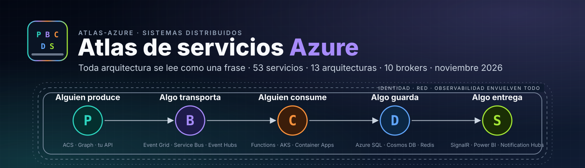
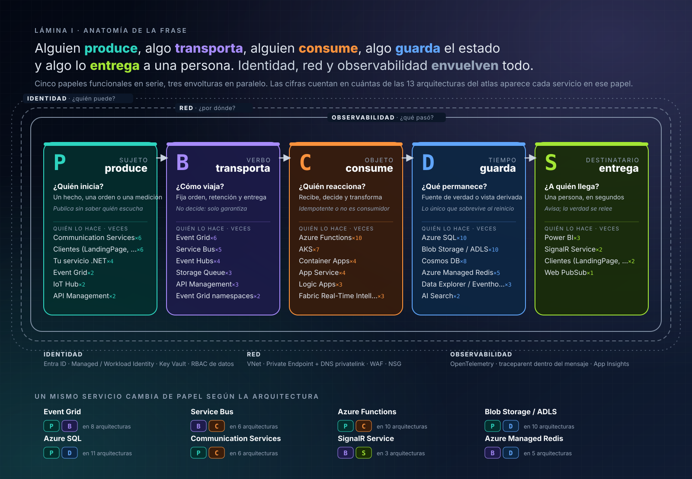
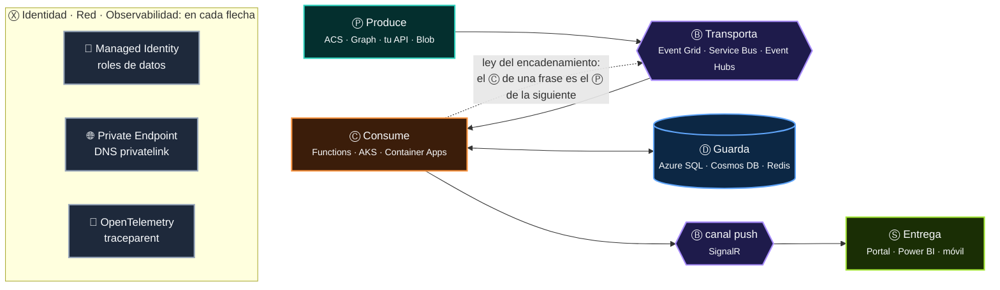
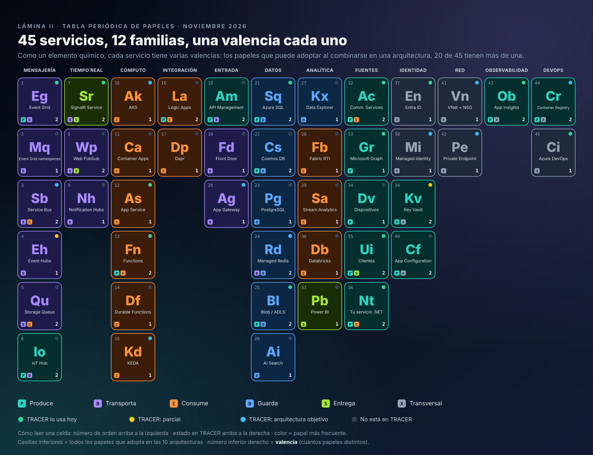
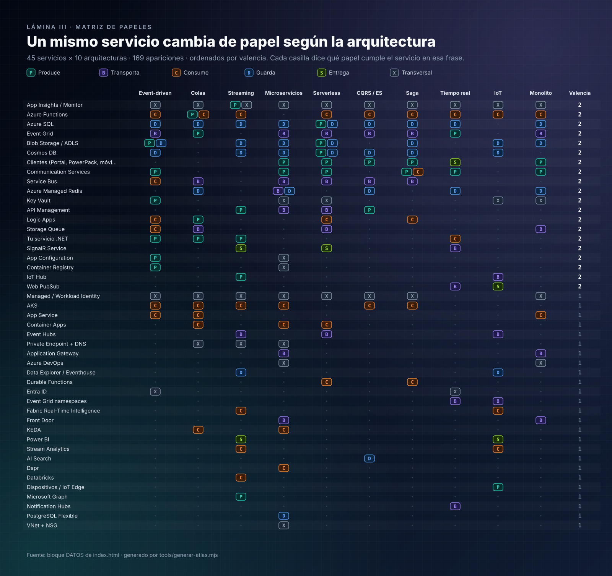
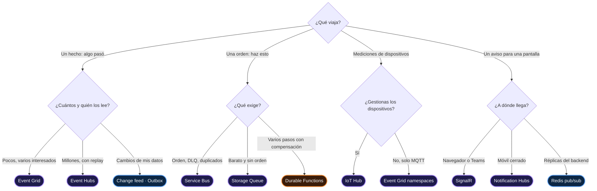

<p align="center">
  
</p>

<p align="center">
  
  
  
  
  
  
  
  
</p>

<p align="center">
  <b>Atlas de servicios Azure</b> es una guía en español para <b>leer, diseñar y defender</b> arquitecturas en Microsoft Azure con una sola gramática.<br>
  53 servicios, 13 arquitecturas y 10 brokers, analizados papel por papel, con teoría, diagramas, código .NET, un caso real (<b>TRACER</b>)<br>y una comparativa con AWS y Google Cloud.<br>
  Incluye una <b>vista interactiva</b> (<code>npm start</code>) y láminas generadas desde los mismos datos, para que la página y los documentos nunca se contradigan.
</p>

---

> ## *Toda arquitectura en Azure se lee como una frase:*
> ## *alguien **produce**, algo **transporta**, alguien **consume**, algo **guarda** el estado y algo lo **entrega** a una persona.*
> ## ***Identidad, red y observabilidad** envuelven todo. Un mismo servicio **cambia de papel** según la arquitectura.*

Este repositorio existe para que, al terminar de leerlo, no quede ninguna duda de **cómo funciona** ese enunciado y de **que se cumple**. Cada afirmación
tiene su capítulo, su lámina y, cuando se puede contar, su cifra.

---

## Contenido

- [La frase, desarmada](#la-frase-desarmada)
- [Lámina I · Anatomía de la frase](#lámina-i--anatomía-de-la-frase)
- ["Alguien" y "algo": la pista escondida](#alguien-y-algo-la-pista-escondida)
- [Los seis papeles](#los-seis-papeles)
- [Las tres envolturas](#las-tres-envolturas)
- [La prueba: un mismo servicio cambia de papel](#la-prueba-un-mismo-servicio-cambia-de-papel)
- [Trece arquitecturas, trece frases](#trece-arquitecturas-trece-frases)
- [Azure frente a AWS y Google Cloud](#azure-frente-a-aws-y-google-cloud)
- [Las siete leyes de la frase](#las-siete-leyes-de-la-frase)
- [Leer cualquier diagrama en ocho preguntas](#leer-cualquier-diagrama-en-ocho-preguntas)
- [Por qué funciona: una teoría de 1948](#por-qué-funciona-una-teoría-de-1948)
- [Cómo usar este atlas](#cómo-usar-este-atlas)
- [Índice de capítulos](#índice-de-capítulos)
- [El atlas interactivo](#el-atlas-interactivo)
- [Ejecutar localmente](#ejecutar-localmente)
- [El caso TRACER](#el-caso-tracer)
- [El atlas en cifras](#el-atlas-en-cifras)
- [Estructura del repositorio](#estructura-del-repositorio)
- [Convenciones](#convenciones)
- [Metodología y fuentes](#metodología-y-fuentes)

---

## La frase, desarmada

El enunciado tiene tres frases: una **tesis**, una **envoltura** y una **ley**. Desarmadas, son once piezas. Cada una se explica y se demuestra en su capítulo.

| # | Pieza | Tipo | Glifo | Lo que afirma | Capítulo |
|:-:|---|---|:-:|---|---|
| 1 | *Toda arquitectura se lee como una frase* | Tesis | — | Hay una estructura común a todas las arquitecturas | [01](docs/01-la-frase.md) · [11](docs/11-trece-arquitecturas-como-frases.md) |
| 2 | *alguien **produce*** | Papel | Ⓟ | Un agente con intención origina un hecho, una orden, una medición o una petición | [02](docs/02-produce.md) |
| 3 | *algo **transporta*** | Papel | Ⓑ | Un medio sin intención fija las garantías: orden, retención, entrega | [03](docs/03-transporta.md) |
| 4 | *alguien **consume*** | Papel | Ⓒ | Otro agente recibe, decide y transforma; debe ser idempotente | [04](docs/04-consume.md) |
| 5 | *algo **guarda** el estado* | Papel | Ⓓ | Lo que sobrevive al reinicio vive fuera del cómputo | [05](docs/05-guarda.md) |
| 6 | *algo lo **entrega** a una persona* | Papel | Ⓢ | La frase termina en un ser humano; avisa, no garantiza | [06](docs/06-entrega.md) |
| 7 | ***Identidad*** | Envoltura | Ⓧ | Cada flecha responde *¿quién puede?* | [07](docs/07-identidad.md) |
| 8 | ***red*** | Envoltura | Ⓧ | Cada flecha responde *¿por dónde?* | [08](docs/08-red.md) |
| 9 | ***observabilidad*** | Envoltura | Ⓧ | Cada flecha responde *¿qué pasó?* | [09](docs/09-observabilidad.md) |
| 10 | *envuelven **todo*** | Propiedad | Ⓧ | Las envolturas no son un paso: están en **cada** paso | [01 § 6](docs/01-la-frase.md#6-las-siete-leyes-de-la-frase) |
| 11 | *un mismo servicio **cambia de papel*** | Ley | — | El papel lo da la posición en la frase, no el producto | [10](docs/10-un-servicio-muchos-papeles.md) |

---

## Lámina I · Anatomía de la frase

Cinco papeles en serie, tres envolturas en paralelo. Cada tarjeta muestra la pregunta que identifica el papel, su función gramatical y los servicios que
más lo cumplen en las trece arquitecturas del atlas (con cuántas veces lo hacen). Al pie, ocho servicios que cambian de papel.

<p align="center">
  <a href="assets/atlas-frase.svg"></a>
</p>

---

## "Alguien" y "algo": la pista escondida

Fíjate en los sujetos del enunciado: **alguien** produce, **algo** transporta, **alguien** consume, **algo** guarda, **algo** entrega. No es un
accidente de redacción: la frase te dice **dónde vive tu código**.

| | "Alguien": Ⓟ y Ⓒ | "Algo": Ⓑ, Ⓓ y Ⓢ |
|---|---|---|
| **Tiene intención** | Sí: decide qué emitir y qué hacer | No: cumple un contrato |
| **Lo escribes en** | C#, Python, TypeScript | Bicep, Terraform, políticas |
| **Falla por** | *Bugs*, excepciones, despliegues | Límites, cuotas, configuración |
| **Escala con** | Réplicas sin estado | *Tiers*, particiones, unidades |
| **En Azure** | App Service, AKS, Container Apps, Functions, Logic Apps | Event Grid, Service Bus, Event Hubs, SQL, Cosmos DB, SignalR |

> [!IMPORTANT]
> Si te encuentras programando **decisiones de negocio dentro de un "algo"** (filtros de Service Bus que codifican reglas, políticas de APIM que deciden
> precios), estás poniendo intención donde la frase dice que no la hay. Funciona, pero queda fuera de tus pruebas. Ver [01 § 2](docs/01-la-frase.md#2-alguien-y-algo-dónde-vive-tu-código).

---

## Los seis papeles

| Papel | Verbo | Pregunta | Función gramatical | Obligación | Más frecuente en el atlas | Capítulo |
|:-:|---|---|---|---|---|---|
| Ⓟ | Produce | ¿Quién inicia? | Sujeto | `id` estable, clave de orden, **un solo commit** | Communication Services y clientes (6 de 13) | [02](docs/02-produce.md) |
| Ⓑ | Transporta | ¿Cómo viaja? | Verbo | Cumplir su contrato: entrega, orden, retención | Event Grid (6 de 13) | [03](docs/03-transporta.md) |
| Ⓒ | Consume | ¿Quién reacciona? | Objeto | **Idempotencia**; confirmar después del efecto | Azure Functions (10 de 13) | [04](docs/04-consume.md) |
| Ⓓ | Guarda | ¿Qué permanece? | Complemento de tiempo | Declarar consistencia y concurrencia | Azure SQL y Blob Storage (10 de 13) | [05](docs/05-guarda.md) |
| Ⓢ | Entrega | ¿A quién llega? | Destinatario | Tolerar la pérdida: **notificar y releer** | Power BI (3 de 13) | [06](docs/06-entrega.md) |
| Ⓧ | Envuelve | ¿Quién puede, por dónde, qué pasó? | Contexto | Estar en **cada** flecha | App Insights / Monitor (13 de 13) | [07](docs/07-identidad.md) · [08](docs/08-red.md) · [09](docs/09-observabilidad.md) |



---

## Las tres envolturas

Identidad, red y observabilidad no son cajas del diagrama: son **atributos de cada flecha**. Una flecha bien dibujada responde tres preguntas:

| Envoltura | Pregunta | Respuesta correcta en 2026 | Respuesta que hay que eliminar | Capítulo |
|---|---|---|---|---|
| 🔑 **Identidad** | ¿Quién puede? | Managed / Workload Identity + **un rol de datos por papel** (*Data Sender* = Ⓟ, *Data Receiver* = Ⓒ) + `disableLocalAuth` | *Connection strings* con `SharedAccessKey` | [07](docs/07-identidad.md) |
| 🌐 **Red** | ¿Por dónde? | *Private Endpoint* por subrecurso + zona `privatelink.*` enlazada; consumidores **pull** sin entrada | Acceso público "temporal"; *webhooks* privados por *push* | [08](docs/08-red.md) |
| 🔭 **Observabilidad** | ¿Qué pasó? | OpenTelemetry + `traceparent` **dentro del mensaje**; una alerta por papel; toda DLQ con dueño | Trazas que terminan en el broker | [09](docs/09-observabilidad.md) |

> [!TIP]
> Los nombres de los roles RBAC de datos **están escritos en la gramática de la frase**: *Azure Service Bus Data **Sender*** es el permiso de un Ⓟ;
> *Azure Service Bus Data **Receiver*** es el de un Ⓒ. Cuando un servicio cambia de papel, cambia el rol que necesita.

---

## La prueba: un mismo servicio cambia de papel

La tercera frase del enunciado es una **ley comprobable**, y el atlas la comprueba con sus propios datos: cruzando los 53 servicios con las 13
arquitecturas salen **215 apariciones**, y **22 de los 53 servicios (42 %) adoptan dos papeles distintos**. En química, el número de formas en que un
elemento se combina se llama **valencia**:

<p align="center">
  <a href="assets/atlas-tabla-periodica.svg"></a>
</p>

Los cambios de papel no son aleatorios. Hay **nueve conversiones**, cada una con un mecanismo concreto:

| Conversión | Nombre | Mecanismo | Ejemplos |
|:-:|---|---|---|
| Ⓓ ↔ Ⓟ | El almacén emite | *Change feed*, Outbox, `BlobCreated` | Azure SQL, Cosmos DB, Blob Storage |
| Ⓑ ↔ Ⓟ | El canal reenvía | Suscripción con *handler* de cola, ruteo, `log-to-eventhub` | Event Grid, IoT Hub, API Management |
| Ⓑ ↔ Ⓒ | El broker es *handler* | Una cola que consume de Event Grid para nivelar carga | Service Bus, Storage Queue |
| Ⓒ ↔ Ⓟ | El agente encadena | *Trigger* + *binding* de salida | Functions, Logic Apps, ACS, tu servicio .NET |
| Ⓑ ↔ Ⓢ | El canal es la salida | *Push* como transporte o como última milla | SignalR, Web PubSub |
| Ⓑ ↔ Ⓓ | La memoria avisa | Pub/sub efímero sobre la cache | Azure Managed Redis |
| Ⓟ ↔ Ⓢ | El cliente pregunta y recibe | La misma pantalla envía comandos y recibe *push* | Portal, PowerPack, móvil |
| Ⓧ ↔ Ⓟ | La envoltura habla | `SecretNearExpiry`, `KeyValueModified`, `ImagePushed`, *diagnostic settings* | Key Vault, App Configuration, ACR, Monitor |
| Ⓒ ↔ Ⓓ | El motor también sirve | Procesa y después guarda lo que otros leen | Synapse Analytics, Azure Machine Learning |

<details>
<summary><b>Lámina III · La matriz completa: 53 servicios × 13 arquitecturas</b> (clic para desplegar)</summary>
<p align="center">
  <a href="assets/atlas-matriz.svg"></a>
</p>
</details>

> [!NOTE]
> Dos ejemplos que caben en una línea. En la arquitectura *event-driven*, **Blob Storage abre y cierra la frase**: emite `BlobCreated` (Ⓟ) y recibe el
> *dead-letter* de Event Grid (Ⓓ). En la de colas, **Azure Functions es las dos mitades de una oración compuesta**: un *trigger* la alimenta (Ⓒ) y un
> *binding* de salida publica (Ⓟ). Tablas de conjugación de cada servicio en [10 · Un servicio, muchos papeles](docs/10-un-servicio-muchos-papeles.md).

---

## Trece arquitecturas, trece frases

Las trece arquitecturas del atlas, escritas con la misma gramática. Lo que cambia son las palabras y el papel de cada una.

| # | Arquitectura | La frase | TRACER |
|:-:|---|---|:-:|
| 1 | [**Event-driven reactivo**](docs/11-trece-arquitecturas-como-frases.md#1-event-driven-reactivo) | Ⓟ ACS, Blob, Key Vault, ACR → Ⓑ **Event Grid** → Ⓒ Functions, webhooks, *Service Bus como handler* → Ⓓ SQL, Cosmos DB | 🟢 |
| 2 | [**Mensajería y colas**](docs/11-trece-arquitecturas-como-frases.md#2-mensajería-y-colas) | Ⓟ webhook, Function, *Event Grid como emisor* → Ⓑ **Service Bus** (sesiones) → Ⓒ *workers* con KEDA → Ⓓ SQL (Inbox, Outbox), Redis | 🔷 |
| 3 | [**Event streaming**](docs/11-trece-arquitecturas-como-frases.md#3-event-streaming-y-telemetría) | Ⓟ Graph, IoT Hub, *Monitor* → Ⓑ **Event Hubs** → Ⓒ procesadores, Stream Analytics, Fabric → Ⓓ Blob, Data Explorer → Ⓢ Power BI, SignalR | 🟡 |
| 4 | [**Microservicios en AKS**](docs/11-trece-arquitecturas-como-frases.md#4-microservicios-cloud-native-en-aks) | Ⓟ clientes → Ⓑ Front Door, App Gateway, APIM → Ⓒ **AKS** → Ⓑ Service Bus, Event Grid, Redis → Ⓓ *database per service* | 🔷 |
| 5 | [**Serverless**](docs/11-trece-arquitecturas-como-frases.md#5-serverless) | Ⓟ HTTP, *Blob*, *Cosmos change feed*, *SQL Change Tracking* → Ⓑ Event Grid, Service Bus → Ⓒ **Functions**, Durable → Ⓓ Cosmos DB, SQL → Ⓢ SignalR | 🟡 |
| 6 | [**CQRS + Event Sourcing**](docs/11-trece-arquitecturas-como-frases.md#6-cqrs--event-sourcing) | Ⓟ comandos → Ⓒ escritura → Ⓓ **event store** → Ⓒ proyectores → Ⓑ integración → Ⓓ modelos de lectura | 🟡 |
| 7 | [**Saga y workflows**](docs/11-trece-arquitecturas-como-frases.md#7-saga-y-workflows-distribuidos) | Ⓟ ACS → Ⓒ **orquestador** → Ⓑ comandos y *timeouts* → Ⓒ participantes (*ACS como participante*) → Ⓓ estado de la saga | 🟢 |
| 8 | [**Tiempo real**](docs/11-trece-arquitecturas-como-frases.md#8-tiempo-real-hacia-clientes) | Ⓟ ACS, *Event Grid como origen* → Ⓒ backend → Ⓑ **SignalR**, Web PubSub → Ⓢ Portal → Ⓓ SQL para resincronizar | 🟢 |
| 9 | [**IoT y edge**](docs/11-trece-arquitecturas-como-frases.md#9-iot-y-edge) | Ⓟ dispositivos → Ⓑ **IoT Hub**, Event Grid MQTT → Ⓒ Stream Analytics, Functions → Ⓓ Data Explorer, Blob → Ⓢ Power BI | · |
| 10 | [**Monolito modular**](docs/11-trece-arquitecturas-como-frases.md#10-monolito-modular-en-paas) | Ⓟ clientes, ACS → Ⓑ App Gateway → Ⓒ **App Service** → Ⓑ Storage Queue, Event Grid → Ⓓ una base, esquemas por módulo | 🟢 |
| 11 | [**Big Data y analítica**](docs/11-trece-arquitecturas-como-frases.md#11-big-data-y-analítica-en-la-nube) | Ⓟ SQL, Cosmos DB, sistemas locales → Ⓑ Data Factory, Event Hubs → Ⓓ **ADLS** (medallion) → Ⓒ Databricks, *Synapse* → Ⓓ *Synapse*, Data Explorer → Ⓢ Power BI | · |
| 12 | [**IA y MLOps**](docs/11-trece-arquitecturas-como-frases.md#12-inteligencia-artificial-y-mlops) | Ⓟ app, tu API → Ⓑ *API Management como AI gateway* → Ⓒ **Azure OpenAI**, *Azure ML* → Ⓓ AI Search (RAG), *registro de modelos de Azure ML* → Ⓢ respuesta en *streaming* | · |
| 13 | [**Híbrida y multinube**](docs/11-trece-arquitecturas-como-frases.md#13-híbrida-y-multinube) | Ⓟ centro de datos local, Azure Local → Ⓑ **ExpressRoute** / VPN → Ⓒ AKS, App Service → Ⓓ SQL, Blob; Ⓧ **Azure Arc** gobierna todo | · |

En *cursiva*, los servicios que en esa frase cumplen un papel distinto del habitual. Cada arquitectura completa (diagrama, garantías, patrones,
antipatrones, su lectura en TRACER y una frase de entrevista) está en [11 · Trece arquitecturas leídas como frases](docs/11-trece-arquitecturas-como-frases.md).

---

## Azure frente a AWS y Google Cloud

Las arquitecturas del atlas se describen **solo con servicios de Azure**. Para orientarte si vienes de otra nube, cinco de ellas traen en la vista
interactiva (y en el [capítulo 11](docs/11-trece-arquitecturas-como-frases.md)) una tabla de equivalentes. Este es el resumen:

| Arquitectura | Azure | AWS | Google Cloud |
|---|---|---|---|
| [Microservicios y contenedores](docs/11-trece-arquitecturas-como-frases.md#4-microservicios-cloud-native-en-aks) | **AKS**, Container Apps | Amazon EKS, ECS, Fargate | GKE |
| [Serverless](docs/11-trece-arquitecturas-como-frases.md#5-serverless) | **Azure Functions**, Logic Apps | AWS Lambda, API Gateway, DynamoDB | Cloud Run functions, Cloud Run |
| [Big Data y analítica](docs/11-trece-arquitecturas-como-frases.md#11-big-data-y-analítica-en-la-nube) | **ADLS**, Synapse, Databricks, Power BI (y Fabric) | S3, Redshift, Glue, EMR | BigQuery, Dataflow, Pub/Sub |
| [IA y MLOps](docs/11-trece-arquitecturas-como-frases.md#12-inteligencia-artificial-y-mlops) | **Azure OpenAI** (Microsoft Foundry), Azure ML | Amazon Bedrock, SageMaker | Vertex AI, TPU, Gemini |
| [Híbrida y multinube](docs/11-trece-arquitecturas-como-frases.md#13-híbrida-y-multinube) | **Azure Arc**, Azure Local, ExpressRoute, Entra ID | AWS Outposts, Direct Connect | Anthos (hoy GKE Enterprise) |
| **Enfoque general** | Adopción corporativa, gobierno de TI, identidad y entornos Microsoft | Profundidad de catálogo, madurez en cómputo general, la comunidad más grande | Datos masivos, IA, redes globales y contenedores |

> [!NOTE]
> Los equivalentes son aproximados: los servicios no coinciden uno a uno en garantías, límites ni precio. La **gramática sí es la misma** en las tres
> nubes: Amazon SQS o Google Pub/Sub también son Ⓑ, AWS Lambda o Cloud Run también son Ⓒ, y S3 o BigQuery también son Ⓓ.

---

## Las siete leyes de la frase

Del enunciado se derivan siete reglas de diseño. Son el criterio de revisión de todo el atlas.

| # | Ley | Enunciado | Si la incumples… |
|:-:|---|---|---|
| 1 | **Del verbo** | Las garantías las fija el Ⓑ; las obligaciones caen en el Ⓒ | *At-least-once* sin idempotencia = efectos duplicados |
| 2 | **De la memoria** | Lo que sobrevive a un reinicio vive en Ⓓ, nunca en Ⓒ | `static SemaphoreSlim` e `IMemoryCache` mienten con N réplicas |
| 3 | **De la última milla** | Ⓢ es *at-most-once*: avisa, no garantiza | Pantallas que mienten tras una desconexión |
| 4 | **Del commit único** | Un Ⓟ que escribe en Ⓓ no puede hacer dos *commits* atómicos | Estado y eventos que no cuadran (*dual write*) |
| 5 | **De la envoltura** | Ⓧ es una propiedad de cada flecha, no una caja | Secretos, redes abiertas y trazas cortadas |
| 6 | **De la posición** | El papel lo da la posición, no el producto | Diseñar con el catálogo en vez de con la frase |
| 7 | **Del encadenamiento** | El Ⓒ de una frase puede ser el Ⓟ de la siguiente | La correlación se pierde entre frases |

---

## Leer cualquier diagrama en ocho preguntas

Para una revisión de diseño, una entrevista o un diagrama heredado. Las cinco primeras recorren la frase; las tres últimas, su envoltura.

| # | Pregunta | Señal de alarma |
|:-:|---|---|
| 1 | **¿Qué viaja?** ¿Un hecho, una orden, una medición o una petición? | Nadie sabe si es hecho u orden |
| 2 | **¿Quién lo produce**, con qué `id` y qué clave de orden? | Publicar después de `SaveChanges`, sin Outbox |
| 3 | **¿Qué lo transporta** y qué garantiza? | Pedir orden a Event Grid o DLQ a Event Hubs |
| 4 | **¿Quién lo consume** y qué pasa si llega dos veces? | "No puede llegar dos veces" |
| 5 | **¿Dónde queda el estado** y quién más lo lee? | Estado en memoria con varias réplicas |
| 6 | **¿Quién puede?** | `SharedAccessKey` en la configuración |
| 7 | **¿Por dónde?** | Acceso público "temporal" |
| 8 | **¿Cómo sabré qué pasó?** | La traza termina en el broker |



Árbol completo con el porqué, la cadena típica y la trampa de cada respuesta: [13 · Guía de decisión](docs/13-guia-de-decision.md).

---

## Por qué funciona: una teoría de 1948

La frase no es una metáfora inventada para un examen. En 1948, Claude Shannon describió **todo** sistema de comunicación con cinco piezas:
**fuente → transmisor → canal (con ruido) → receptor → destino**. La frase de Azure es ese mismo modelo con los dos añadidos que la nube hizo
inevitables: la **memoria** (el receptor muere y renace, así que el estado vive fuera) y el **contexto** (el canal es compartido, así que hay que
demostrar quién habla, por dónde y dejar rastro). El *ruido* de Shannon son las **ocho falacias de la computación distribuida**, y la respuesta a ese
ruido es la observabilidad.

| Shannon (1948) | La frase (2026) | *Enterprise Integration Patterns* (2003) |
|---|---|---|
| Fuente + transmisor | Ⓟ Produce | Message Endpoint (emisor) |
| Canal | Ⓑ Transporta | Message Channel |
| Ruido | Las falacias → Ⓧ observabilidad | Wire Tap, Message History |
| Receptor | Ⓒ Consume | Message Endpoint (receptor), Competing Consumers |
| Destino | Ⓢ Entrega | — |
| — | Ⓓ Guarda | Message Store, Idempotent Receiver |
| — | Ⓧ Identidad y red | — |

Desarrollo completo, gramática formal (EBNF) y análisis de una llamada real en [01 · La frase](docs/01-la-frase.md).

---

## Cómo usar este atlas

| Si eres… | Empieza por | Sigue con | Termina en |
|---|---|---|---|
| **Nuevo en Azure** | [01 · La frase](docs/01-la-frase.md) | [02](docs/02-produce.md) → [06](docs/06-entrega.md): los cinco papeles | [16 · Glosario](docs/16-referencia-rapida-y-glosario.md#glosario) |
| **Quien prepara una entrevista** | [01 § 7 · Ocho preguntas](docs/01-la-frase.md#7-método-leer-cualquier-diagrama-en-ocho-preguntas) | [11 · Trece arquitecturas](docs/11-trece-arquitecturas-como-frases.md) | [14 § 7 · Trece frases](docs/14-caso-tracer.md#7-trece-frases-para-la-entrevista) |
| **Arquitecto/a** | [10 · Polisemia](docs/10-un-servicio-muchos-papeles.md) | [12 · Brokers](docs/12-brokers-quien-escribe-quien-lee.md) → [13 · Decisión](docs/13-guia-de-decision.md) | [14 · TRACER](docs/14-caso-tracer.md) |
| **Desarrollador/a .NET** | [02 · Produce](docs/02-produce.md) y [04 · Consume](docs/04-consume.md) | [05 · Guarda](docs/05-guarda.md) | [16 · Paquetes](docs/16-referencia-rapida-y-glosario.md#paquetes-net-por-papel) |
| **Seguridad y plataforma** | [07 · Identidad](docs/07-identidad.md) | [08 · Red](docs/08-red.md) | [09 · Observabilidad](docs/09-observabilidad.md) |
| **Quien trabaja en TRACER** | [14 · Caso TRACER](docs/14-caso-tracer.md) | Los capítulos que enlaza cada silencio | [14 § 6 · Hoja de ruta](docs/14-caso-tracer.md#6-hoja-de-ruta-por-papel) |

```mermaid
flowchart LR
    T["01<br/>La frase<br/>teoría"]:::X --> R["02–06<br/>Los cinco papeles<br/>Ⓟ Ⓑ Ⓒ Ⓓ Ⓢ"]:::C
    R --> E["07–09<br/>Las tres envolturas<br/>Ⓧ"]:::X
    E --> L["10<br/>La ley de la posición<br/>polisemia"]:::B
    L --> A["11–13<br/>Arquitecturas, brokers<br/>y decisiones"]:::P
    A --> K["14<br/>Caso TRACER"]:::S
    K --> Z["15–16<br/>Catálogo y referencia"]:::D
    classDef P fill:#042F2E,stroke:#2DD4BF,color:#F8FAFC,stroke-width:2px
    classDef B fill:#1E1B4B,stroke:#A78BFA,color:#F8FAFC,stroke-width:2px
    classDef C fill:#3B1D0A,stroke:#FB923C,color:#F8FAFC,stroke-width:2px
    classDef D fill:#0C2744,stroke:#60A5FA,color:#F8FAFC,stroke-width:2px
    classDef S fill:#1A2E05,stroke:#A3E635,color:#F8FAFC,stroke-width:2px
    classDef X fill:#1E293B,stroke:#94A3B8,color:#F8FAFC,stroke-width:2px
```



---

## Índice de capítulos

| # | Capítulo | Lo que encontrarás | Pieza del enunciado |
|---|---|---|---|
| 01 | [**La frase**](docs/01-la-frase.md) | Las once piezas, "alguien" y "algo", Shannon, la gramática formal, las siete leyes, el método de las ocho preguntas, el análisis de una llamada | La tesis |
| 02 | [Ⓟ **Produce**](docs/02-produce.md) | Hechos, órdenes, mediciones y peticiones; seis familias de productores; CloudEvents; Outbox; código por broker | *alguien produce* |
| 03 | [Ⓑ **Transporta**](docs/03-transporta.md) | Seis formas de transportar, las siete propiedades de un verbo, *push* frente a *pull*, orden, cola frente a router frente a log, verbos compuestos, *gateways* | *algo transporta* |
| 04 | [Ⓒ **Consume**](docs/04-consume.md) | *Peek-lock*, Inbox, procesadores de sesión y de particiones, *webhooks*, Functions, KEDA, mensajes venenosos | *alguien consume* |
| 05 | [Ⓓ **Guarda**](docs/05-guarda.md) | Seis clases de estado, consistencia (CAP, PACELC, Cosmos DB), concurrencia, el almacén que produce, coordinación entre réplicas | *algo guarda el estado* |
| 06 | [Ⓢ **Entrega**](docs/06-entrega.md) | La ley de la última milla, notificar y releer, SignalR Service, grupos por inquilino, UX de la consistencia eventual | *algo lo entrega a una persona* |
| 07 | [Ⓧ **Identidad**](docs/07-identidad.md) | Los dos planos, identidades sin secretos, Workload Identity, un rol por papel, `disableLocalAuth`, Key Vault | *identidad* |
| 08 | [Ⓧ **Red**](docs/08-red.md) | La red premia el *pull*, *Private Endpoint*, el DNS que todo lo rompe, borde global y regional, topología | *red* |
| 09 | [Ⓧ **Observabilidad**](docs/09-observabilidad.md) | `traceparent` a través de cada broker, OpenTelemetry, KQL, una alerta por papel, SLO de una frase | *observabilidad* |
| 10 | [**Un servicio, muchos papeles**](docs/10-un-servicio-muchos-papeles.md) | La demostración con datos: valencia, nueve conversiones, tablas de conjugación, la matriz completa | *cambia de papel* |
| 11 | [Trece arquitecturas como frases](docs/11-trece-arquitecturas-como-frases.md) ⚙️ | Cada arquitectura: frase, diagrama, carriles, garantías, patrones, antipatrones, TRACER, frase de entrevista y, en cinco, equivalentes en AWS y Google Cloud | *toda arquitectura* |
| 12 | [Brokers: quién escribe, quién lee](docs/12-brokers-quien-escribe-quien-lee.md) ⚙️ | Comparativa de contratos y los diez brokers por dentro | *algo transporta* |
| 13 | [Guía de decisión](docs/13-guia-de-decision.md) ⚙️ | El árbol "¿qué viaja?" y sus trece respuestas razonadas | — |
| 14 | [**Caso práctico TRACER**](docs/14-caso-tracer.md) | Inventario, la frase de una llamada, los cinco silencios, la arquitectura objetivo y la hoja de ruta | Todas |
| 15 | [Catálogo A–Z](docs/15-catalogo-a-z.md) ⚙️ | Los 53 servicios con familia, papeles, valencia, garantías, SDK y rol RBAC | — |
| 16 | [Referencia rápida y glosario](docs/16-referencia-rapida-y-glosario.md) | Límites, semánticas, paquetes, roles, zonas DNS, comandos, patrones y 45 términos | — |

⚙️ = generado desde los datos de [`index.html`](index.html) con `npm run atlas`.

---

## El atlas interactivo

[`index.html`](index.html) es la versión navegable del atlas: una sola página, sin dependencias, con cuatro vistas.

| Vista | Lo que muestra | Equivalente en los documentos |
|---|---|---|
| **Arquitecturas** | Las 13 arquitecturas como carriles de colores (un color por papel), con cajón de detalle por servicio y, en cinco de ellas, la tabla *Equivalentes en otras nubes* | [11](docs/11-trece-arquitecturas-como-frases.md) |
| **Matriz de roles** | Servicio × arquitectura, filtrable por familia, papel y texto | [10 § 6](docs/10-un-servicio-muchos-papeles.md#6-la-matriz-completa) |
| **Productores y consumidores** | Por broker: quién escribe y quién lee, con su contrato | [12](docs/12-brokers-quien-escribe-quien-lee.md) |
| **¿Qué uso?** | El árbol de decisión paso a paso | [13](docs/13-guia-de-decision.md) |

El selector **Resaltar TRACER** (*No · Hoy · + Objetivo AKS*) atenúa todo lo que TRACER no usa, para ver de un vistazo la frase que dice hoy y la que dirá.

---

## Ejecutar localmente

Requisitos: [Node.js](https://nodejs.org/) 18 o superior.

```bash
npm install        # instala live-server (solo la primera vez)
npm start          # sirve el atlas en http://127.0.0.1:8080 con recarga automática
npm run atlas      # regenera láminas, catálogos y capítulos ⚙️ desde index.html
npm run verificar  # comprueba que todos los enlaces y anclas de la documentación existen
```

Cada vez que guardes un cambio en `index.html`, el navegador se recarga solo. Detén el servidor con `Ctrl+C`.

> [!TIP]
> **Una sola fuente de verdad.** Los datos (servicios, arquitecturas, brokers y árbol de decisión) viven en el bloque `DATOS` de `index.html`.
> `tools/generar-atlas.mjs` los lee de ahí y produce las láminas SVG, `data/atlas.json` y los capítulos marcados con ⚙️. Para añadir un servicio o
> corregir una arquitectura, edita `index.html` y ejecuta `npm run atlas`: la página, las láminas y los documentos cambian juntos.

---

## El caso TRACER

TRACER, la plataforma de llamadas sobre Azure Communication Services que sirve de caso práctico, usa **24 de los 53 servicios** del atlas: 13 hoy, 2 de
forma parcial y 9 en su arquitectura objetivo en AKS. Leído como frase, su diagnóstico cabe en una línea: **la frase ya está escrita; le falta la
envoltura.** Cinco de los nueve servicios objetivo son identidad, red u operación.

| Silencio | Hoy | Ley | Mañana |
|---|---|---|---|
| Un verbo para las órdenes | `TaskQueuer` en memoria | Del verbo | Service Bus con `SessionId = CallConnectionId` |
| Memoria fuera del proceso | `static SemaphoreSlim`, `IMemoryCache` | De la memoria | Sesiones, `sp_getapplock`, Managed Redis |
| Identidad sin secretos | AccessKey: 0 usos de `DefaultAzureCredential` | De la envoltura | Managed / Workload Identity |
| Red privada | PaaS con acceso público | De la envoltura | VNet + *Private Endpoints* + DNS |
| Una sola traza | Telemetría por servicio | Del encadenamiento | `traceparent` dentro de cada evento |

Análisis completo, arquitectura objetivo y hoja de ruta por papel en [14 · Caso práctico TRACER](docs/14-caso-tracer.md).

---

## El atlas en cifras

| Indicador | Valor |
|---|---|
| Servicios analizados | **53**, en 14 familias |
| Arquitecturas | **13**, de *event-driven* a híbrida y multinube |
| Arquitecturas con comparativa AWS / Google Cloud | **5** |
| Brokers y fuentes de cambios analizados por dentro | **10** |
| Apariciones servicio × arquitectura | **215** |
| Servicios con más de un papel | **22 de 53** (42 %) |
| Servicio presente en todas las arquitecturas | **1**: Application Insights / Monitor (y en una de ellas, también Ⓟ) |
| Servicios en TRACER | **24 de 53** (13 hoy · 2 parcial · 9 objetivo) |
| Capítulos | **16** (4 generados desde los datos) |
| Láminas SVG | **4** (portada, anatomía, tabla periódica, matriz) |
| Diagramas Mermaid | **51** |

---

## Estructura del repositorio

```text
.
├── README.md                              ← estás aquí (portada e índice del atlas)
├── index.html                             ← atlas interactivo y FUENTE ÚNICA de los datos (bloque DATOS)
├── docs/                                  ← 16 capítulos
│   ├── 01-la-frase.md                     ← la teoría: tesis, leyes y método
│   ├── 02-produce.md … 06-entrega.md      ← los cinco papeles
│   ├── 07-identidad.md … 09-observabilidad.md  ← las tres envolturas
│   ├── 10-un-servicio-muchos-papeles.md   ← la ley de la posición (matriz ⚙️)
│   ├── 11 · 12 · 13                       ← arquitecturas, brokers y decisión ⚙️
│   ├── 14-caso-tracer.md                  ← el caso práctico
│   ├── 15-catalogo-a-z.md                 ← ⚙️
│   └── 16-referencia-rapida-y-glosario.md
├── assets/                                ← láminas SVG ⚙️: banner, anatomía, tabla periódica, matriz
├── data/atlas.json                        ← ⚙️ datos + matriz de papeles, para otras herramientas
├── tools/
│   ├── generar-atlas.mjs                  ← index.html → láminas, JSON y capítulos (Node 18+, sin dependencias)
│   └── verificar-enlaces.mjs              ← valida cada enlace y ancla al estilo de GitHub
├── package.json                           ← npm start · npm run atlas · npm run verificar
└── LICENSE                                ← Apache 2.0
```

---

## Convenciones

| Símbolo | Significado |
|---|---|
| Ⓟ Ⓑ Ⓒ Ⓓ Ⓢ Ⓧ | Produce · Transporta (*broker*) · Consume · Guarda (*data*) · Entrega (*screen*) · Envuelve (transversal). Las letras son las de la vista interactiva |
| 🟢 🟡 🔷 · | TRACER: lo usa hoy · parcial · arquitectura objetivo · no lo usa |
| 🔑 🌐 🔭 | Identidad · red · observabilidad |
| ⚙️ | Generado desde `index.html`: no se edita a mano |
| *Valencia* | Número de papeles distintos que un servicio adopta en las 13 arquitecturas |
| Recuadros *Note*, *Tip*, *Important*, *Warning*, *Caution* | Notas, consejos, puntos clave, advertencias y precauciones |

Colores, iguales en la página, las láminas y los diagramas: **turquesa** = produce · **violeta** = transporta · **naranja** = consume ·
**azul** = guarda · **lima** = entrega · **gris pizarra** = envoltura.

---

## Metodología y fuentes

- **Fecha de corte:** 9 de noviembre de 2026. Límites, cifras y nombres de servicios corresponden a esa fecha y dependen del *tier*; verifícalos en la
  documentación oficial antes de citarlos en un contrato.
- **Datos:** los 53 servicios, las 13 arquitecturas, los 10 brokers y el árbol de decisión son los de la vista interactiva, que resume los documentos de
  preparación y teoría del examen de *backend* .NET + Azure del espacio de trabajo de TRACER. Las cifras de este README (215 apariciones, 22 servicios
  polisémicos, valencias) se **calculan** desde esos datos con `npm run atlas`; no se escriben a mano.
- **Arquitecturas 11–13 y comparativas:** se añadieron a partir de un texto comparativo de AWS, Azure y Google Cloud, usando solo su parte de Azure para
  los carriles. Se actualizaron nombres que ya cambiaron: Cloud Functions → *Cloud Run functions*, Anthos → *GKE Enterprise*, Azure Stack HCI →
  *Azure Local*, Azure OpenAI → parte de *Microsoft Foundry*. Synapse sigue disponible, pero para proyectos nuevos Microsoft orienta hacia Fabric.
- **Corrección de datos:** en la arquitectura CQRS, Service Bus y Event Grid figuraban en el carril de proyectores (Ⓒ). Se movieron a un carril propio
  de integración (Ⓑ), porque son el transporte hacia el que el proyector publica, no el proyector.
- **Fuentes técnicas:** Microsoft Learn (Event Grid, Service Bus, Event Hubs, Functions, SignalR Service, identidades administradas, Private Link,
  Azure Monitor y OpenTelemetry), la especificación [CloudEvents 1.0](https://cloudevents.io/), [W3C Trace Context](https://www.w3.org/TR/trace-context/),
  C. E. Shannon, *A Mathematical Theory of Communication* (1948) y G. Hohpe y B. Woolf, *Enterprise Integration Patterns* (2003).
- **Atlas hermanos:** [**Azure Atlas**](https://github.com/CristianSifuentes/Azure), el catálogo de 250 servicios con sus retiros, del que este atlas toma
  la teoría de sistemas distribuidos y las semánticas de entrega; y [**EF Core Atlas**](https://github.com/CristianSifuentes/EFCore), para todo lo que ocurre
  dentro de Ⓓ cuando el almacén es relacional.
- **Límites:** el código .NET ilustra los patrones con las API actuales de los SDK `Azure.*`, pero no se compila en este repositorio. Este atlas no es
  documentación oficial de Microsoft.

---

<p align="center">
  <i>Alguien produce, algo transporta, alguien consume, algo guarda el estado y algo lo entrega a una persona.</i><br>
  Hecho para la comunidad hispanohablante · Licencia <a href="LICENSE">Apache 2.0</a>
</p>
