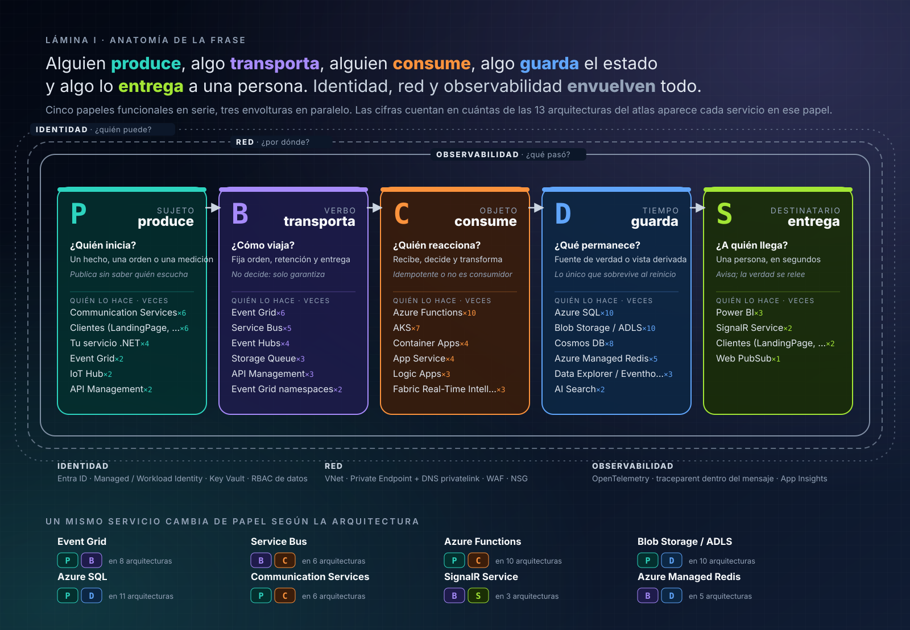
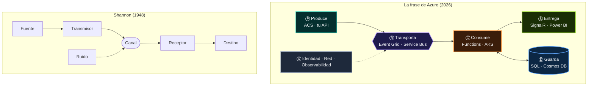
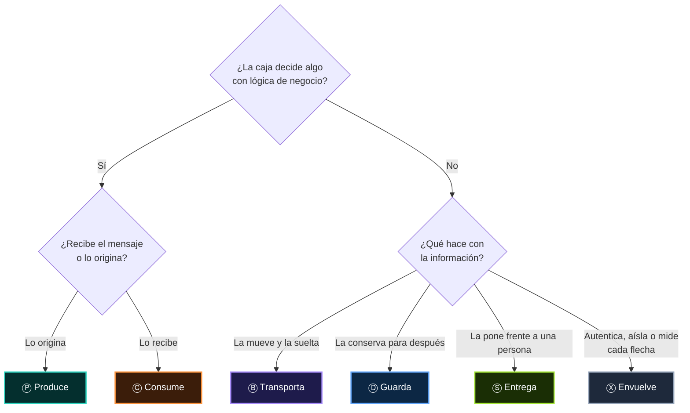
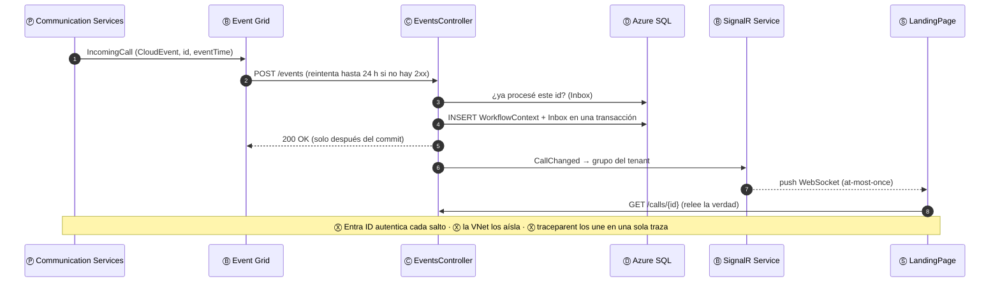

# 01 · La frase: una gramática para leer arquitecturas

> *Toda arquitectura en Azure se lee como una frase: alguien **produce**, algo **transporta**, alguien **consume**, algo **guarda** el estado
> y algo lo **entrega** a una persona. **Identidad, red y observabilidad** envuelven todo. Un mismo servicio **cambia de papel** según la arquitectura.*

Este capítulo desarma el enunciado pieza por pieza, explica por qué funciona (no es una metáfora bonita: tiene 78 años de teoría detrás) y lo convierte
en un método que puedes aplicar a cualquier diagrama, de Azure o de cualquier otra nube.

## Contenido

1. [Las once piezas del enunciado](#1-las-once-piezas-del-enunciado)
2. ["Alguien" y "algo": dónde vive tu código](#2-alguien-y-algo-dónde-vive-tu-código)
3. [Por qué funciona: Shannon, 1948](#3-por-qué-funciona-shannon-1948)
4. [Los seis papeles, definidos con rigor](#4-los-seis-papeles-definidos-con-rigor)
5. [La gramática formal](#5-la-gramática-formal)
6. [Las siete leyes de la frase](#6-las-siete-leyes-de-la-frase)
7. [Método: leer cualquier diagrama en ocho preguntas](#7-método-leer-cualquier-diagrama-en-ocho-preguntas)
8. [Análisis gramatical completo: una llamada en TRACER](#8-análisis-gramatical-completo-una-llamada-en-tracer)
9. [Lo que la frase no dice](#9-lo-que-la-frase-no-dice)

---

## 1. Las once piezas del enunciado

El enunciado tiene tres frases. La primera plantea una **tesis** (las arquitecturas se leen), la segunda añade una **envoltura** (lo que no está en la
línea pero la rodea) y la tercera enuncia una **ley** (los papeles no son fijos). Desarmadas, son once piezas:

| # | Fragmento | Tipo | Glifo | Lo que afirma | Dónde se demuestra |
|:-:|---|---|:-:|---|---|
| 1 | *"Toda arquitectura en Azure se lee como una frase"* | Tesis | — | Hay una estructura común a **todas** las arquitecturas; aprenderla vale más que memorizar diagramas | [§3](#3-por-qué-funciona-shannon-1948), [11](11-trece-arquitecturas-como-frases.md) |
| 2 | *"alguien **produce**"* | Papel | Ⓟ | Todo flujo nace de un agente con intención: un hecho, una orden, una medición o una petición | [02 · Produce](02-produce.md) |
| 3 | *"algo **transporta**"* | Papel | Ⓑ | Entre productor y consumidor hay un medio que **no decide**, pero fija las garantías: orden, retención, entrega | [03 · Transporta](03-transporta.md) |
| 4 | *"alguien **consume**"* | Papel | Ⓒ | Otro agente con intención recibe, decide y transforma | [04 · Consume](04-consume.md) |
| 5 | *"algo **guarda** el estado"* | Papel | Ⓓ | Lo que debe sobrevivir a un reinicio vive fuera del cómputo | [05 · Guarda](05-guarda.md) |
| 6 | *"algo lo **entrega** a una persona"* | Papel | Ⓢ | La frase termina en un ser humano: una pantalla, un tablero, una notificación | [06 · Entrega](06-entrega.md) |
| 7 | *"**Identidad**"* | Envoltura | Ⓧ | Cada flecha responde *¿quién eres y qué puedes hacer?* | [07 · Identidad](07-identidad.md) |
| 8 | *"**red**"* | Envoltura | Ⓧ | Cada flecha recorre un camino que se puede abrir, cerrar o volver privado | [08 · Red](08-red.md) |
| 9 | *"y **observabilidad**"* | Envoltura | Ⓧ | Cada flecha deja rastro, y el rastro se puede unir de extremo a extremo | [09 · Observabilidad](09-observabilidad.md) |
| 10 | *"**envuelven todo**"* | Propiedad | Ⓧ | Las envolturas no son un paso de la frase: están **en cada paso** | [§6, ley 5](#6-las-siete-leyes-de-la-frase) |
| 11 | *"Un mismo servicio **cambia de papel** según la arquitectura"* | Ley | — | El papel lo da la **posición** en la frase, no el producto | [10 · Polisemia](10-un-servicio-muchos-papeles.md) |

<p align="center">
  <a href="../assets/atlas-frase.svg"></a>
</p>

> [!NOTE]
> Las letras vienen de la vista interactiva ([`index.html`](../index.html)): **P**roduce, **B**roker (transporta), **C**onsume, **D**atos (guarda),
> **S**creen (entrega) y **X** (transversal). En el texto se escriben dentro de un círculo, Ⓟ Ⓑ Ⓒ Ⓓ Ⓢ Ⓧ, para que se lean como glifos y no como palabras.

---

## 2. "Alguien" y "algo": dónde vive tu código

Lee el enunciado otra vez y fíjate en los sujetos: **alguien** produce, **algo** transporta, **alguien** consume, **algo** guarda, **algo** entrega.
No es casualidad de redacción. Es la observación más útil de todo el atlas:

| | "Alguien" (Ⓟ, Ⓒ) | "Algo" (Ⓑ, Ⓓ, Ⓢ) |
|---|---|---|
| **Tiene intención** | Sí: decide qué emitir y qué hacer con lo recibido | No: obedece un contrato |
| **Contiene tu lógica de negocio** | Sí: tu API, tu worker, tu Function | No: lo configuras, no lo programas |
| **Lo escribes en** | C#, Python, TypeScript | Bicep, Terraform, políticas, *portal* |
| **Falla por** | *Bugs*, excepciones, despliegues | Límites, cuotas, configuración, regiones |
| **Lo pruebas con** | Pruebas unitarias y de integración | Pruebas de carga, caos y *failover* |
| **Escala con** | Réplicas sin estado (HPA, KEDA, Flex Consumption) | *Tiers*, particiones, unidades de mensajería |
| **Ejemplos en Azure** | App Service, AKS, Container Apps, Functions, Logic Apps, ACS, Graph | Event Grid, Service Bus, Event Hubs, SQL, Cosmos DB, SignalR |

> [!IMPORTANT]
> **Regla práctica:** si algo de tu diagrama "tiene que decidir", es Ⓟ o Ⓒ y debe ser código tuyo (o un servicio con lógica configurable como Logic Apps).
> Si te encuentras programando decisiones de negocio *dentro* de un Ⓑ (filtros SQL de Service Bus que codifican reglas de negocio, transformaciones en
> políticas de APIM que deciden precios), estás poniendo intención donde la frase dice "algo". Funciona, pero es invisible para las pruebas y para el siguiente equipo.

---

## 3. Por qué funciona: Shannon, 1948

En *A Mathematical Theory of Communication* (1948), Claude Shannon describió todo sistema de comunicación con cinco piezas: una **fuente** de información,
un **transmisor**, un **canal** sujeto a **ruido**, un **receptor** y un **destino**. Setenta y ocho años después, la frase de Azure es ese mismo diagrama
con dos añadidos que la nube hizo inevitables: la **memoria** (el estado) y el **contexto** (las envolturas).



| Shannon | La frase | Qué aporta la nube |
|---|---|---|
| Fuente + transmisor | Ⓟ Produce | El SDK es el transmisor: serializa, firma, reintenta |
| Canal | Ⓑ Transporta | El canal ya no es pasivo: **retiene** (colas, logs), **ordena** (sesiones, particiones) y **reintenta** |
| Ruido | Las **ocho falacias** de la computación distribuida | La red no es fiable, la latencia no es cero, la topología cambia… → por eso Ⓧ observabilidad |
| Receptor | Ⓒ Consume | Ya no es uno: son **N réplicas** que compiten o particionan el trabajo |
| Destino | Ⓢ Entrega | Una persona, con su propia conexión que también falla |
| — | Ⓓ Guarda | **Nuevo:** el receptor muere y renace; la memoria tiene que estar fuera |
| — | Ⓧ Identidad y red | **Nuevo:** el canal es compartido; hay que demostrar quién habla y por dónde |

La otra raíz teórica es *Enterprise Integration Patterns* (Hohpe y Woolf, 2003): **Message Channel** es Ⓑ, **Message Endpoint** es Ⓟ o Ⓒ,
**Message Store** es Ⓓ y **Wire Tap** / **Message History** son Ⓧ observabilidad. Los 65 patrones del libro son, en esta gramática, **variaciones de una frase**:
un *Content-Based Router* es un Ⓑ con filtros; un *Competing Consumers* es un Ⓒ en plural; un *Idempotent Receiver* es un Ⓒ que consulta un Ⓓ.

---

## 4. Los seis papeles, definidos con rigor

Un papel no es una categoría de producto: es una **función en la frase**. Cada uno tiene una pregunta que lo identifica, una obligación que lo define y
una forma típica de fallar.

| Papel | Pregunta | Definición operativa | Obligación | Falla típica |
|:-:|---|---|---|---|
| Ⓟ | ¿Quién inicia? | Origina un mensaje cuyo **significado** conoce | Darle identidad (`id`), clave de orden y contrato estable | *Dual write*: guarda y publica por separado; uno de los dos falla |
| Ⓑ | ¿Cómo viaja? | Recibe, **retiene o reenvía**, y entrega según un contrato, sin interpretar el contenido | Cumplir la semántica que promete (*at-least-once*, orden por clave…) | Usarlo con una semántica que no tiene (orden en Event Grid, DLQ en Event Hubs) |
| Ⓒ | ¿Quién reacciona? | Recibe un mensaje y produce un **efecto**: un cambio de estado, otro mensaje, una llamada | Ser **idempotente** y confirmar solo después del efecto | Confirmar antes de procesar; perder el *lock*; duplicar efectos |
| Ⓓ | ¿Qué permanece? | Conserva información que debe **sobrevivir** a cualquier instancia de cómputo | Definir su consistencia y su concurrencia | Estado escondido en memoria (`static`, `IMemoryCache`) con N réplicas |
| Ⓢ | ¿A quién llega? | Lleva un cambio hasta un **ser humano** | Tolerar la pérdida: la verdad se relee de Ⓓ | Usar el canal *push* como fuente de verdad |
| Ⓧ | ¿Quién puede, por dónde, qué pasó? | Propiedad que debe cumplir **cada flecha**, no una caja de la línea | Estar en todas partes, no en "una capa" | Secretos en *connection strings*, DNS privado mal enlazado, trazas cortadas en el broker |

### La prueba del papel

Ante una caja de un diagrama, tres preguntas deciden su papel en **esa** frase:



> [!TIP]
> La prueba se aplica **por flecha**, no por servicio. Blob Storage *guarda* el audio de una llamada (Ⓓ) y, en la misma arquitectura, *emite*
> `BlobCreated` hacia Event Grid (Ⓟ). Son dos frases que comparten una palabra. Ver [10 · Un servicio, muchos papeles](10-un-servicio-muchos-papeles.md).

---

## 5. La gramática formal

Escrita como una gramática (notación EBNF), la frase admite omisiones y encadenamientos, igual que el lenguaje natural:

```ebnf
arquitectura  = envoltura , frase , { frase } ;
envoltura     = identidad , red , observabilidad ;          (* Ⓧ: se aplica a cada flecha *)

frase         = productor , [ transporte ] , consumidor , [ estado ] , [ entrega ] ;
productor     = "Ⓟ" , servicio ;
transporte    = "Ⓑ" , servicio , { "Ⓑ" , servicio } ;       (* cadenas de brokers: Event Grid → Service Bus *)
consumidor    = "Ⓒ" , servicio ;
estado        = "Ⓓ" , servicio ;
entrega       = [ "Ⓑ" , canal_push ] , "Ⓢ" , persona ;

(* Encadenamiento: el consumidor de una frase es el productor de la siguiente *)
frase_compuesta = frase , { "→" , frase } ;
```

Tres consecuencias de esta gramática, todas visibles en las [trece arquitecturas](11-trece-arquitecturas-como-frases.md):

| Fenómeno lingüístico | En la arquitectura | Ejemplo |
|---|---|---|
| **Sujeto tácito** (se omite Ⓑ) | Una llamada síncrona HTTP: el transporte es la red y, si acaso, un *gateway* | LandingPage → API Management → API |
| **Oración compuesta** (Ⓒ se vuelve Ⓟ) | Un consumidor que publica: Functions con *trigger* y *binding* de salida | Event Grid → Function → Service Bus → worker |
| **Complemento múltiple** (varios Ⓑ seguidos) | Nivelar carga o cambiar de semántica entre tramos | Event Grid (*push*, sin orden) → Service Bus (*pull*, FIFO por sesión) |
| **Elipsis de Ⓢ** | Frases máquina a máquina: nadie mira en tiempo real | Telemetría → Event Hubs → Capture a ADLS |

---

## 6. Las siete leyes de la frase

Del enunciado se derivan siete reglas que este atlas usa como criterio de diseño y de revisión. Cada una tiene su capítulo.

| # | Ley | Enunciado | Corolario de diseño | Capítulo |
|:-:|---|---|---|---|
| 1 | **Ley del verbo** | Las garantías las fija el Ⓑ; las obligaciones caen en el Ⓒ | Si el broker es *at-least-once*, el consumidor **debe** ser idempotente | [03](03-transporta.md), [04](04-consume.md) |
| 2 | **Ley de la memoria** | Todo lo que debe sobrevivir a un reinicio vive en Ⓓ, nunca en Ⓒ | Antes de escalar a N réplicas, busca `static`, `Singleton` con estado e `IMemoryCache` | [05](05-guarda.md) |
| 3 | **Ley de la última milla** | Ⓢ es *at-most-once*: avisa, no garantiza | El cliente relee de Ⓓ al reconectar ("notificar y releer") | [06](06-entrega.md) |
| 4 | **Ley del commit único** | Un Ⓟ que también escribe en Ⓓ no puede hacer dos *commits* atómicos | *Transactional Outbox* o *change feed*: un solo *commit*, un *relay* | [02](02-produce.md), [05](05-guarda.md) |
| 5 | **Ley de la envoltura** | Ⓧ no es una caja: es una propiedad de **cada flecha** | Cada flecha del diagrama debe responder: ¿con qué identidad?, ¿por qué red?, ¿con qué `traceparent`? | [07](07-identidad.md), [08](08-red.md), [09](09-observabilidad.md) |
| 6 | **Ley de la posición** | El papel lo da la posición en la frase, no el producto | No preguntes "¿qué es Service Bus?" sino "¿qué hace Service Bus **aquí**?" | [10](10-un-servicio-muchos-papeles.md) |
| 7 | **Ley del encadenamiento** | El Ⓒ de una frase puede ser el Ⓟ de la siguiente | Propaga identidad de correlación y `traceparent` al encadenar, o la historia se corta | [09](09-observabilidad.md), [11](11-trece-arquitecturas-como-frases.md) |

---

## 7. Método: leer cualquier diagrama en ocho preguntas

Úsalo en una entrevista, en una revisión de diseño o frente a un diagrama heredado. Las cinco primeras recorren la frase; las tres últimas, la envoltura.

| # | Pregunta | Busca | Señal de alarma |
|:-:|---|---|---|
| 1 | **¿Qué viaja?** ¿Un hecho, una orden, una medición o una petición? | El **sustantivo**: decide todo lo demás ([13](13-guia-de-decision.md)) | Nadie sabe decir si es hecho u orden |
| 2 | **¿Quién lo produce** y con qué identidad de mensaje? | Ⓟ, `id`, clave de orden | Publicar después de `SaveChanges` sin Outbox |
| 3 | **¿Qué lo transporta** y qué garantiza? | Ⓑ, su fila en la [comparativa](12-brokers-quien-escribe-quien-lee.md#comparativa-de-contratos) | Pedir orden a Event Grid o DLQ a Event Hubs |
| 4 | **¿Quién lo consume** y qué pasa si llega dos veces? | Ⓒ, idempotencia, *lock*, *checkpoint* | "No puede llegar dos veces" |
| 5 | **¿Dónde queda el estado** y quién más lo lee? | Ⓓ, consistencia, concurrencia | Estado en memoria con más de una réplica |
| 6 | **¿Quién puede?** | Ⓧ identidad: *Managed Identity*, rol RBAC de datos | *Connection strings* con `SharedAccessKey` |
| 7 | **¿Por dónde?** | Ⓧ red: *Private Endpoint*, zona DNS, WAF | Acceso público "temporal" |
| 8 | **¿Cómo sabré qué pasó?** | Ⓧ observabilidad: traza de extremo a extremo | La traza termina en el broker |

---

## 8. Análisis gramatical completo: una llamada en TRACER

TRACER es el caso práctico del atlas ([capítulo 14](14-caso-tracer.md)). Así se analiza, como en clase de lengua, lo que ocurre cuando entra una llamada:

> *Communication Services* **emite** `IncomingCall`; *Event Grid* lo **enruta**; el *EventsController* lo **procesa** y **registra** el `WorkflowContext` en
> *Azure SQL*; *SignalR* lo **avisa** al LandingPage. *Entra ID*, la *VNet* y *Application Insights* lo **envuelven**.

| Palabra | Papel | Función gramatical | Garantía que hereda la frase | Obligación que impone |
|---|:-:|---|---|---|
| Communication Services | Ⓟ | Sujeto | Eventos con `id` y `Repeatability-Request-ID` en los comandos | Ninguna sobre el receptor: publica hechos |
| Event Grid | Ⓑ | Verbo | *At-least-once*, sin orden, reintentos hasta 24 h, *dead-letter* a Blob | El consumidor debe deduplicar por `id` y ordenar por `eventTime` |
| EventsController (App Service) | Ⓒ | Objeto | — | Responder 200 **después** de procesar; ser idempotente |
| Azure SQL | Ⓓ | Complemento de tiempo | ACID local | Concurrencia optimista o *lock* entre réplicas |
| SignalR Service | Ⓑ → Ⓢ | Destinatario | *At-most-once* hacia el cliente | El LandingPage relee el estado al reconectar |
| Entra ID · VNet · App Insights | Ⓧ | Contexto | — | Cada flecha autenticada, privada y trazada |



---

## 9. Lo que la frase no dice

Una buena teoría conoce sus límites. La frase es un **modelo de flujo**; deja fuera, a propósito, tres cosas:

- **Cantidades.** No dice cuántos mensajes por segundo ni cuántos bytes. Esas cifras eligen el *tier* y a veces el producto (Event Grid frente a
  Event Hubs). Están en la [referencia rápida](16-referencia-rapida-y-glosario.md#límites-que-deciden-diseños).
- **Costos.** Dos frases con la misma estructura pueden costar órdenes de magnitud distintos. La gramática no sustituye a la calculadora de precios.
- **Organización.** La [ley de Conway](https://en.wikipedia.org/wiki/Conway%27s_law) decide dónde se cortan las frases entre equipos. La gramática
  muestra los cortes; no decide dónde ponerlos.

---

[Índice](../README.md) · [02 · Produce →](02-produce.md)
