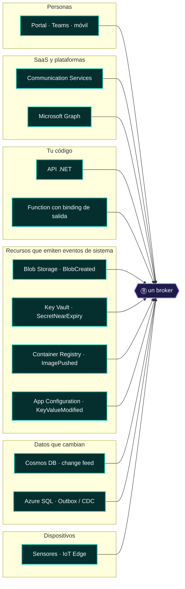
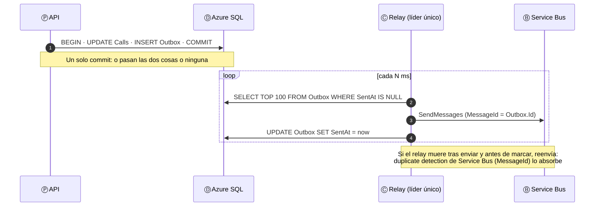

# 02 · Ⓟ Alguien produce

> **El sujeto de la frase.** Un productor origina un mensaje cuyo significado conoce. No sabe (ni debe saber) quién lo va a leer: publica **hechos**,
> no órdenes a un servicio concreto. Su obligación es darle al mensaje identidad, clave de orden y un contrato que no cambie a escondidas.

## Contenido

1. [Cuatro sustantivos: lo que se produce](#1-cuatro-sustantivos-lo-que-se-produce)
2. [Seis familias de productores en Azure](#2-seis-familias-de-productores-en-azure)
3. [El contrato: CloudEvents 1.0](#3-el-contrato-cloudevents-10)
4. [Las cuatro obligaciones del productor](#4-las-cuatro-obligaciones-del-productor)
5. [El problema del doble commit y el Outbox](#5-el-problema-del-doble-commit-y-el-outbox)
6. [Código .NET: un productor por broker](#6-código-net-un-productor-por-broker)
7. [Antipatrones](#7-antipatrones)
8. [Checklist del productor](#8-checklist-del-productor)

---

## 1. Cuatro sustantivos: lo que se produce

Antes de elegir un servicio, nombra el **sustantivo**. Es la decisión que más pesa en toda la frase, porque cada sustantivo exige un verbo distinto.

| Sustantivo | Intención del emisor | Tiempo verbal | Ejemplo en TRACER | Verbo natural (Ⓑ) |
|---|---|---|---|---|
| **Hecho** (evento discreto) | "Esto pasó." No espera nada de nadie | Pretérito: `CallConnected` | ACS emite `IncomingCall` | Event Grid |
| **Orden** (comando) | "Haz esto." Espera que alguien lo haga exactamente una vez a efectos de negocio | Imperativo: `TransferCall` | El webhook encola el trabajo de una llamada | Service Bus |
| **Medición** (stream) | "Esto está pasando." Una serie que se analiza en conjunto | Gerundio: presencias, telemetría | Graph envía cambios de presencia | Event Hubs |
| **Petición** (request) | "Dame esto ahora." Espera respuesta síncrona | Interrogativo: `GET /calls/42` | El Portal consulta una llamada | HTTP (con APIM o App Gateway) |

> [!IMPORTANT]
> Un hecho se nombra en **pasado** (`OrderPlaced`, `BlobCreated`) y una orden en **imperativo** (`PlaceOrder`, `DisconnectCall`). Si en tu sistema hay un
> "evento" llamado `SendEmail`, es una orden disfrazada: alguien espera que ocurra y le va a importar si nadie lo procesa. Necesita una cola con DLQ, no un router.

---

## 2. Seis familias de productores en Azure

Según el atlas, los productores más frecuentes son Communication Services (Ⓟ en 6 de las 10 arquitecturas), los clientes (5) y tu propio servicio .NET (3).
Pero el papel Ⓟ aparece en lugares menos obvios: **recursos de Azure que emiten eventos de sistema**.



| Familia | Cómo produce | Qué controlas | Qué no controlas |
|---|---|---|---|
| **Personas y clientes** | Peticiones HTTP, comandos desde la UI | Validación, autenticación, cuotas (APIM) | El ritmo: picos impredecibles |
| **SaaS** (ACS, Graph) | *Webhooks*, *system topics*, *change notifications*, *partner topics* | La suscripción y el *handler* | El esquema del evento y su frecuencia; el *throttling* (429 + `Retry-After` en Graph) |
| **Tu código** | SDK (`ServiceBusSender`, `EventGridPublisherClient`…) o *bindings* | Todo: contrato, `id`, clave de orden | — |
| **Recursos de Azure** | *System topics* de Event Grid | Qué tipos suscribes y con qué filtros | El esquema: lo define Azure |
| **Datos** | *Change feed* de Cosmos DB, Change Tracking o CDC de SQL, tabla Outbox | La partición y el formato del Outbox | El orden global: solo por partición o por secuencia |
| **Dispositivos** | MQTT, AMQP o HTTPS hacia IoT Hub o Event Grid *namespaces* | Firmware, identidad X.509 | Conectividad intermitente, relojes desfasados |

> [!TIP]
> **La polisemia empieza aquí.** Key Vault, Container Registry, App Configuration y Blob Storage suelen dibujarse como Ⓧ o Ⓓ, pero en la
> arquitectura *event-driven* son **productores**: emiten hechos que disparan rotaciones de secretos, despliegues o refrescos de configuración.
> Ver [10 · Un servicio, muchos papeles](10-un-servicio-muchos-papeles.md).

---

## 3. El contrato: CloudEvents 1.0

[CloudEvents](https://cloudevents.io/) es la especificación de la CNCF para describir eventos de forma común. Event Grid la acepta de forma nativa
(junto al esquema propio de Event Grid) y es el formato recomendado para eventos nuevos. Un productor serio rellena bien estos atributos:

| Atributo | Obligatorio | Para qué sirve | Error típico |
|---|:-:|---|---|
| `id` | ✅ | **Identidad del hecho.** El consumidor deduplica por `source` + `id` | Generar un `id` nuevo en cada reintento: el duplicado se vuelve "otro hecho" |
| `source` | ✅ | Quién lo emitió (URI) | Poner el nombre del *host* en vez del contexto de negocio |
| `type` | ✅ | Qué pasó, en pasado y con espacio de nombres: `com.tracer.call.connected` | Versionar cambiando el `type` sin avisar a los suscriptores |
| `specversion` | ✅ | `1.0` | — |
| `time` | ⬜ | Cuándo pasó **en el origen**. Es el reloj con el que el consumidor ordena | Usar la hora de publicación en vez de la del hecho |
| `subject` | ⬜ | Sobre qué entidad: `calls/8f2c…`. Event Grid filtra por prefijo y sufijo | Dejarlo vacío y obligar a filtrar en el código |
| `datacontenttype`, `dataschema` | ⬜ | Contrato del cuerpo | Cuerpos sin esquema que cambian sin versión |
| `traceparent` (extensión) | ⬜ | Une la traza del productor con la del consumidor ([09](09-observabilidad.md)) | No propagarlo: la traza se corta en el broker |

```json
{
  "specversion": "1.0",
  "id": "4b1f6c2e-2d8b-4b5e-9a57-0c8f6f3e9a10",
  "source": "/tracer/calls",
  "type": "com.tracer.call.disconnect-requested",
  "subject": "calls/8f2c1a",
  "time": "2026-11-09T15:04:05.123Z",
  "datacontenttype": "application/json",
  "traceparent": "00-4bf92f3577b34da6a3ce929d0e0e4736-00f067aa0ba902b7-01",
  "data": { "callConnectionId": "8f2c1a", "reason": "garbage-collector" }
}
```

---

## 4. Las cuatro obligaciones del productor

| # | Obligación | Por qué | Cómo en Azure |
|:-:|---|---|---|
| 1 | **Identidad estable del mensaje** | Habilita la deduplicación en el broker y en el consumidor | `MessageId` en Service Bus (activa *duplicate detection*); `id` en CloudEvents; `Repeatability-Request-ID` en las APIs de ACS |
| 2 | **Clave de orden** | El orden solo existe **por clave**, nunca global | `SessionId` en Service Bus; `PartitionKey` en Event Hubs; *partition key* en Cosmos DB |
| 3 | **Tamaño acotado** | Cada broker tiene un techo, y los mensajes gordos encarecen y ralentizan | *Claim-check*: el cuerpo va a Blob y el mensaje lleva la referencia. Techos: Storage Queue 64 KB · Service Bus 256 KB Standard / 100 MB Premium · Event Grid y Event Hubs 1 MB |
| 4 | **Un solo commit** | Guardar y publicar son dos sistemas: no hay transacción distribuida | Outbox transaccional o *change feed* ([§5](#5-el-problema-del-doble-commit-y-el-outbox)) |

---

## 5. El problema del doble commit y el Outbox

Es el error más caro de un productor, y el más común. El código parece inocente:

```csharp
await db.SaveChangesAsync();                       // 1. commit en SQL
await sender.SendMessageAsync(new(json));          // 2. publicar al broker  ← si esto falla, SQL ya cambió
```

Si el proceso muere entre la línea 1 y la 2, el estado cambió y **nadie se enteró**. Si inviertes el orden, alguien se entera de algo que **no pasó**.
No hay orden correcto: son dos *commits* en dos sistemas. La solución es que haya **uno solo**:



```csharp
// Productor: el cambio de negocio y el mensaje viajan en la misma transacción (EF Core)
public async Task SolicitarDesconexionAsync(string callId, CancellationToken ct)
{
    var llamada = await db.Calls.SingleAsync(c => c.ConnectionId == callId, ct);
    llamada.Estado = EstadoLlamada.Desconectando;

    db.Outbox.Add(new OutboxMessage
    {
        Id = Guid.CreateVersion7(),                         // ordenable en el tiempo (.NET 9+)
        Tipo = "com.tracer.call.disconnect-requested",
        ClaveDeOrden = callId,                              // → SessionId en Service Bus
        Cuerpo = JsonSerializer.Serialize(new { callId }),
        TraceParent = Activity.Current?.Id,                 // ver capítulo 09
        CreadoEn = DateTimeOffset.UtcNow
    });

    await db.SaveChangesAsync(ct);                          // UN solo commit
}
```

| Variante | Fuente de cambios | Quién publica | Cuándo elegirla |
|---|---|---|---|
| **Outbox con relay propio** | Tabla `Outbox` en Azure SQL | `BackgroundService` con líder único (lease de Blob o `sp_getapplock`) | Control total, cualquier broker |
| **Outbox con SQL trigger de Functions** | Change Tracking sobre `Outbox` | Function con `SqlTrigger` | Serverless, sin relay que operar |
| **Change feed de Cosmos DB** | El propio contenedor | Function `CosmosDBTrigger` o Change Feed Processor | Cosmos DB como fuente de verdad: **el Outbox viene incluido** |
| **CDC con Debezium** | Log de transacciones | Conector Kafka hacia Event Hubs | Integrar sistemas existentes sin tocar su código |

> [!TIP]
> El Outbox convierte a Azure SQL en **productor** (Ⓟ) además de almacén (Ⓓ). Es el ejemplo más claro de la ley de la posición: la misma tabla
> guarda y emite. Más en [05 · Guarda](05-guarda.md#5-cuando-el-estado-también-produce).

---

## 6. Código .NET: un productor por broker

Todos los ejemplos usan **identidad administrada** (`DefaultAzureCredential` en desarrollo; ver [07](07-identidad.md) para producción) y los SDK actuales
`Azure.Messaging.*`. Los clientes son *thread-safe* y caros de crear: regístralos como **singleton**.

```csharp
// Program.cs: un cliente por broker, compartido por toda la aplicación (Microsoft.Extensions.Azure)
builder.Services.AddAzureClients(az =>
{
    az.AddServiceBusClientWithNamespace("sb-tracer-prd.servicebus.windows.net");
    az.AddEventHubProducerClientWithNamespace("evh-tracer-prd.servicebus.windows.net", "presences");
    az.UseCredential(new DefaultAzureCredential());
});
builder.Services.AddSingleton(_ => new EventGridPublisherClient(
    new Uri("https://egt-tracer-calls.eastus2-1.eventgrid.azure.net/api/events"), new DefaultAzureCredential()));
```

**Un hecho → Event Grid** (custom topic en CloudEvents)

```csharp
var evento = new CloudEvent(
    source: "/tracer/calls",
    type: "com.tracer.call.disconnect-requested",
    jsonSerializableData: new { callConnectionId = callId })
{
    Id = outbox.Id.ToString(),              // estable entre reintentos
    Subject = $"calls/{callId}",
    Time = outbox.CreadoEn
};
evento.ExtensionAttributes["traceparent"] = outbox.TraceParent;
await eventGrid.SendEventAsync(evento, ct);
```

**Una orden → Service Bus** (con sesión y deduplicación)

```csharp
await using ServiceBusSender sender = serviceBus.CreateSender("call-commands");
await sender.SendMessageAsync(new ServiceBusMessage(BinaryData.FromObjectAsJson(new { callId }))
{
    MessageId = outbox.Id.ToString(),       // duplicate detection (ventana configurable, hasta 7 días)
    SessionId = callId,                     // FIFO por llamada
    Subject = "TransferCall",
    ContentType = "application/json"
}, ct);
```

**Una medición → Event Hubs** (lote por clave de partición)

```csharp
using EventDataBatch lote = await producer.CreateBatchAsync(new CreateBatchOptions { PartitionKey = userId }, ct);
foreach (var cambio in cambiosDePresencia)
    if (!lote.TryAdd(new EventData(BinaryData.FromObjectAsJson(cambio))))
        throw new InvalidOperationException("El evento no cabe en el lote (1 MB).");
await producer.SendAsync(lote, ct);
```

> [!NOTE]
> Los SDK reintentan por su cuenta los errores transitorios (`ServiceBusRetryOptions`, `EventHubsRetryOptions`). No envuelvas el `Send` en un bucle de
> reintentos propio sin un `MessageId` estable: multiplicarías los duplicados.

---

## 7. Antipatrones

| Antipatrón | Síntoma | Corrección |
|---|---|---|
| **Doble commit** | Estado y eventos que no cuadran tras un despliegue o un reinicio | Outbox o *change feed* |
| **Orden disfrazada de hecho** | Un "evento" `SendInvoice` que nadie procesa y nadie lo nota | Cola con DLQ: es una orden |
| **Productor que conoce al consumidor** | El evento lleva campos "para el servicio X" | Publica el hecho completo; cada consumidor toma lo suyo |
| **Payload gordo** | Errores de tamaño, latencia, costos por operación de 64 KB | *Claim-check* con Blob |
| **`id` nuevo en cada reintento** | Duplicados que la deduplicación no detecta | `id` generado una vez, guardado con el mensaje |
| **Cliente por petición** | Agotamiento de conexiones AMQP, latencia | Cliente *singleton* con `AddAzureClients` |
| **Secretos en el productor** | `SharedAccessKey` en `appsettings.json` | Identidad administrada + rol *Data Sender* ([07](07-identidad.md)) |

---

## 8. Checklist del productor

- [ ] Sé decir si produzco un **hecho**, una **orden**, una **medición** o una **petición**.
- [ ] Cada mensaje tiene un `id` / `MessageId` **estable** entre reintentos.
- [ ] Cada mensaje que necesita orden lleva su **clave** (`SessionId`, `PartitionKey`).
- [ ] Ningún mensaje supera el techo del broker; los grandes usan *claim-check*.
- [ ] Guardar y publicar ocurren en **un solo commit** (Outbox o *change feed*).
- [ ] El contrato tiene `type` versionado y esquema documentado.
- [ ] El mensaje lleva `traceparent`.
- [ ] El productor se autentica con **identidad administrada** y un rol de datos de mínimo privilegio.

---

[← 01 · La frase](01-la-frase.md) · [Índice](../README.md) · [03 · Transporta →](03-transporta.md)
