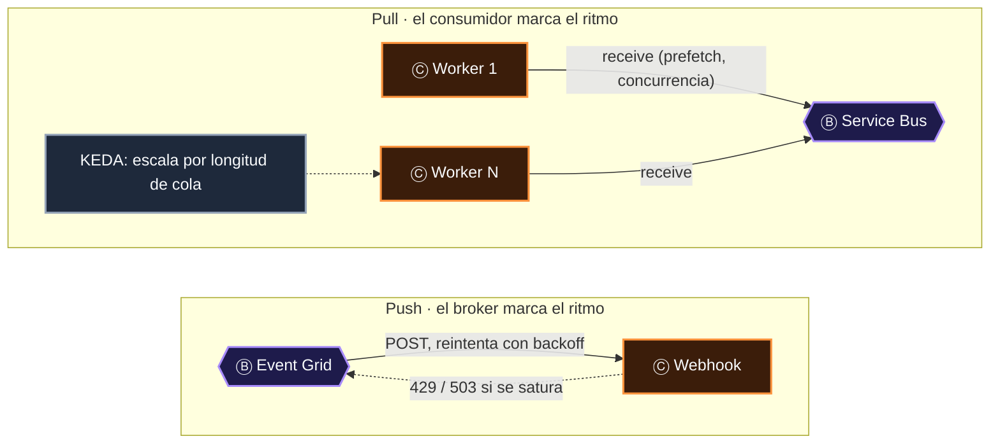
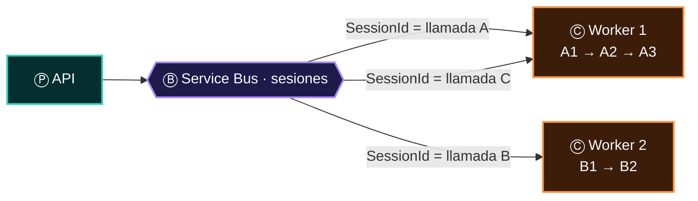
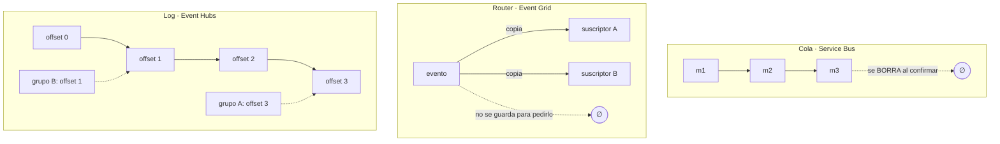

# 03 · Ⓑ Algo transporta

> **El verbo de la frase.** El transporte no decide nada, y sin embargo es la pieza que más determina el comportamiento del sistema: fija si el mensaje
> se empuja o se jala, si llega en orden, cuánto tiempo sobrevive, qué pasa cuando nadie lo puede procesar y si alguien podrá releerlo mañana.
> **Elegir el broker es elegir las garantías.**

## Contenido

1. [Seis formas de transportar](#1-seis-formas-de-transportar)
2. [Las siete propiedades de un verbo](#2-las-siete-propiedades-de-un-verbo)
3. [Push o pull: quién marca el ritmo](#3-push-o-pull-quién-marca-el-ritmo)
4. [Orden: total, por clave o ninguno](#4-orden-total-por-clave-o-ninguno)
5. [Semántica de entrega: la ley del verbo](#5-semántica-de-entrega-la-ley-del-verbo)
6. [Cola, router o log: la diferencia que importa](#6-cola-router-o-log-la-diferencia-que-importa)
7. [Verbos compuestos: encadenar brokers](#7-verbos-compuestos-encadenar-brokers)
8. [Los gateways también transportan](#8-los-gateways-también-transportan)
9. [Checklist del transporte](#9-checklist-del-transporte)

---

## 1. Seis formas de transportar

| Forma | Metáfora | Servicios en Azure | Lo que garantiza | Lo que no |
|---|---|---|---|---|
| **Router de eventos** | Cartero que reparte copias | Event Grid (*push*) | *Fan-out* con filtros, reintentos hasta 24 h, *dead-letter* a Blob | Orden; que el consumidor marque el ritmo |
| **Cola / topic** | Buzón con acuse de recibo | Service Bus, Storage Queue, Event Grid *namespaces* (*pull*) | Retención hasta consumir, *lock*, DLQ, FIFO por sesión (Service Bus) | Releer lo ya consumido |
| **Log particionado** | Libro contable de solo escritura | Event Hubs (y su endpoint en IoT Hub) | Volumen, orden por partición, *replay* por *offset* | Reintento ni DLQ por mensaje |
| **Gateway de dispositivos** | Aduana con pasaporte por equipo | IoT Hub, Event Grid MQTT | Identidad por dispositivo, comandos de vuelta | Gestión de dispositivos (solo IoT Hub la tiene) |
| **Gateway de peticiones** | Recepción de un edificio | API Management, Application Gateway, Front Door | Seguridad, cuotas, enrutamiento L7, WAF | Retención: si el *backend* cae, la petición se pierde |
| **Canal hacia personas** | Megáfono | SignalR, Web PubSub, Notification Hubs | Latencia de milisegundos a miles de conexiones | Persistencia (*at-most-once*) |
| **Pub/sub efímero** | Grito en el pasillo | Redis pub/sub | Aviso instantáneo a todas las réplicas | Nada si nadie escucha |

> [!NOTE]
> Según el atlas, los transportadores más usados son Event Grid (Ⓑ en 6 de las 10 arquitecturas) y Service Bus (5). Los dos aparecen además en otros
> papeles: Event Grid como **productor** (cuando reenvía hacia una cola) y Service Bus como **consumidor** de Event Grid. Ver [10](10-un-servicio-muchos-papeles.md).

---

## 2. Las siete propiedades de un verbo

Toda decisión de transporte se reduce a siete propiedades. Son las columnas de la [comparativa de brokers](12-brokers-quien-escribe-quien-lee.md#comparativa-de-contratos)
y de la vista interactiva **Productores y consumidores**.

| Propiedad | Pregunta | Valores posibles | Consecuencia para el consumidor |
|---|---|---|---|
| **Modelo** | ¿Quién inicia la entrega? | *Push* · *pull* · log | Con *push*, el broker te puede saturar; con *pull*, tú marcas el ritmo |
| **Entrega** | ¿Cuántas veces puede llegar? | *At-most-once* · *at-least-once* | *At-least-once* ⇒ idempotencia obligatoria |
| **Orden** | ¿En qué secuencia llega? | Ninguno · por clave · total | Sin orden ⇒ ordena por `time` del hecho, no por llegada |
| **Retención** | ¿Cuánto sobrevive sin consumir? | Segundos · días · hasta TTL | Define tu ventana para recuperarte de una caída |
| **Tamaño máx.** | ¿Cuánto cabe? | 64 KB … 100 MB | Por encima, *claim-check* |
| **Dead-letter** | ¿Qué pasa con lo imposible? | Nativa · a Blob · *poison queue* · ninguna | Sin DLQ, un mensaje venenoso bloquea o se pierde |
| **Replay** | ¿Puedo releer el pasado? | Sí (log) · no (cola) | Con *replay* puedes reconstruir proyecciones |

| | Event Grid | Service Bus | Event Hubs | Storage Queue | SignalR | Redis pub/sub |
|---|---|---|---|---|---|---|
| **Modelo** | *Push* (o *pull* en *namespaces*) | *Pull* · *peek-lock* | *Pull* · log | *Pull* | *Push* WebSocket | *Push* en memoria |
| **Entrega** | *At-least-once* | *At-least-once* (o *at-most-once*) | *At-least-once* con *checkpoint* | *At-least-once* | *At-most-once* | *At-most-once* |
| **Orden** | No | FIFO por **sesión** | Por **partición** | No | Por conexión | Por canal |
| **Retención** | Reintentos hasta 24 h | Hasta el TTL | 1–7 días Std · hasta 90 Premium/Dedicated | 7 días por defecto | Ninguna | Ninguna |
| **Tamaño** | 1 MB | 256 KB Std · 100 MB Premium | 1 MB | 64 KB | Pequeño | Pequeño |
| **Dead-letter** | A Blob | Nativa (DLQ) | No | *Poison queue* (Functions) | No | No |
| **Replay** | No | No (solo *peek*) | **Sí**, por *offset* | No | No | Solo con Streams |

---

## 3. Push o pull: quién marca el ritmo



| | *Push* | *Pull* |
|---|---|---|
| **Contrapresión** (*backpressure*) | Indirecta: respondes 429/503 y el broker reintenta más tarde | Natural: solo pides lo que puedes procesar |
| **Latencia** | Mínima | Depende del *polling* (largo en Service Bus: casi inmediata) |
| **Consumidores** | Deben estar expuestos por HTTP (o ser un servicio de Azure) | Pueden estar en una red privada sin entrada |
| **Escala del consumidor** | Por peticiones HTTP | Por trabajo pendiente (KEDA) |
| **Ideal para** | Reacciones ligeras y *fan-out* | Trabajo pesado, a ritmo propio |

> [!TIP]
> **Patrón de nivelación de carga:** Event Grid → Service Bus. Event Grid hace el *fan-out* con filtros (*push*), Service Bus absorbe el pico y los
> *workers* jalan a su ritmo (*pull*). Es un verbo compuesto ([§7](#7-verbos-compuestos-encadenar-brokers)).

---

## 4. Orden: total, por clave o ninguno

En un sistema distribuido **no existe el orden global barato**. Lo que existe es orden **por clave**, y hay que elegir la clave con cuidado.

| Broker | Unidad de orden | Cómo se pide | Costo de pedirlo |
|---|---|---|---|
| Service Bus | **Sesión** (`SessionId`) | Cola o suscripción con sesiones habilitadas | Una sesión la procesa **un solo** consumidor a la vez: el paralelismo es el número de sesiones activas |
| Event Hubs | **Partición** (`PartitionKey` → *hash*) | Clave de partición al enviar | Particiones calientes si la clave está mal repartida |
| Cosmos DB *change feed* | **Partition key lógica** | Viene incluido | Ninguno |
| Event Grid, Storage Queue | Ninguna | — | Ordena en el consumidor por `time` o versión |



> [!IMPORTANT]
> En TRACER, `SessionId = CallConnectionId` hace que **una sola instancia** procese en orden los eventos de cada llamada, sin `SemaphoreSlim` estático
> ni estado en memoria. Las sesiones son **afinidad por entidad sin estado local**: reemplazan al `TaskQueuer` en memoria del diseño actual.

---

## 5. Semántica de entrega: la ley del verbo

> **Ley 1:** las garantías las fija el Ⓑ; las obligaciones caen en el Ⓒ.

*Exactly-once* de extremo a extremo no existe en redes asíncronas. Lo que se construye es **efectivamente una vez** = *at-least-once* + idempotencia.

| Broker | Entrega | Cómo llega a "efectivamente una vez" |
|---|---|---|
| Service Bus · *peek-lock* | *At-least-once* | `MessageId` + *duplicate detection* (ventana configurable, hasta 7 días) + consumidor idempotente; transacciones dentro del *namespace* |
| Service Bus · *receive-and-delete* | *At-most-once* | No aplica: aceptas pérdida |
| Event Hubs | *At-least-once* (relee desde el último *checkpoint*) | Clave idempotente en el destino: `partición + sequenceNumber` |
| Event Grid | *At-least-once* con reintentos | Deduplicar por `source` + `id` |
| Storage Queue | *At-least-once* (visibilidad) | `DequeueCount` + idempotencia |
| SignalR, Redis pub/sub | *At-most-once* | No lo intentes: relee de Ⓓ |

---

## 6. Cola, router o log: la diferencia que importa

La confusión más frecuente en entrevistas y en diseños: tratar los tres como intercambiables.



| | Cola | Router | Log |
|---|---|---|---|
| **El mensaje desaparece cuando…** | Un consumidor lo confirma | Se entrega (o vence el reintento) | Vence la retención (nunca al leer) |
| **Varios lectores** | Compiten por cada mensaje | Cada suscripción recibe su copia | Cada grupo lleva su propia posición |
| **Error en un mensaje** | Reintento individual y DLQ | Reintento y *dead-letter* a Blob | Decides tú: saltar, reintentar o parar la partición |
| **Pregunta que responde** | "¿Quién hace este trabajo?" | "¿A quién le interesa este hecho?" | "¿Qué ha pasado, en orden?" |

> [!CAUTION]
> Event Hubs **no es una cola de trabajo**: no hay *lock* por mensaje ni DLQ. Si un evento falla, o lo reintentas tú bloqueando la partición, o lo
> mandas a una cola de errores propia. Para trabajo por mensaje, Service Bus.

---

## 7. Verbos compuestos: encadenar brokers

Una frase puede tener varios Ⓑ seguidos. Cada salto cambia la semántica, y eso es justo lo que se busca.

| Cadena | Por qué | Ejemplo |
|---|---|---|
| **Event Grid → Service Bus** | De *push* sin orden a *pull* con orden y DLQ | Eventos de ACS que deben procesarse por llamada |
| **Event Grid → Event Hubs** | De hechos discretos a un stream analizable | Auditoría de eventos de recursos en Fabric |
| **IoT Hub → Event Hubs** | De dispositivos con identidad a un log | Telemetría hacia Stream Analytics |
| **Service Bus → Event Grid** | Avisar cuando hay mensajes sin consumidor activo (Premium) | *Workers* que arrancan bajo demanda |
| **Event Hubs → Blob (Capture)** | Del log efímero al lago permanente | Arquitectura Kappa |

```bash
# Event Grid → Service Bus: la suscripción usa una cola como handler, con identidad administrada.
# Requisitos: el system topic tiene identidad asignada por el sistema, y esa identidad tiene
# "Azure Service Bus Data Sender" sobre la cola. Así el namespace puede tener disableLocalAuth=true.
az eventgrid system-topic event-subscription create \
  --name acs-a-cola --resource-group rg-tracer --system-topic-name acs-tracer \
  --delivery-identity systemassigned \
  --delivery-identity-endpoint-type servicebusqueue \
  --delivery-identity-endpoint /subscriptions/<sub>/resourceGroups/rg-tracer/providers/Microsoft.ServiceBus/namespaces/sb-tracer/queues/call-events \
  --included-event-types Microsoft.Communication.IncomingCall Microsoft.Communication.CallEnded
```

> [!NOTE]
> En una cadena, el broker intermedio cumple **dos papeles a la vez**: es Ⓒ para el primero (lo consume) y Ⓑ para el último consumidor. Es la ley
> del encadenamiento aplicada al transporte.

---

## 8. Los gateways también transportan

En una frase **síncrona** (petición y respuesta), no hay cola: el verbo es la red y quien la gobierna. API Management, Application Gateway y Front Door
son Ⓑ en la arquitectura de microservicios y en el monolito modular del atlas.

| Gateway | Ámbito | Capa | Lo que añade a la frase |
|---|---|---|---|
| **Front Door** | Global, en el borde | L7 | *Anycast*, CDN, WAF, *failover* entre regiones |
| **Application Gateway** | Regional, dentro de tu VNet | L7 | WAF, TLS, rutas por *path*, *ingress* de AKS (AGIC / Application Gateway for Containers) |
| **API Management** | Regional o multirregión | L7 de API | Validación JWT, cuotas, versiones, transformación, `log-to-eventhub` |

> [!WARNING]
> Un gateway **no retiene**: si el *backend* cae, la petición falla. Cuando una petición dispara trabajo largo, el patrón es **webhook delgado**:
> valida, encola en Service Bus, responde `202 Accepted` y deja el trabajo al consumidor.

---

## 9. Checklist del transporte

- [ ] Elegí el broker por el **sustantivo** (hecho, orden, medición, aviso), no por costumbre.
- [ ] Conozco las siete propiedades del broker elegido y las escribí en el diseño.
- [ ] Si necesito orden, sé **por qué clave**, y la clave reparte bien la carga.
- [ ] Hay un destino para lo imposible: DLQ, *dead-letter* a Blob o *poison queue*, **con alerta**.
- [ ] La retención cubre mi peor tiempo de recuperación.
- [ ] Ningún mensaje supera el techo del *tier*.
- [ ] Los brokers aceptan solo identidades de Entra ID (`disableLocalAuth`) y tráfico privado ([07](07-identidad.md), [08](08-red.md)).
- [ ] Hay alertas sobre la profundidad de la cola, el *lag* del log y los mensajes en *dead-letter* ([09](09-observabilidad.md)).

---

[← 02 · Produce](02-produce.md) · [Índice](../README.md) · [04 · Consume →](04-consume.md)
