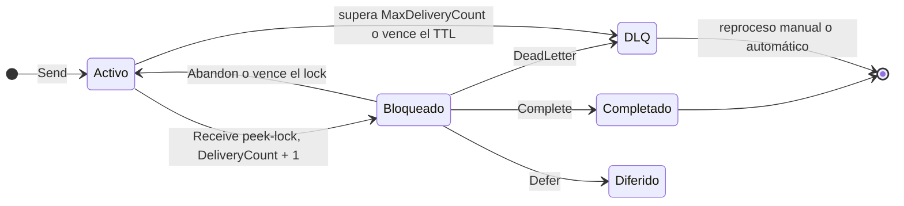
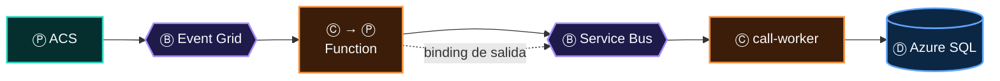

# 04 · Ⓒ Alguien consume

> **El objeto de la frase: quien recibe la acción y la transforma.** Un consumidor recibe un mensaje y produce un efecto: cambia un estado, emite otro
> mensaje o llama a un tercero. Tiene una sola obligación sagrada, que hereda del verbo: **procesar dos veces el mismo mensaje no debe tener efecto**.

## Contenido

1. [Cuatro formas de consumir](#1-cuatro-formas-de-consumir)
2. [El ciclo de vida de un mensaje en peek-lock](#2-el-ciclo-de-vida-de-un-mensaje-en-peek-lock)
3. [Idempotencia: el consumidor Inbox](#3-idempotencia-el-consumidor-inbox)
4. [Código .NET: un consumidor por broker](#4-código-net-un-consumidor-por-broker)
5. [Escalar consumidores: HPA, KEDA y Functions](#5-escalar-consumidores-hpa-keda-y-functions)
6. [Mensajes venenosos y dead-letter](#6-mensajes-venenosos-y-dead-letter)
7. [El consumidor que también produce](#7-el-consumidor-que-también-produce)
8. [Antipatrones y checklist](#8-antipatrones-y-checklist)

---

## 1. Cuatro formas de consumir

| Forma | Cómo recibe | Servicios | Concurrencia | Confirmación |
|---|---|---|---|---|
| **Webhook** (*push*) | El broker llama a tu endpoint HTTPS | App Service, AKS vía *ingress*, Functions `EventGridTrigger` | Las peticiones que el broker envíe | Código HTTP 2xx |
| **Competing consumers** (*pull*) | N réplicas compiten por los mensajes de una cola | `ServiceBusProcessor`, Functions `ServiceBusTrigger`, workers con KEDA | Réplicas × llamadas concurrentes | `Complete`, `Abandon`, `DeadLetter` |
| **Lector particionado** (log) | Cada réplica se queda con un subconjunto de particiones | `EventProcessorClient`, Functions `EventHubTrigger`, Stream Analytics | Hasta una réplica activa por partición y grupo | *Checkpoint* de *offset* |
| **Trigger de datos** | Lee el cambio de un almacén | Functions `CosmosDBTrigger`, `SqlTrigger`, `BlobTrigger`; Change Feed Processor | Por partición o *lease* | *Lease* / *continuation token* |

Según el atlas, los consumidores más frecuentes son **Azure Functions** (Ⓒ en 9 de las 10 arquitecturas), **AKS** (6) y Container Apps, App Service y
Logic Apps (3 cada uno). Functions es también el ejemplo canónico de Ⓒ que se vuelve Ⓟ ([§7](#7-el-consumidor-que-también-produce)).

---

## 2. El ciclo de vida de un mensaje en peek-lock

*Peek-lock* es la razón por la que Service Bus es el verbo de las órdenes. El mensaje no se borra al leerlo: se **bloquea** mientras lo procesas.



| Concepto | Valor por defecto | Qué debes saber |
|---|---|---|
| `LockDuration` | 1 minuto (máx. 5) | Si procesas más tiempo, el SDK **renueva** el *lock* (`MaxAutoLockRenewalDuration`) |
| `MaxDeliveryCount` | 10 | Tras 10 entregas fallidas, el mensaje va a la DLQ con motivo `MaxDeliveryCountExceeded` |
| *Lock lost* | — | Si el *lock* vence, otro consumidor recibe el mensaje: **duplicado garantizado** si tu efecto ya ocurrió |
| *Prefetch* | 0 | Acelera, pero los mensajes precargados también consumen *lock*: úsalo con procesamiento corto |

> [!WARNING]
> **Confirma solo después del efecto.** El orden correcto es: recibir → procesar → *commit* del estado → `Complete`. Si confirmas antes y el proceso muere,
> pierdes el mensaje. Si confirmas después y el proceso muere entre el *commit* y el `Complete`, el mensaje se reentrega: por eso el consumidor
> debe ser idempotente. No hay un tercer orden.

---

## 3. Idempotencia: el consumidor Inbox

Un consumidor es idempotente cuando procesar `n` veces el mismo mensaje deja el sistema igual que procesarlo una. Hay tres maneras de lograrlo:

| Estrategia | Cómo | Cuándo |
|---|---|---|
| **Efecto naturalmente idempotente** | `UPSERT`, `SET estado = X` (no `estado = estado + 1`), `PUT` en lugar de `POST` | Siempre que el modelo lo permita: es gratis |
| **Inbox** (tabla de mensajes procesados) | Insertar `MessageId` con índice único **en la misma transacción** que el efecto | Efectos no idempotentes sobre una base relacional |
| **Concurrencia optimista** | Versión o ETag: el segundo intento falla por versión obsoleta | Actualizaciones de agregados (Cosmos DB, EF Core `RowVersion`) |

```csharp
// Consumidor Inbox con EF Core: el registro del mensaje y el efecto se confirman juntos
public async Task ProcesarAsync(ServiceBusReceivedMessage mensaje, CancellationToken ct)
{
    await using var tx = await db.Database.BeginTransactionAsync(ct);

    db.Inbox.Add(new InboxMessage { MessageId = mensaje.MessageId, Consumidor = "call-worker", RecibidoEn = DateTimeOffset.UtcNow });
    try
    {
        await db.SaveChangesAsync(ct);                     // índice único (MessageId, Consumidor)
    }
    catch (DbUpdateException ex) when (ex.InnerException is SqlException { Number: 2601 or 2627 })
    {
        return;                                            // ya procesado: no hagas nada, solo confirma
    }

    var orden = mensaje.Body.ToObjectFromJson<TransferirLlamada>()!;
    var llamada = await db.Calls.SingleAsync(c => c.ConnectionId == orden.CallId, ct);
    llamada.Transferir(orden.AgenteId);                    // efecto de negocio

    await db.SaveChangesAsync(ct);
    await tx.CommitAsync(ct);                              // Inbox + efecto: un solo commit
}
```

> [!TIP]
> Si el efecto es una **llamada a un tercero** (por ejemplo, `TransferCall` en ACS), la idempotencia la pone el tercero: Communication Services acepta
> `Repeatability-Request-ID` y `Repeatability-First-Sent` para que el reintento no transfiera dos veces. Usa el `MessageId` como `Repeatability-Request-ID`.

---

## 4. Código .NET: un consumidor por broker

**Órdenes con sesiones → `ServiceBusSessionProcessor`** (un *worker* en AKS o Container Apps)

```csharp
public sealed class CallWorker(ServiceBusClient bus, IServiceScopeFactory scopes, ILogger<CallWorker> log) : BackgroundService
{
    protected override async Task ExecuteAsync(CancellationToken ct)
    {
        await using var procesador = bus.CreateSessionProcessor("call-commands", new ServiceBusSessionProcessorOptions
        {
            MaxConcurrentSessions = 16,                    // 16 llamadas en paralelo por réplica
            MaxConcurrentCallsPerSession = 1,              // en orden dentro de cada llamada
            AutoCompleteMessages = false,                  // confirmo yo, después del commit
            MaxAutoLockRenewalDuration = TimeSpan.FromMinutes(5),
            SessionIdleTimeout = TimeSpan.FromSeconds(30)
        });

        procesador.ProcessMessageAsync += async args =>
        {
            using var scope = scopes.CreateScope();
            var handler = scope.ServiceProvider.GetRequiredService<TransferirLlamadaHandler>();
            try
            {
                await handler.ProcesarAsync(args.Message, args.CancellationToken);
                await args.CompleteMessageAsync(args.Message, args.CancellationToken);
            }
            catch (DatosInvalidosException ex)             // error permanente: no reintentes
            {
                await args.DeadLetterMessageAsync(args.Message, "DatosInvalidos", ex.Message, args.CancellationToken);
            }                                              // error transitorio: deja que el lock venza o Abandon
        };
        procesador.ProcessErrorAsync += args =>
        {
            log.LogError(args.Exception, "Error en {Origen} ({Entidad})", args.ErrorSource, args.EntityPath);
            return Task.CompletedTask;
        };

        await procesador.StartProcessingAsync(ct);
        await Task.Delay(Timeout.Infinite, ct).ContinueWith(_ => { });
        await procesador.StopProcessingAsync();
    }
}
```

**Hechos por push → webhook de Event Grid** (CloudEvents, con el *handshake* de validación)

```csharp
// CloudEvents 1.0: Event Grid valida el endpoint con un OPTIONS (abuse protection) antes de enviar
app.MapMethods("/events", ["OPTIONS"], (HttpContext ctx) =>
{
    ctx.Response.Headers["WebHook-Allowed-Origin"] = ctx.Request.Headers["WebHook-Request-Origin"].ToString();
    return Results.Ok();
});

app.MapPost("/events", async (HttpRequest req, IEventosLlamada eventos, CancellationToken ct) =>
{
    var lote = CloudEvent.ParseMany(await BinaryData.FromStreamAsync(req.Body, ct));
    foreach (var e in lote.OrderBy(e => e.Time))           // sin orden garantizado: ordena por el reloj del hecho
        await eventos.ProcesarUnaVezAsync(e, ct);           // dedupe por e.Source + e.Id (Inbox)
    return Results.Ok();                                    // 200 solo después de procesar
}).RequireAuthorization("EventGrid");                       // token de Entra ID en la entrega (capítulo 07)
```

**Mediciones → `EventProcessorClient`** (*checkpoint* por lote)

```csharp
var checkpoints = new BlobContainerClient(new Uri("https://sttracer.blob.core.windows.net/checkpoints"), credencial);
var procesador = new EventProcessorClient(checkpoints, "presences-svc", "evh-tracer-prd.servicebus.windows.net", "presences", credencial);

var pendientes = new ConcurrentDictionary<string, int>();
procesador.ProcessEventAsync += async args =>
{
    if (!args.HasEvent) return;
    await proyector.AplicarAsync(args.Data.EventBody.ToObjectFromJson<CambioDePresencia>()!, args.CancellationToken);
    if (pendientes.AddOrUpdate(args.Partition.PartitionId, 1, (_, n) => n + 1) % 100 == 0)
        await args.UpdateCheckpointAsync(args.CancellationToken);   // nunca por evento: es una escritura en Blob
};
procesador.ProcessErrorAsync += args => { log.LogError(args.Exception, "Partición {P}", args.PartitionId); return Task.CompletedTask; };
await procesador.StartProcessingAsync();
```

**Serverless → Functions, *isolated worker*** (el *trigger* consume, el *binding* de salida produce)

```csharp
public sealed class ComandosDeLlamada(TransferirLlamadaHandler handler)
{
    [Function(nameof(ComandosDeLlamada))]
    [ServiceBusOutput("call-audit", Connection = "ServiceBus")]           // Ⓟ: publica al terminar
    public async Task<string> Run(
        [ServiceBusTrigger("call-commands", Connection = "ServiceBus", IsSessionsEnabled = true, AutoCompleteMessages = false)]
        ServiceBusReceivedMessage mensaje,                                // Ⓒ: consume
        ServiceBusMessageActions acciones,
        CancellationToken ct)
    {
        await handler.ProcesarAsync(mensaje, ct);
        await acciones.CompleteMessageAsync(mensaje, ct);
        return JsonSerializer.Serialize(new { mensaje.MessageId, procesado = DateTimeOffset.UtcNow });
    }
}
// Conexión sin secretos: app setting ServiceBus__fullyQualifiedNamespace = sb-tracer-prd.servicebus.windows.net
```

---

## 5. Escalar consumidores: HPA, KEDA y Functions

> **Ley 2 (de la memoria):** antes de escalar a N réplicas, saca el estado del proceso.

| Mecanismo | Escala por | Escala a cero | Dónde |
|---|---|---|---|
| **HPA** | CPU y memoria | No | AKS |
| **KEDA** | **Trabajo pendiente**: longitud de cola, *lag* de Event Hubs, Redis, Prometheus | Sí | Add-on de AKS; nativo en Container Apps |
| **Functions** (Flex Consumption) | Eventos por *trigger* | Sí | Functions |
| **App Service** autoescalado | Métricas o calendario | No | App Service |

```yaml
# KEDA: el call-worker escala por mensajes pendientes, autenticado con Workload Identity (sin secretos)
apiVersion: keda.sh/v1alpha1
kind: TriggerAuthentication
metadata:
  name: sb-workload-identity
spec:
  podIdentity:
    provider: azure-workload
---
apiVersion: keda.sh/v1alpha1
kind: ScaledObject
metadata:
  name: call-worker
spec:
  scaleTargetRef:
    name: call-worker
  minReplicaCount: 1
  maxReplicaCount: 30
  triggers:
    - type: azure-servicebus
      metadata:
        namespace: sb-tracer-prd
        queueName: call-commands
        messageCount: "20"            # objetivo: 20 mensajes pendientes por réplica
      authenticationRef:
        name: sb-workload-identity
```

| Antes de escalar, busca… | Por qué rompe con N réplicas | Muévelo a |
|---|---|---|
| `static SemaphoreSlim` | Solo protege **un** proceso | Sesiones de Service Bus, `sp_getapplock`, *lock* en Redis |
| `IMemoryCache` | Cada réplica tiene su versión de la verdad | Azure Managed Redis (`HybridCache`) |
| `BackgroundService` que no debe duplicarse | Corre en **cada** réplica | Líder único con *lease* de Blob, o un Job aparte |
| Colas en memoria (`Channel<T>`, `TaskQueuer`) | Se pierden al reiniciar | Service Bus |

---

## 6. Mensajes venenosos y dead-letter

Un **mensaje venenoso** es el que nunca se podrá procesar: datos inválidos, versión de contrato desconocida, entidad borrada. Reintentarlo solo gasta.

| Broker | Destino del veneno | Cuándo | Cómo se reprocesa |
|---|---|---|---|
| Service Bus | Subcola `$DeadLetterQueue` de cada cola y suscripción | `MaxDeliveryCount`, TTL vencido (si se habilita), filtro con error, o `DeadLetter` explícito | Leer la DLQ, corregir y reenviar a la cola principal |
| Event Grid | Contenedor de Blob configurado | Agotados los reintentos (por defecto 30 intentos o 24 h) o error permanente (400, 413) | Un proceso que lee el Blob y republica |
| Storage Queue + Functions | Cola `<nombre>-poison` | 5 intentos de desencolado (configurable) | Function que vigila la cola `-poison` |
| Event Hubs | **No existe** | — | Tu código decide: cola de errores propia y seguir avanzando |

> [!CAUTION]
> Una DLQ sin alerta es un cementerio silencioso. Cada DLQ necesita una métrica vigilada (`DeadletteredMessages` en Service Bus,
> `DeadLetteredCount` en Event Grid) y un procedimiento escrito de reproceso. Ver [09 · Observabilidad](09-observabilidad.md#6-alertas-que-salvan-la-noche).

---

## 7. El consumidor que también produce

> **Ley 7 (del encadenamiento):** el Ⓒ de una frase puede ser el Ⓟ de la siguiente.



En la vista **Matriz de roles**, Azure Functions aparece como Ⓒ en 9 arquitecturas y como Ⓟ en la de colas. Un *trigger* la alimenta y un *binding*
de salida publica. Lo mismo ocurre con Logic Apps (acción *Send message*), Stream Analytics (consume de un stream y produce a otro) y tu propio servicio
.NET. Cuando un consumidor produce, hereda **todas** las obligaciones del [capítulo 02](02-produce.md): `id` estable, clave de orden, un solo *commit*
y `traceparent` propagado.

---

## 8. Antipatrones y checklist

| Antipatrón | Consecuencia | Corrección |
|---|---|---|
| Webhook que responde 200 **antes** de procesar | Event Grid no reintenta: si fallas después, el evento se pierde | Responde 2xx al terminar; si el trabajo es largo, encola y responde |
| Procesar más allá del *lock* | *Lock lost* → otro consumidor lo procesa también | `MaxAutoLockRenewalDuration`, o divide el trabajo |
| Reintentar operaciones no idempotentes | Efectos duplicados (dos transferencias, dos cobros) | Inbox, `Repeatability-Request-ID`, UPSERT |
| *Checkpoint* por cada evento | Miles de escrituras en Blob, latencia | *Checkpoint* por lote o por tiempo |
| `HttpClient` o cliente de SDK por invocación | Agotamiento de *sockets* y conexiones AMQP | `IHttpClientFactory`, clientes *singleton* |
| Estado en memoria con varias réplicas | Decisiones contradictorias | [05 · Guarda](05-guarda.md) |

- [ ] El consumidor es **idempotente** y lo demuestra una prueba que entrega el mismo mensaje dos veces.
- [ ] Confirma (`Complete`, 2xx, *checkpoint*) **después** del *commit* del efecto.
- [ ] Distingue errores **transitorios** (reintentar) de **permanentes** (*dead-letter*).
- [ ] Su duración de procesamiento cabe en el *lock*, o el *lock* se renueva.
- [ ] Escala por **trabajo pendiente** (KEDA, *triggers*), no solo por CPU.
- [ ] No guarda estado en memoria que otra réplica necesite.
- [ ] Si produce, cumple el checklist del [productor](02-produce.md#8-checklist-del-productor).

---

[← 03 · Transporta](03-transporta.md) · [Índice](../README.md) · [05 · Guarda →](05-guarda.md)
