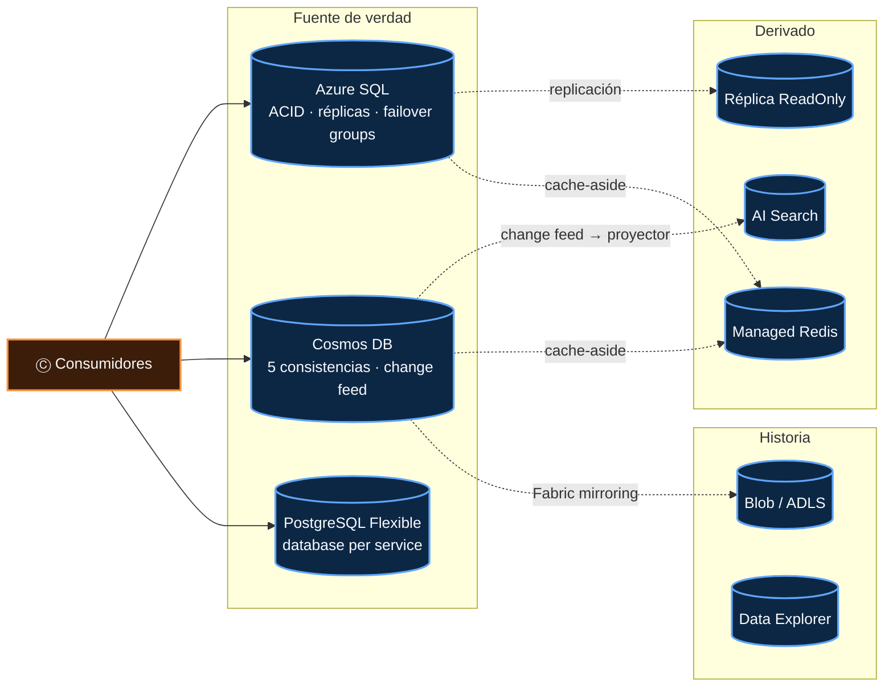
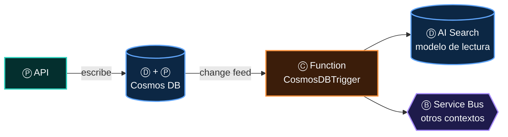

# 05 · Ⓓ Algo guarda el estado

> **El complemento de tiempo de la frase.** Todo lo demás es efímero: un mensaje se consume, una réplica muere, una conexión se corta. El estado es
> lo único que **sobrevive al reinicio**. Por eso vive fuera del cómputo, y por eso cada almacén debe declarar dos cosas: qué consistencia ofrece y
> cómo resuelve dos escrituras simultáneas.

## Contenido

1. [Seis clases de estado](#1-seis-clases-de-estado)
2. [El mapa de almacenes del atlas](#2-el-mapa-de-almacenes-del-atlas)
3. [Consistencia: lo que promete cada almacén](#3-consistencia-lo-que-promete-cada-almacén)
4. [Concurrencia: dos escritores, una verdad](#4-concurrencia-dos-escritores-una-verdad)
5. [Cuando el estado también produce](#5-cuando-el-estado-también-produce)
6. [Modelos de lectura: estado derivado y reconstruible](#6-modelos-de-lectura-estado-derivado-y-reconstruible)
7. [Coordinación entre réplicas sin infraestructura extra](#7-coordinación-entre-réplicas-sin-infraestructura-extra)
8. [Antipatrones y checklist](#8-antipatrones-y-checklist)

---

## 1. Seis clases de estado

No todo lo que se guarda es "la base de datos". Distinguir la **clase** de estado decide el almacén, la consistencia y lo que pasa si se pierde.

| Clase | Pregunta que responde | Si se pierde… | Almacenes típicos |
|---|---|---|---|
| **Fuente de verdad** | ¿Qué es cierto ahora? | Desastre: hay que restaurar | Azure SQL, Cosmos DB, PostgreSQL |
| **Event store** | ¿Qué ha pasado, en orden? | Desastre: es la historia | Cosmos DB (*append-only*, `partition key = aggregateId`), tabla de eventos en SQL |
| **Modelo de lectura** | ¿Cómo lo muestro rápido? | Molestia: se **reconstruye** desde la fuente | Réplica `ReadOnly` de SQL, vistas desnormalizadas en Cosmos DB, AI Search |
| **Cache** | ¿Lo tengo a mano? | Nada: se recalcula (más lento) | Azure Managed Redis |
| **Coordinación** | ¿Quién tiene el turno? ¿Hasta dónde leí? | Duplicados o bloqueos temporales | *Leases* de Blob, *checkpoints*, sesiones de Service Bus, `sp_getapplock`, Redis `SET NX` |
| **Archivo** (lago) | ¿Qué pasó el año pasado? | Pérdida analítica | Blob / ADLS (Capture de Event Hubs), Data Explorer |

> [!IMPORTANT]
> Un **modelo de lectura** que no se puede reconstruir desde la fuente de verdad no es un modelo de lectura: es una segunda fuente de verdad, y
> tendrás que decidir cuál gana cuando discrepen.

---

## 2. El mapa de almacenes del atlas

Según la [matriz de papeles](10-un-servicio-muchos-papeles.md), los almacenes más frecuentes son **Azure SQL** y **Blob Storage**
(Ⓓ en 10 de las 13 arquitecturas cada uno), **Cosmos DB** (8) y **Azure Managed Redis** (5).



| Almacén | Fortaleza | Límite que decide diseños | Rol RBAC de datos |
|---|---|---|---|
| **Azure SQL** | ACID, SQL completo, Change Tracking, réplica de lectura | Escala vertical; transacciones solo dentro de la base | Usuario contenido de Entra ID |
| **Cosmos DB** | Distribución global, *change feed*, latencia de un dígito | 2 MB por ítem; diseño por *partition key*; costo en RU | Rol de datos de Cosmos DB (RBAC propio del plano de datos) |
| **Blob / ADLS** | Barato, ilimitado, eventos `BlobCreated`, *leases* | No es una base: sin consultas ricas | Storage Blob Data Contributor |
| **Managed Redis** | Memoria compartida, *locks*, *rate limit* | Volátil por diseño; *pub/sub* *at-most-once* | Entra ID (políticas de acceso a datos) |
| **PostgreSQL Flexible** | Ecosistema abierto, `pgvector`, *logical decoding* | Igual que SQL: escala vertical | Rol de Entra ID en PostgreSQL |

---

## 3. Consistencia: lo que promete cada almacén

El teorema **CAP** dice que, ante una partición de red, eliges entre consistencia y disponibilidad. Su extensión **PACELC** añade lo que importa a diario:
*y si no hay partición* (**E**lse), eliges entre **L**atencia y **C**onsistencia. Cosmos DB es el único almacén de Azure que te deja elegir el punto exacto:

| Nivel de Cosmos DB | Garantía | Latencia y costo | Cuándo |
|---|---|---|---|
| **Strong** | Linealizable: lees la última escritura confirmada | La más alta; lecturas al doble de RU; **no admite** escrituras multirregión | Saldos, inventario crítico |
| **Bounded staleness** | Como mucho K versiones o T segundos de retraso | Alta | Lecturas globales con retraso acotado |
| **Session** *(por defecto)* | Tus propias escrituras, en orden, dentro de tu sesión | Baja | La inmensa mayoría de las aplicaciones |
| **Consistent prefix** | Nunca ves escrituras fuera de orden | Muy baja | *Feeds*, historiales |
| **Eventual** | Converge "algún día" | Mínima | Contadores, *likes*, telemetría |

> [!NOTE]
> **Entre servicios, la consistencia siempre es eventual.** ACID existe *dentro* de una base; en cuanto el estado cruza un broker, el lector lo ve
> después. La interfaz debe estar diseñada para ese "después": es la [ley de la última milla](06-entrega.md).

---

## 4. Concurrencia: dos escritores, una verdad

Con N réplicas consumiendo, dos escrituras sobre la misma entidad **van a ocurrir**. Hay dos familias de defensa:

| Estrategia | Cómo | Ventaja | Costo |
|---|---|---|---|
| **Optimista** | Leer versión → escribir *si la versión no cambió* → si cambió, releer y reintentar | Sin bloqueos; escala | Reintentos bajo contención alta |
| **Pesimista** | Tomar un *lock* antes de leer | Simple de razonar | Bloqueos, *deadlocks*, *locks* huérfanos |

```csharp
// Optimista en Cosmos DB: ETag
ItemResponse<Llamada> leida = await contenedor.ReadItemAsync<Llamada>(id, new PartitionKey(id), cancellationToken: ct);
Llamada llamada = leida.Resource;
llamada.Estado = "Transferida";
try
{
    await contenedor.ReplaceItemAsync(llamada, id, new PartitionKey(id),
        new ItemRequestOptions { IfMatchEtag = leida.ETag }, ct);
}
catch (CosmosException e) when (e.StatusCode == HttpStatusCode.PreconditionFailed)
{
    // 412: alguien escribió antes. Releer, volver a decidir, reintentar.
}
```

```csharp
// Optimista en EF Core + Azure SQL: rowversion
public class Llamada
{
    public int Id { get; set; }
    public string Estado { get; set; } = "";
    [Timestamp] public byte[] Version { get; set; } = [];   // DbUpdateConcurrencyException si cambió
}
```

---

## 5. Cuando el estado también produce

> **Ley 6 (de la posición):** el papel lo da la posición en la frase, no el producto.

Los almacenes modernos no solo guardan: **emiten** sus cambios. En ese momento cumplen dos papeles a la vez, Ⓓ y Ⓟ. En la matriz del atlas, Azure SQL,
Cosmos DB y Blob Storage aparecen como **Ⓟ y Ⓓ en la arquitectura *serverless***; Blob también en la *event-driven*.

| Almacén | Cómo produce | Orden | Qué se pierde |
|---|---|---|---|
| **Cosmos DB** | *Change feed*: cada escritura es un evento | Por *partition key* | Los borrados, en el modo por defecto (usa borrado lógico con TTL) |
| **Azure SQL** | Change Tracking (`SqlTrigger` de Functions), CDC, tabla Outbox | Por versión o LSN | Nada si usas Outbox |
| **Blob Storage** | `BlobCreated` / `BlobDeleted` a Event Grid | Ninguno | — |
| **PostgreSQL** | *Logical decoding* → Debezium | Por LSN | — |



> [!TIP]
> El *change feed* de Cosmos DB es un **Outbox incorporado**: el cambio y el evento son la misma escritura, así que el problema del doble *commit*
> ([02 § 5](02-produce.md#5-el-problema-del-doble-commit-y-el-outbox)) desaparece por construcción.

---

## 6. Modelos de lectura: estado derivado y reconstruible

En CQRS, la escritura y la lectura tienen modelos distintos. La lectura es **estado derivado**: se alimenta de eventos y se puede tirar y reconstruir.

| Modelo de lectura | Se alimenta de | Ideal para |
|---|---|---|
| Réplica `ApplicationIntent=ReadOnly` de Azure SQL | Replicación nativa | Reportes pesados sin tocar la primaria (TRACER: reportes con `AsNoTracking` y `AsSplitQuery`) |
| Vista desnormalizada en Cosmos DB | *Change feed* → proyector | Pantallas que leen un documento por petición |
| Índice de AI Search | *Indexer* o *push* | Búsqueda de texto completo y vectorial |
| Claves en Redis | Proyector o *cache-aside* | Lecturas muy calientes (presencia, contadores) |

> [!CAUTION]
> **Nunca valides un comando contra un modelo de lectura.** Es eventualmente consistente: puede decir que un agente está libre cuando la fuente de
> verdad ya lo asignó hace 200 ms. Las decisiones se toman contra la fuente de verdad, con concurrencia optimista.

---

## 7. Coordinación entre réplicas sin infraestructura extra

El estado de coordinación es el más olvidado y el que más incidentes causa al escalar. Tres recetas que usan almacenes que **ya tienes**:

**Reserva atómica con `UPDATE … WHERE`** (*semantic lock* de una saga)

```csharp
// Reservar un agente: solo una réplica gana. Sin locks distribuidos.
int filas = await db.Agentes
    .Where(a => a.Id == agenteId && a.ReservadoPor == null)
    .ExecuteUpdateAsync(s => s
        .SetProperty(a => a.ReservadoPor, callId)
        .SetProperty(a => a.ReservadoEn, DateTimeOffset.UtcNow), ct);

if (filas == 0) return Resultado.AgenteOcupado;          // otra réplica lo reservó primero
```

**Lock con nombre en Azure SQL** (`sp_getapplock`)

```sql
DECLARE @r int;
EXEC @r = sp_getapplock @Resource = N'outbox-relay', @LockMode = 'Exclusive',
                        @LockOwner = 'Session', @LockTimeout = 0;
SELECT @r;   -- >= 0: tienes el lock; < 0: otra réplica es el relay
```

**Líder único con un *lease* de Blob** (para un `BackgroundService` que no debe duplicarse)

```csharp
BlobLeaseClient lease = contenedor.GetBlobClient("lideres/outbox-relay").GetBlobLeaseClient();
try
{
    await lease.AcquireAsync(TimeSpan.FromSeconds(60), cancellationToken: ct);  // 15–60 s o infinito
    // soy el líder: trabajar y llamar a lease.RenewAsync() antes de que venza
}
catch (RequestFailedException e) when (e.Status == 409)
{
    // otra réplica es el líder: esperar y volver a intentar
}
```

| Necesidad | Primera opción | Alternativa |
|---|---|---|
| Orden por entidad | Sesiones de Service Bus | Partición de Event Hubs |
| Exclusión mutua entre réplicas | `UPDATE … WHERE` / `sp_getapplock` | Redis `SET NX PX` (`LockTakeAsync`) |
| Un solo líder | *Lease* de Blob | `sp_getapplock` con `@LockOwner = 'Session'` |
| Posición de lectura | *Checkpoint* en Blob (Event Hubs) | *Leases* del Change Feed Processor |
| Estado de una conversación | Estado de sesión de Service Bus (`SetSessionStateAsync`) | Fila en SQL |

---

## 8. Antipatrones y checklist

| Antipatrón | Consecuencia | Corrección |
|---|---|---|
| Base compartida entre microservicios | Monolito distribuido: nadie puede cambiar el esquema | *Database per service* + eventos |
| `IMemoryCache` como verdad con N réplicas | Respuestas distintas según la réplica | Managed Redis o releer de la fuente |
| Event Hubs como *event store* | La retención borra tu historia | Cosmos DB o tabla de eventos |
| Borrados físicos con *change feed* | Los consumidores nunca se enteran | Borrado lógico + TTL |
| Leer de la réplica para decidir | Decisiones con datos viejos | Decidir contra la primaria |

- [ ] Cada almacén tiene declarada su **clase** de estado (verdad, eventos, lectura, cache, coordinación, archivo).
- [ ] Sé qué **consistencia** ofrece cada uno y la UI la tolera.
- [ ] Toda entidad con escritores concurrentes tiene **concurrencia optimista** o un *lock* explícito.
- [ ] Ningún estado necesario para otra réplica vive en memoria del proceso.
- [ ] Los modelos de lectura se pueden **reconstruir**, y he probado a hacerlo.
- [ ] El acceso a datos es con **Entra ID** y por **Private Endpoint** ([07](07-identidad.md), [08](08-red.md)).
- [ ] Hay copia de seguridad y *failover* probados para cada fuente de verdad.

---

[← 04 · Consume](04-consume.md) · [Índice](../README.md) · [06 · Entrega →](06-entrega.md)
