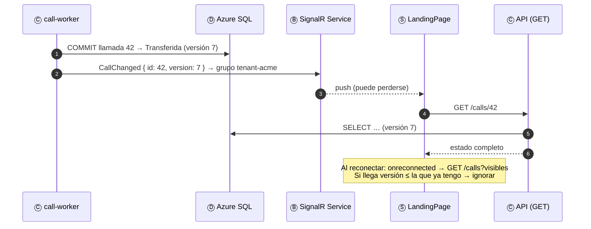
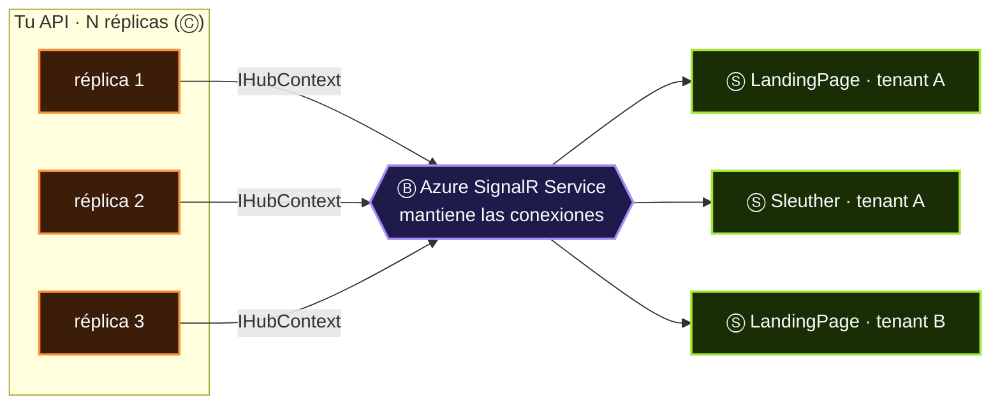

# 06 · Ⓢ Algo lo entrega a una persona

> **El destinatario de la frase.** Toda arquitectura existe para que, al final, una persona vea algo: una llamada que entra, un tablero que se mueve,
> una notificación en el teléfono. La última milla es la más frágil de todas: la conexión del usuario se corta, el móvil duerme, la pestaña se cierra.
> Por eso **avisa, pero no garantiza**: la verdad siempre se relee de Ⓓ.

## Contenido

1. [Cuatro formas de llegar a una persona](#1-cuatro-formas-de-llegar-a-una-persona)
2. [La ley de la última milla](#2-la-ley-de-la-última-milla)
3. [Notificar y releer](#3-notificar-y-releer)
4. [SignalR Service: el servicio que sustituye al backplane](#4-signalr-service-el-servicio-que-sustituye-al-backplane)
5. [Grupos, inquilinos y seguridad](#5-grupos-inquilinos-y-seguridad)
6. [Diseñar la interfaz para la consistencia eventual](#6-diseñar-la-interfaz-para-la-consistencia-eventual)
7. [Antipatrones y checklist](#7-antipatrones-y-checklist)

---

## 1. Cuatro formas de llegar a una persona

| Canal | Servicio | Cliente | Latencia | Garantía | Cuándo |
|---|---|---|---|---|---|
| **WebSocket con protocolo SignalR** | Azure SignalR Service | Navegador, Teams, .NET, JS, Java | Milisegundos | *At-most-once* | Pantallas de operación: estados de llamadas, colas, chats |
| **WebSocket nativo** | Azure Web PubSub | Cualquier cliente WebSocket | Milisegundos | *At-most-once* | Clientes no .NET/JS, juegos, IoT ligero |
| **Push del sistema operativo** | Notification Hubs (APNs, FCM, WNS) | App móvil, aunque esté cerrada | Segundos (lo decide el SO) | *Best effort* | Avisos: "tienes una llamada perdida" |
| **Tableros** | Power BI (tiempo real desde Stream Analytics o Fabric) | Navegador | Segundos | Refresco del conjunto de datos | Supervisión y analítica operativa |

> [!NOTE]
> En la matriz del atlas, SignalR y Web PubSub son **Ⓑ** en la arquitectura de tiempo real (son el canal) y **Ⓢ** en las de *streaming*, *serverless* e IoT
> (son la salida). Es la misma polisemia que con los brokers: el papel depende de si en esa frase importa más el *transporte* o la *llegada*.

---

## 2. La ley de la última milla

> **Ley 3:** Ⓢ es *at-most-once*: avisa, no garantiza. La verdad se relee de Ⓓ.

| Lo que puede pasar | Probabilidad en producción | Consecuencia si el canal fuera la verdad |
|---|---|---|
| El usuario pierde la red 3 segundos | Constante (Wi-Fi, VPN, móvil) | Se pierde el cambio y la pantalla miente |
| La pestaña estaba en segundo plano | Alta (los navegadores ralentizan los temporizadores) | Mensajes acumulados o perdidos |
| La réplica de tu API se reinicia | En cada despliegue | Las conexiones se reestablecen |
| El SO móvil retrasa la notificación | Alta | El aviso llega tarde o agrupado |

Ninguno de estos casos es raro, y ninguno se resuelve con reintentos en el canal. Se resuelve con un **diseño**.

---

## 3. Notificar y releer

El patrón central de la última milla: el mensaje *push* es **ligero** (qué cambió, no cómo quedó) y el cliente **relee** el estado por la API. Al
reconectar, relee todo lo visible.



| Regla | Por qué |
|---|---|
| El mensaje lleva **id y versión**, no el objeto | Mensajes pequeños, sin datos sensibles, y el cliente detecta duplicados o desorden |
| El cliente **descarta versiones viejas** | Los avisos pueden llegar desordenados |
| Al **reconectar**, relee todo lo visible | Lo perdido durante la desconexión se recupera de Ⓓ |
| La API de lectura es **idempotente y cacheable** | Mil clientes releyendo a la vez no deben tumbarla |

---

## 4. SignalR Service: el servicio que sustituye al backplane

Con SignalR autoalojado, cada réplica de tu API tiene sus propias conexiones: un mensaje enviado desde la réplica 1 no llega a los clientes de la
réplica 2. La solución clásica era un *backplane* (Redis). **Azure SignalR Service elimina el problema**: las conexiones viven en el servicio y
cualquier réplica puede enviar a cualquier cliente.



```csharp
// Servidor: el hub vive en tu API, las conexiones en Azure SignalR Service
builder.Services.AddSignalR().AddAzureSignalR(o =>
{
    o.Endpoints = [new ServiceEndpoint(new Uri("https://sigr-tracer-prd.service.signalr.net"), new DefaultAzureCredential())];
});
app.MapHub<CallsHub>("/callshub").RequireAuthorization();

[Authorize]
public sealed class CallsHub : Hub
{
    public override async Task OnConnectedAsync()
    {
        var tenant = Context.User!.FindFirst("tid")!.Value;          // el grupo sale del token, no del cliente
        await Groups.AddToGroupAsync(Context.ConnectionId, $"tenant-{tenant}");
        await base.OnConnectedAsync();
    }
}

// Cualquier consumidor, en cualquier réplica, avisa al grupo
public sealed class AvisosDeLlamada(IHubContext<CallsHub> hub)
{
    public Task CambioAsync(string tenant, int callId, long version, CancellationToken ct) =>
        hub.Clients.Group($"tenant-{tenant}").SendAsync("CallChanged", new { callId, version }, ct);
}
```

```typescript
// Cliente: notificar y releer, con reconexión automática
const conexion = new signalR.HubConnectionBuilder()
  .withUrl("/callshub", { accessTokenFactory: () => obtenerToken() })
  .withAutomaticReconnect()
  .build();

conexion.on("CallChanged", async ({ callId, version }) => {
  if (version <= (versiones.get(callId) ?? -1)) return;   // aviso viejo o duplicado
  pintar(await api.get(`/calls/${callId}`));               // releer la verdad
});
conexion.onreconnected(async () => pintarTodo(await api.get("/calls?visibles")));
await conexion.start();
```

| Modo de SignalR Service | Quién tiene el hub | Cuándo |
|---|---|---|
| **Default** | Tu servidor ASP.NET Core | API existente con lógica en el hub (TRACER: `/callshub`) |
| **Serverless** | Nadie: Functions publica con *bindings* y recibe por *upstream* | Arquitecturas *serverless*, sin servidor permanente |

---

## 5. Grupos, inquilinos y seguridad

| Riesgo | Mitigación |
|---|---|
| Un cliente se une al grupo de otro inquilino | El grupo se decide en el **servidor** a partir de las *claims* del token, nunca de un parámetro del cliente |
| Datos sensibles en el *push* | El aviso lleva ids; los datos se leen por la API, que vuelve a autorizar |
| Grupos demasiado amplios | Un grupo por inquilino o por cola; nunca "todos" con datos de negocio |
| Tokens de larga duración | `accessTokenFactory` renueva; SignalR Service valida con Entra ID |

---

## 6. Diseñar la interfaz para la consistencia eventual

La consistencia eventual no se arregla en el *backend*: se **diseña** en la interfaz. Algunos recursos de diseño que funcionan:

| Situación | Recurso de interfaz |
|---|---|
| El usuario pulsa "Transferir" | Estado intermedio explícito: *Transfiriendo…*, y confirmación cuando llega el aviso |
| El aviso tarda | Indicador de "actualizado hace X s" y botón de refresco |
| Se perdió la conexión | Banda "Reconectando…" y relectura completa al volver |
| Dos supervisores actúan a la vez | El segundo recibe un 409/412 con el estado nuevo y decide de nuevo |

> [!TIP]
> **Frase de entrevista:** *"La consistencia eventual se nota aquí: el LandingPage ve 'agente conectado' milisegundos después. La UI se diseña para tolerarlo:
> estados intermedios, versión en cada aviso y relectura al reconectar."*

---

## 7. Antipatrones y checklist

| Antipatrón | Consecuencia | Corrección |
|---|---|---|
| SignalR como fuente de verdad | Pantallas que mienten tras una desconexión | Notificar y releer |
| *Polling* cada segundo | Carga constante en la API y en la base | *Push* + relectura bajo demanda |
| Hub autoalojado con N réplicas sin *backplane* | Mensajes que solo llegan a algunos clientes | Azure SignalR Service |
| Push móvil para datos críticos | Avisos que llegan tarde o nunca | El push avisa; la app lee al abrirse |

- [ ] El canal *push* transporta **avisos** (id + versión), no estado completo.
- [ ] El cliente **relee** al recibir un aviso y al **reconectar**.
- [ ] Los grupos se asignan en el servidor a partir del **token**.
- [ ] La interfaz muestra **estados intermedios** y tolera la consistencia eventual.
- [ ] Hay métricas de conexiones y mensajes por segundo en SignalR Service, con alertas de cuota.

---

[← 05 · Guarda](05-guarda.md) · [Índice](../README.md) · [07 · Identidad →](07-identidad.md)
