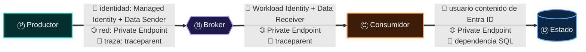
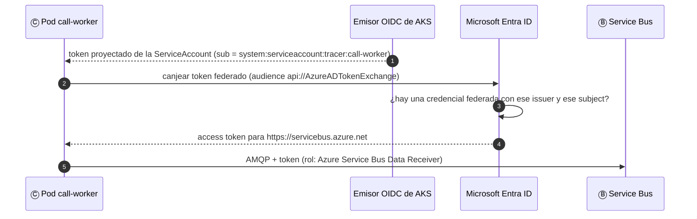
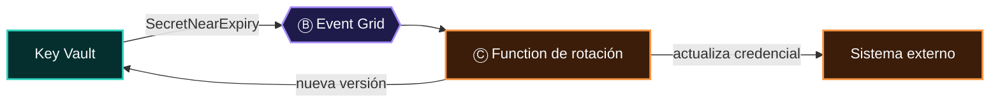

# 07 · Ⓧ Identidad: ¿quién puede?

> **La primera envoltura.** Identidad, red y observabilidad no son cajas del diagrama: son **propiedades de cada flecha**. Este capítulo trata la
> primera. Cada flecha de una frase debe responder dos preguntas: *¿quién eres?* (autenticación) y *¿qué puedes hacer?* (autorización). En Azure, en 2026,
> la respuesta correcta casi nunca incluye un secreto.

## Contenido

1. [Envolver no es añadir una capa](#1-envolver-no-es-añadir-una-capa)
2. [Autenticación, autorización y los dos planos](#2-autenticación-autorización-y-los-dos-planos)
3. [Identidades sin secretos](#3-identidades-sin-secretos)
4. [Un rol de datos por papel](#4-un-rol-de-datos-por-papel)
5. [La identidad flecha por flecha](#5-la-identidad-flecha-por-flecha)
6. [Apagar las llaves: disableLocalAuth](#6-apagar-las-llaves-disablelocalauth)
7. [Key Vault: para los secretos que quedan](#7-key-vault-para-los-secretos-que-quedan)
8. [TRACER: de AccessKey a Workload Identity](#8-tracer-de-accesskey-a-workload-identity)
9. [Checklist de identidad](#9-checklist-de-identidad)

---

## 1. Envolver no es añadir una capa

> **Ley 5 (de la envoltura):** Ⓧ no es una caja: es una propiedad de cada flecha.

El error clásico es dibujar "Seguridad" como un rectángulo al lado del diagrama. La frase lo dice mejor: identidad, red y observabilidad **envuelven
todo**. En la práctica significa que cada flecha tiene tres atributos:



| Envoltura | Pregunta por flecha | Capítulo | En el atlas (servicios Ⓧ) |
|---|---|---|---|
| 🔑 **Identidad** | ¿Quién eres y qué puedes hacer? | Este | Entra ID, Managed / Workload Identity, Key Vault, App Configuration |
| 🌐 **Red** | ¿Por qué camino viajas y quién más lo ve? | [08](08-red.md) | VNet + NSG, Private Endpoint + DNS |
| 🔭 **Observabilidad** | ¿Cómo sabré qué pasó? | [09](09-observabilidad.md) | Application Insights / Monitor, Container Registry, Azure DevOps |

---

## 2. Autenticación, autorización y los dos planos

| Concepto | Pregunta | En Azure |
|---|---|---|
| **Autenticación** | ¿Quién eres? | Microsoft Entra ID emite un *token* OAuth 2.0 / OIDC |
| **Autorización** | ¿Qué puedes hacer? | Azure RBAC: un **rol** asignado a una **identidad** sobre un **ámbito** |
| **Plano de control** | ¿Puedes *administrar* el recurso? | Crear colas, cambiar *tiers*, leer llaves (`Contributor`, `Owner`) |
| **Plano de datos** | ¿Puedes *usar* el recurso? | Enviar y recibir mensajes, leer blobs (`… Data Sender`, `… Data Reader`) |

> [!CAUTION]
> **Los dos planos se tocan a través de las llaves.** Un `Contributor` sobre un *namespace* de Service Bus no tiene roles de datos, pero puede llamar a
> `listKeys` y obtener la *connection string* con `RootManageSharedAccessKey`: acceso total a los mensajes. Mientras la autenticación local esté
> encendida, **el plano de control es una puerta trasera al plano de datos**. Por eso existe `disableLocalAuth` ([§6](#6-apagar-las-llaves-disablelocalauth)).

---

## 3. Identidades sin secretos

| Tipo | Vive con | Ideal para | Cómo obtiene el token |
|---|---|---|---|
| **Managed Identity asignada por el sistema** | El recurso (se borra con él) | Un App Service, una Function, un *system topic* de Event Grid | Endpoint IMDS / de identidad de la plataforma |
| **Managed Identity asignada por el usuario** | Su propio recurso (reutilizable) | Varias apps con los mismos permisos; identidad estable entre recreaciones | Igual, indicando el `clientId` |
| **Workload Identity (AKS)** | Una *ServiceAccount* de Kubernetes federada con una identidad de Entra | Pods de AKS | Federación OIDC: el token de la *ServiceAccount* se canjea por uno de Entra |
| **Federación de CI/CD** | Un *pipeline* de GitHub Actions o Azure DevOps | Despliegues sin secretos de *service principal* | OIDC del proveedor de CI → Entra ID |



```bash
# Workload Identity en AKS, de extremo a extremo
az aks update -g rg-tracer -n aks-tracer --enable-oidc-issuer --enable-workload-identity
EMISOR=$(az aks show -g rg-tracer -n aks-tracer --query oidcIssuerProfile.issuerUrl -o tsv)

az identity create -g rg-tracer -n id-call-worker
az identity federated-credential create -g rg-tracer --identity-name id-call-worker --name call-worker \
  --issuer "$EMISOR" --subject system:serviceaccount:tracer:call-worker --audience api://AzureADTokenExchange
```

```yaml
apiVersion: v1
kind: ServiceAccount
metadata:
  name: call-worker
  namespace: tracer
  annotations:
    azure.workload.identity/client-id: "<clientId de id-call-worker>"
---
# En el Deployment: spec.template.metadata.labels → azure.workload.identity/use: "true"
#                   spec.template.spec.serviceAccountName → call-worker
```

### `DefaultAzureCredential` en desarrollo y en producción

`DefaultAzureCredential` recorre una cadena de credenciales (variables de entorno, Workload Identity, Managed Identity, Visual Studio, Azure CLI…) y
usa la primera que funcione. Es perfecta en desarrollo: tu código usa tu `az login` en local y la identidad administrada en Azure, sin cambiar una línea.

> [!TIP]
> En producción, la recomendación actual es ser **determinista**: usar la credencial concreta (`ManagedIdentityCredential`, `WorkloadIdentityCredential`)
> o acotar la cadena con la variable `AZURE_TOKEN_CREDENTIALS`. Así un fallo de identidad no se convierte en un intento silencioso con otra credencial
> ni en segundos de latencia al arrancar.

```csharp
TokenCredential credencial = builder.Environment.IsDevelopment()
    ? new DefaultAzureCredential()
    : new ManagedIdentityCredential(ManagedIdentityId.FromUserAssignedClientId(builder.Configuration["AZURE_CLIENT_ID"]!));
```

---

## 4. Un rol de datos por papel

Cada papel de la frase necesita **un** rol de datos, de mínimo privilegio, sobre el **ámbito más estrecho** posible (la cola, no el *namespace*; el
contenedor, no la cuenta).

| Papel | Sobre | Rol integrado | Nota |
|:-:|---|---|---|
| Ⓟ | Event Grid (*custom topic*) | **EventGrid Data Sender** | El *publisher* no necesita leer nada |
| Ⓟ | Service Bus (cola o *topic*) | **Azure Service Bus Data Sender** | |
| Ⓟ | Event Hubs | **Azure Event Hubs Data Sender** | |
| Ⓟ | Storage Queue | **Storage Queue Data Message Sender** | |
| Ⓒ | Service Bus (cola o suscripción) | **Azure Service Bus Data Receiver** | Incluye *complete*, *abandon* y *dead-letter* |
| Ⓒ | Event Hubs | **Azure Event Hubs Data Receiver** | Y **Storage Blob Data Contributor** sobre el contenedor de *checkpoints* |
| Ⓒ | Storage Queue | **Storage Queue Data Message Processor** | Leer y borrar mensajes |
| Ⓓ | Blob Storage | **Storage Blob Data Contributor** / **Reader** | |
| Ⓓ | Azure SQL | Usuario contenido de Entra ID (`CREATE USER [app] FROM EXTERNAL PROVIDER`) + roles de base de datos | No es Azure RBAC: es seguridad de SQL |
| Ⓓ | Cosmos DB | Rol de datos de Cosmos DB (*Built-in Data Contributor*) | RBAC propio del plano de datos, asignado con `az cosmosdb sql role assignment` |
| Ⓢ | SignalR Service | **SignalR App Server** | Para el servidor; los clientes usan *tokens* de acceso emitidos por el servidor |
| Ⓧ | Key Vault | **Key Vault Secrets User** | Solo leer secretos, en un *vault* con modelo RBAC |
| Ⓧ | App Configuration | **App Configuration Data Reader** | |
| Ⓧ | Container Registry | **AcrPull** | `az aks update --attach-acr` lo asigna al *kubelet* |

```bicep
// El call-worker puede RECIBIR de una cola concreta, y nada más
param principalId string

resource sb 'Microsoft.ServiceBus/namespaces@2024-01-01' existing = { name: 'sb-tracer-prd' }
resource cola 'Microsoft.ServiceBus/namespaces/queues@2024-01-01' existing = { parent: sb, name: 'call-commands' }

// Azure Service Bus Data Receiver (verifica el GUID con: az role definition list --name "Azure Service Bus Data Receiver")
var dataReceiver = '4f6d3b9b-027b-4f4c-9142-0e5a2a2247e0'

resource asignacion 'Microsoft.Authorization/roleAssignments@2022-04-01' = {
  name: guid(cola.id, principalId, dataReceiver)
  scope: cola
  properties: {
    roleDefinitionId: subscriptionResourceId('Microsoft.Authorization/roleDefinitions', dataReceiver)
    principalId: principalId
    principalType: 'ServicePrincipal'
  }
}
```

---

## 5. La identidad flecha por flecha

La frase de una llamada en TRACER ([01 § 8](01-la-frase.md#8-análisis-gramatical-completo-una-llamada-en-tracer)), envuelta en identidad:

| Flecha | Quién se autentica | Mecanismo | Autorización |
|---|---|---|---|
| ACS → Event Grid | Azure (interno) | *System topic* del recurso | Lo gestiona la plataforma |
| Event Grid → webhook `/events` | Event Grid ante tu API | **Webhook protegido por Entra ID**: Event Grid obtiene un *token* para la aplicación de tu API | Tu API valida audiencia y emisor |
| Event Grid → Service Bus | El *system topic* | **Entrega con identidad administrada** | Azure Service Bus Data Sender sobre la cola |
| API → Azure SQL | La API | Managed Identity (`Authentication=Active Directory Default`) | Usuario contenido con roles mínimos |
| API → SignalR Service | La API | Managed Identity | SignalR App Server |
| LandingPage → SignalR Service | El usuario | *Token* de acceso emitido por tu API tras validar a Entra ID | Grupos asignados por *claims* |
| Pod → Service Bus | El *call-worker* | Workload Identity | Azure Service Bus Data Receiver |
| Pipeline → Azure | Azure DevOps | Federación OIDC (*workload identity federation*) | Rol de despliegue acotado al grupo de recursos |

---

## 6. Apagar las llaves: disableLocalAuth

Mientras existan llaves compartidas (*SAS*, *access keys*, *connection strings* con secreto), cualquier identidad sigue siendo opcional. El paso que
cierra la puerta es desactivar la autenticación local en cada servicio, y vigilarlo con Azure Policy.

| Servicio | Propiedad | Efecto |
|---|---|---|
| Service Bus, Event Hubs | `disableLocalAuth: true` | Solo *tokens* de Entra ID |
| Event Grid (*topics*, *domains*, *namespaces*) | `disableLocalAuth: true` | Sin llaves de acceso ni SAS |
| Storage | `allowSharedKeyAccess: false` | Sin *account keys* ni SAS firmadas con ellas |
| Cosmos DB | `disableLocalAuth: true` | Sin llaves primarias para el plano de datos |
| SignalR, Web PubSub | `disableLocalAuth: true` | Sin *access keys* |
| App Configuration | `disableLocalAuth: true` | Sin *access keys* |
| Azure SQL | Autenticación **solo Microsoft Entra** | Sin usuarios SQL con contraseña |

> [!IMPORTANT]
> Desactivar la autenticación local es un **cambio que rompe** cualquier cliente que aún use *connection strings*. El orden seguro: 1) asignar roles de datos;
> 2) cambiar los clientes a identidad; 3) observar que ninguna petición usa SAS (registros de diagnóstico); 4) desactivar.

---

## 7. Key Vault: para los secretos que quedan

Algunos secretos no desaparecen: llaves de API de terceros, certificados de clientes, credenciales de sistemas heredados. Su lugar es Key Vault, con
modelo de permisos RBAC, acceso privado y rotación.



> [!NOTE]
> Fíjate en el papel de Key Vault en este diagrama: es **Ⓟ**. En la matriz del atlas aparece como Ⓧ en seis arquitecturas y como Ⓟ en la *event-driven*.
> Lo mismo ocurre con App Configuration (`KeyValueModified`) y Container Registry (`ImagePushed`): la envoltura también habla.

| Práctica | Detalle |
|---|---|
| Referencias en lugar de valores | `@Microsoft.KeyVault(SecretUri=…)` en App Service y Functions; proveedor de secretos de Key Vault (CSI) en AKS |
| Un *vault* por aplicación y ambiente | Limita el radio de impacto y simplifica los roles |
| *Soft delete* y protección de purga | Obligatorios en producción |
| Rotación por evento | `SecretNearExpiry` → Function que rota |

---

## 8. TRACER: de AccessKey a Workload Identity

Según el atlas, **TRACER usa hoy AccessKey y *connection strings*: 0 usos de `DefaultAzureCredential`**. Entra ID está en uso (Ⓧ 🟢), Key Vault de forma
parcial (🟡) y Managed / Workload Identity forma parte de la arquitectura objetivo (🔷).

| Paso | Acción | Riesgo que elimina |
|:-:|---|---|
| 1 | Inventario de *connection strings* y llaves en `appsettings`, variables de *pipeline* y Key Vault | No saber qué hay que cambiar |
| 2 | Identidad asignada por el usuario por aplicación (`id-tracer-api`, `id-call-worker`) | Identidades atadas al ciclo de vida del recurso |
| 3 | Roles de datos por papel y por entidad ([§4](#4-un-rol-de-datos-por-papel)) | Permisos de `RootManageSharedAccessKey` |
| 4 | Clientes con `AddAzureClients` + credencial; SQL con `Authentication=Active Directory Default` | Secretos en configuración |
| 5 | Workload Identity en AKS para los *pods* | Secretos montados en Kubernetes |
| 6 | `disableLocalAuth` en cada servicio + Azure Policy | La puerta trasera del plano de control |

---

## 9. Checklist de identidad

- [ ] Ninguna flecha de la frase usa un secreto que podría ser una identidad administrada.
- [ ] Cada identidad tiene **un** rol de datos de mínimo privilegio sobre el ámbito más estrecho.
- [ ] La autenticación local está **desactivada** en cada servicio, y una política lo impide en los nuevos.
- [ ] En producción, la credencial es **determinista**.
- [ ] Los webhooks de Event Grid están protegidos con Entra ID.
- [ ] Los grupos de SignalR se asignan desde las *claims* del *token*.
- [ ] Los secretos que quedan viven en Key Vault, con RBAC, acceso privado y rotación.
- [ ] Los *pipelines* se autentican con federación OIDC, no con secretos de *service principal*.

---

[← 06 · Entrega](06-entrega.md) · [Índice](../README.md) · [08 · Red →](08-red.md)
