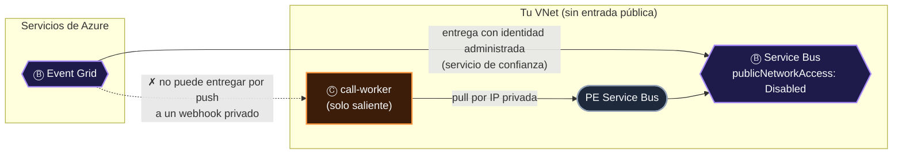
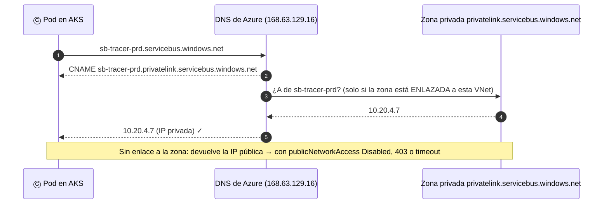
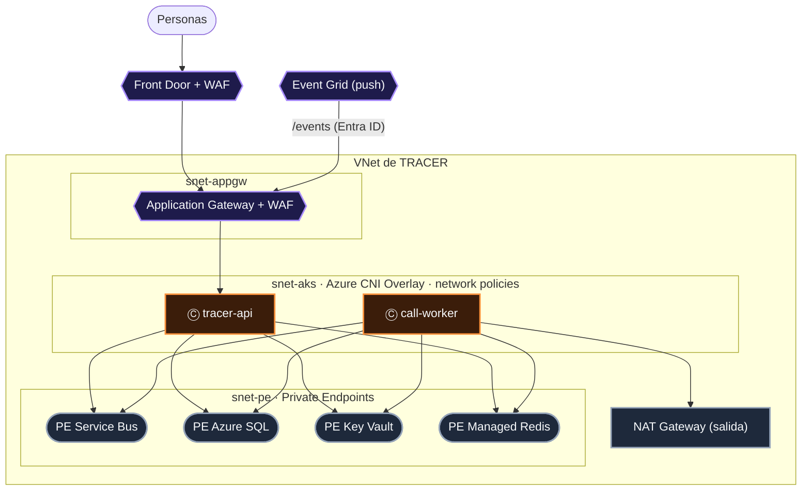

# 08 · Ⓧ Red: ¿por dónde?

> **La segunda envoltura.** Cada flecha de la frase recorre un camino físico. Ese camino se puede abrir a Internet, cerrar en una red privada o
> filtrar con un firewall de aplicaciones. Diseñar la red no es dibujar una VNet alrededor de todo: es decidir, **flecha por flecha**, quién inicia la conexión
> y por qué dirección IP resuelve el nombre.

## Contenido

1. [La red vista desde la frase](#1-la-red-vista-desde-la-frase)
2. [La red premia el pull](#2-la-red-premia-el-pull)
3. [Private Endpoint: una IP privada para un servicio público](#3-private-endpoint-una-ip-privada-para-un-servicio-público)
4. [El DNS: donde fallan casi todas las redes privadas](#4-el-dns-donde-fallan-casi-todas-las-redes-privadas)
5. [La entrada: borde global y borde regional](#5-la-entrada-borde-global-y-borde-regional)
6. [Topología de referencia](#6-topología-de-referencia)
7. [Checklist de red](#7-checklist-de-red)

---

## 1. La red vista desde la frase

| Flecha | Quién inicia la conexión | Dirección | Qué necesita la red |
|---|---|---|---|
| Ⓟ → Ⓑ (publicar) | El productor | Saliente | Ruta al *endpoint* del broker (privado o público) |
| Ⓑ → Ⓒ por **push** (Event Grid → webhook) | **El broker** | **Entrante** al consumidor | Un *endpoint* HTTPS alcanzable desde Event Grid |
| Ⓒ ← Ⓑ por **pull** (*worker* ← Service Bus) | El consumidor | Saliente | Ruta al broker; **ninguna entrada** |
| Ⓒ → Ⓓ | El consumidor | Saliente | *Private Endpoint* de la base |
| Ⓑ → Ⓢ (SignalR → navegador) | El cliente abre el WebSocket | Saliente desde el cliente | SignalR accesible por los clientes (público o por *Private Endpoint* según el escenario) |
| Persona → API | El cliente | Entrante | Front Door o Application Gateway con WAF |

---

## 2. La red premia el pull

Esta es la observación más útil del capítulo. Un consumidor *pull* solo necesita **salir**: puede vivir en una subred sin ninguna regla de entrada.
Un consumidor *push* necesita que el broker **entre**, y eso choca con una red privada.



> [!IMPORTANT]
> Event Grid entrega por **push** desde su propia infraestructura, así que no puede llamar a un webhook que solo existe dentro de tu VNet. El patrón para
> redes privadas es encadenar el verbo: **Event Grid → Service Bus (o Event Hubs, o Storage Queue) con identidad administrada**, y que el consumidor jale
> por *Private Endpoint*. Para que Event Grid pueda escribir en un Service Bus sin acceso público, habilita la excepción de **servicios de confianza
> de Microsoft** en la red del *namespace*. Es la [ley del encadenamiento](01-la-frase.md#6-las-siete-leyes-de-la-frase) puesta al servicio de la red.

---

## 3. Private Endpoint: una IP privada para un servicio público

Un *Private Endpoint* es una interfaz de red en **tu** subred con una IP privada que representa a un recurso PaaS concreto (un *namespace*, una cuenta,
un servidor). El tráfico viaja por la red troncal de Microsoft y el recurso puede cerrar su acceso público (`publicNetworkAccess: Disabled`).

| Concepto | Qué es | Error típico |
|---|---|---|
| **Private Endpoint** | NIC con IP privada que apunta a **un** recurso y **un** subrecurso (`blob`, `namespace`, `sqlServer`…) | Crear el de `blob` y olvidar el de `queue` en la misma cuenta |
| **Zona DNS privada** | `privatelink.<servicio>` enlazada a la VNet | No enlazarla a la VNet desde donde se resuelve |
| **Service Endpoint** | Ruta optimizada a un servicio desde una subred, pero el recurso sigue teniendo IP pública | Confundirlo con *Private Endpoint* |
| **NSG** | Reglas L4 por subred o NIC | Asumir que filtra el tráfico hacia *Private Endpoints* sin habilitar las políticas de red de la subred |

---

## 4. El DNS: donde fallan casi todas las redes privadas

> *"Falla casi siempre por DNS: sin la Private DNS Zone enlazada, el pod resuelve la IP pública."* (vista interactiva, Private Endpoint + DNS)

El nombre público del recurso no cambia. Lo que cambia es **a qué IP resuelve**, según desde dónde preguntes:



| Servicio | Zona DNS privada |
|---|---|
| Service Bus **y** Event Hubs | `privatelink.servicebus.windows.net` |
| Event Grid (*topics*, *domains*) | `privatelink.eventgrid.azure.net` |
| Blob · Queue | `privatelink.blob.core.windows.net` · `privatelink.queue.core.windows.net` |
| Azure SQL | `privatelink.database.windows.net` |
| Cosmos DB (NoSQL) | `privatelink.documents.azure.com` |
| PostgreSQL Flexible | `privatelink.postgres.database.azure.com` |
| Azure Managed Redis | `privatelink.redis.azure.net` |
| Key Vault | `privatelink.vaultcore.azure.net` |
| App Configuration | `privatelink.azconfig.io` |
| App Service / Functions | `privatelink.azurewebsites.net` |
| SignalR Service · Web PubSub | `privatelink.service.signalr.net` · `privatelink.webpubsub.azure.com` |
| Container Registry | `privatelink.azurecr.io` |
| API Management | `privatelink.azure-api.net` |

```bash
# Diagnóstico desde dentro de la VNet (un pod de depuración en AKS)
kubectl run dns --rm -it --image=busybox:1.36 --restart=Never -- nslookup sb-tracer-prd.servicebus.windows.net
#   ✓ Address: 10.x.x.x        → la zona privada está enlazada
#   ✗ Address: 20.x / 40.x / 52.x → resuelve la IP pública: falta el enlace de la zona, o el DNS personalizado no reenvía a 168.63.129.16
```

> [!TIP]
> Con DNS personalizado (controladores de dominio, Azure DNS Private Resolver, DNS de AKS), las consultas de `privatelink.*` deben **reenviarse** a
> `168.63.129.16`. Es la segunda causa más frecuente después de la zona sin enlazar.

---

## 5. La entrada: borde global y borde regional

En la arquitectura de microservicios del atlas, la entrada tiene tres capas, todas Ⓑ: **Front Door** (global), **Application Gateway** (regional, con WAF,
como *ingress* de AKS) y **API Management** (cuotas, JWT, versiones).

| Capa | Dónde corta | Protege de | Decide |
|---|---|---|---|
| **Front Door** + WAF | Borde global (*anycast*) | DDoS L7, bots, geografía | Región de origen, caché |
| **Application Gateway** + WAF | Dentro de tu VNet | OWASP en tráfico regional | Ruta por *path* (`/api`, `/events`) hacia AKS |
| **API Management** | Antes de tu API | Abuso por cliente | Cuotas, validación JWT, versiones |

> [!NOTE]
> En el diseño objetivo de TRACER, Application Gateway enruta `/api` y `/events` hacia AKS. La ruta `/events` es la entrada de los webhooks de Event Grid:
> la **única** flecha *push* que debe permanecer accesible desde fuera, y por eso exige autenticación con Entra ID ([07](07-identidad.md#5-la-identidad-flecha-por-flecha)).

---

## 6. Topología de referencia



| Decisión | Recomendación | Por qué |
|---|---|---|
| Subredes | Separadas para *gateway*, AKS y *Private Endpoints* | Reglas, rutas y delegaciones distintas |
| Red de AKS | Azure CNI Overlay | *kubenet* tiene retiro anunciado; Overlay no consume IPs de la VNet por *pod* |
| Tráfico este-oeste | Network policies (Cilium) | Un pod comprometido no debe alcanzar a todos |
| Salida | NAT Gateway | IPs de salida estables y sin agotamiento de SNAT |
| Acceso público de los PaaS | `Disabled`, con excepciones explícitas | Lo que no está expuesto no se ataca |

---

## 7. Checklist de red

- [ ] Sé, para cada flecha, **quién inicia** la conexión y en qué dirección.
- [ ] Los consumidores privados reciben por **pull**; el único *push* entrante está autenticado y detrás de un WAF.
- [ ] Cada PaaS tiene su *Private Endpoint* **por subrecurso** y `publicNetworkAccess: Disabled`.
- [ ] Cada zona `privatelink.*` está **enlazada** a todas las VNets que resuelven, o el DNS personalizado reenvía a `168.63.129.16`.
- [ ] Probé la resolución con `nslookup` **desde dentro** de la red.
- [ ] Las excepciones de "servicios de confianza" están documentadas (Event Grid → Service Bus).
- [ ] La salida usa NAT Gateway; el tráfico este-oeste en AKS está limitado por *network policies*.

---

[← 07 · Identidad](07-identidad.md) · [Índice](../README.md) · [09 · Observabilidad →](09-observabilidad.md)
