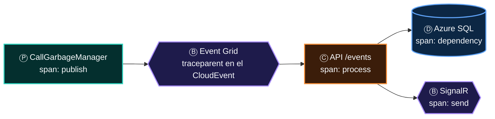

# 09 · Ⓧ Observabilidad: ¿qué pasó?

> **La tercera envoltura.** Un sistema asíncrono no se depura con un *breakpoint*: el mensaje cruzó tres servicios, dos colas y una base en procesos
> distintos, en momentos distintos. La única manera de reconstruir la frase completa es que **cada flecha deje rastro** y que los rastros compartan un
> identificador. Ese identificador tiene nombre y formato: `traceparent`.

## Contenido

1. [Tres señales, una historia](#1-tres-señales-una-historia)
2. [W3C Trace Context: el hilo que une la frase](#2-w3c-trace-context-el-hilo-que-une-la-frase)
3. [El rastro a través de cada broker](#3-el-rastro-a-través-de-cada-broker)
4. [Instrumentar en .NET con OpenTelemetry](#4-instrumentar-en-net-con-opentelemetry)
5. [KQL: leer la frase completa](#5-kql-leer-la-frase-completa)
6. [Alertas que salvan la noche](#6-alertas-que-salvan-la-noche)
7. [SLO de una frase](#7-slo-de-una-frase)
8. [Operar la envoltura: CI/CD también es observabilidad](#8-operar-la-envoltura-cicd-también-es-observabilidad)
9. [Checklist de observabilidad](#9-checklist-de-observabilidad)

---

## 1. Tres señales, una historia

| Señal | Responde | Granularidad | En Azure |
|---|---|---|---|
| **Trazas** | ¿Por dónde pasó **este** mensaje y cuánto tardó cada salto? | Por operación | Application Insights (`requests`, `dependencies`) vía OpenTelemetry |
| **Métricas** | ¿Cómo va el sistema **en conjunto**? | Agregada por tiempo | Azure Monitor Metrics (plataforma) + métricas propias |
| **Registros** | ¿Qué dijo el código en ese momento? | Por evento | Log Analytics (`traces`, `exceptions`, registros de diagnóstico) |

Application Insights / Monitor es el único servicio Ⓧ que aparece en **las 10 arquitecturas** del atlas, y en la de *streaming* también es **Ⓟ**:
sus *diagnostic settings* envían registros a Event Hubs. La envoltura también produce.

---

## 2. W3C Trace Context: el hilo que une la frase

```text
traceparent: 00-4bf92f3577b34da6a3ce929d0e0e4736-00f067aa0ba902b7-01
             │  │                                │                └─ flags (01 = muestreado)
             │  │                                └─ id del tramo padre (span id, 8 bytes)
             │  └─ id de la traza: el MISMO en toda la frase (16 bytes)
             └─ versión
```

Una frase completa es **una traza**; cada flecha es un **tramo** (*span*). En .NET, `Activity` es el tramo y `Activity.Current.Id` ya está en formato W3C.
Application Insights lo llama `operation_Id`.



> *"Propaga `traceparent` dentro del evento para ver el árbol Garbage → Event Grid → API → SQL."* (vista interactiva, App Insights / Monitor)

---

## 3. El rastro a través de cada broker

> **Ley 7 (del encadenamiento):** propaga la correlación al encadenar, o la historia se corta.

El contexto HTTP viaja solo en una cabecera. Cuando la frase cruza un broker, el contexto tiene que viajar **dentro del mensaje**.

| Broker | Dónde viaja el contexto | ¿Lo hace el SDK? | Qué debes hacer |
|---|---|---|---|
| **Service Bus** | Propiedad de aplicación `Diagnostic-Id` | Sí (`Azure.Messaging.ServiceBus`) | Habilitar las fuentes `Azure.*` en OpenTelemetry |
| **Event Hubs** | Propiedad `Diagnostic-Id` del evento | Sí (`Azure.Messaging.EventHubs`) | Igual; los procesadores por lote enlazan varios contextos (*links*) |
| **Event Grid** (CloudEvents) | Atributos de extensión `traceparent` / `tracestate` | Sí al publicar con el SDK | Leerlo en el *handler* y usarlo como padre |
| **Storage Queue** | En ningún sitio estándar | No | Inclúyelo en el cuerpo y restáuralo |
| **Outbox** | Columna `TraceParent` | No | Guardarlo al escribir y restaurarlo en el *relay* |
| **SignalR** | No se propaga al cliente | — | Registra el envío como tramo del servidor |

```csharp
// Restaurar el contexto cuando el SDK no lo hace (Outbox relay, Storage Queue, webhook de Event Grid)
static readonly ActivitySource Fuente = new("Tracer.Calls");

using var tramo = ActivityContext.TryParse(mensaje.TraceParent, null, out var padre)
    ? Fuente.StartActivity("outbox publish", ActivityKind.Producer, padre)
    : Fuente.StartActivity("outbox publish", ActivityKind.Producer);

tramo?.SetTag("messaging.system", "servicebus");
tramo?.SetTag("messaging.destination.name", "call-commands");
tramo?.SetTag("messaging.message.id", mensaje.Id);
```

---

## 4. Instrumentar en .NET con OpenTelemetry

```csharp
// Program.cs: una línea para Application Insights + tus fuentes propias
builder.Services.AddOpenTelemetry()
    .UseAzureMonitor()                                   // Azure.Monitor.OpenTelemetry.AspNetCore
    .ConfigureResource(r => r.AddService("tracer-api", serviceVersion: builder.Configuration["BUILD_VERSION"]))
    .WithTracing(t => t.AddSource("Tracer.Calls"))       // tramos propios (ActivitySource)
    .WithMetrics(m => m.AddMeter("Tracer.Calls"));       // métricas propias (Meter)
// Conexión: APPLICATIONINSIGHTS_CONNECTION_STRING (y autenticación de Entra ID para la ingesta en producción)
```

| Qué captura la distro de Azure Monitor | Sin código adicional |
|---|---|
| Peticiones entrantes de ASP.NET Core | ✅ |
| `HttpClient` saliente | ✅ |
| SQL Client (EF Core sobre Azure SQL) | ✅ |
| Clientes de Azure SDK (`Azure.*`: Service Bus, Event Hubs, Storage, Key Vault…) | ✅ (la distro habilita sus fuentes; con otro exportador, activa `Azure.Experimental.EnableActivitySource`) |
| Registros de `ILogger` correlacionados con la traza | ✅ |
| Tramos de negocio (*"transferir llamada"*) | Con tu `ActivitySource` |

> [!TIP]
> Nombra los tramos con la **gramática de la frase**: `publish` para Ⓟ, `receive`/`process` para Ⓒ, `send` para Ⓢ (son las operaciones de las
> convenciones semánticas de mensajería de OpenTelemetry). Un tablero que agrupa por papel enseña al instante dónde se rompe la frase.

---

## 5. KQL: leer la frase completa

```kusto
// La frase entera de una operación, en orden, salto a salto
union requests, dependencies, traces, exceptions
| where operation_Id == "4bf92f3577b34da6a3ce929d0e0e4736"
| project timestamp, itemType, cloud_RoleName, name, duration, success, message = coalesce(message, outerMessage)
| order by timestamp asc
```

```kusto
// ¿Qué papel falla? Tasa de error por servicio y tipo de dependencia en la última hora
dependencies
| where timestamp > ago(1h)
| summarize total = count(), fallos = countif(success == false), p95 = percentile(duration, 95) by cloud_RoleName, type, target
| extend tasa_error = round(100.0 * fallos / total, 2)
| order by tasa_error desc
```

```kusto
// Latencia de extremo a extremo: del hecho en el origen al procesamiento (customDimensions.eventTime lo registra el consumidor)
requests
| where name == "POST /events" and timestamp > ago(1d)
| extend retraso_ms = datetime_diff('millisecond', timestamp, todatetime(customDimensions.eventTime))
| summarize p50 = percentile(retraso_ms, 50), p95 = percentile(retraso_ms, 95), p99 = percentile(retraso_ms, 99) by bin(timestamp, 15m)
| render timechart
```

---

## 6. Alertas que salvan la noche

Una alerta por papel, sobre la métrica que revela que **esa parte de la frase** se rompió:

| Papel | Servicio | Métrica | Señal de problema |
|:-:|---|---|---|
| Ⓟ | Service Bus / Event Hubs | `ThrottledRequests`, `ServerErrors` | Los productores están siendo frenados |
| Ⓑ | Service Bus | `ActiveMessages` (por entidad) | La cola crece: los consumidores no dan abasto |
| Ⓑ | Service Bus | `DeadletteredMessages` | **Mensajes muertos**: alguien tiene que mirarlos |
| Ⓑ | Event Grid | `DeliveryAttemptFailCount`, `DeadLetteredCount`, `DroppedEventCount` | Entregas fallidas, eventos a Blob o perdidos |
| Ⓑ | Event Hubs | *Lag* del grupo de consumidores (calculado: último `sequenceNumber` menos *checkpoint*) | Los lectores se quedan atrás; no es una métrica estándar, se calcula (KEDA lo hace) |
| Ⓒ | Application Insights | Tasa de fallos de `requests` y duración p95 de procesamiento | El consumidor falla o se vuelve lento |
| Ⓓ | Azure SQL / Cosmos DB | CPU/DTU; peticiones con estado **429** | El almacén se satura |
| Ⓢ | SignalR Service | `ConnectionCount` frente al límite de unidades | La última milla se queda sin capacidad |

> [!CAUTION]
> **Toda DLQ necesita una alerta y un dueño.** `DeadletteredMessages > 0` durante 5 minutos es la alerta con mejor relación señal/ruido de un sistema
> basado en mensajes: cada disparo es un mensaje de negocio que nadie procesó.

---

## 7. SLO de una frase

Los SLO clásicos miden un servicio. En una arquitectura de frases, el usuario percibe **la frase entera**. Mide también eso:

| SLO | Definición | Ejemplo para TRACER |
|---|---|---|
| **Frescura** | Tiempo desde el hecho en el origen (`time` del CloudEvent) hasta que Ⓓ lo refleja | 99 % de los eventos de llamada reflejados en SQL en < 2 s |
| **Entrega a la persona** | Tiempo desde el hecho hasta el aviso en Ⓢ | 95 % de los cambios visibles en el Portal en < 3 s |
| **Completitud** | Mensajes que terminan en DLQ por cada millón | < 10 por millón |
| **Disponibilidad de la entrada** | Respuestas 2xx en `/events` | 99,95 % |

---

## 8. Operar la envoltura: CI/CD también es observabilidad

En el atlas, Container Registry y Azure DevOps son Ⓧ de la familia DevOps. Pertenecen a la envoltura porque responden la misma pregunta, *¿qué pasó?*,
pero sobre el **código**: qué versión corre, cuándo cambió y quién la aprobó.

| Práctica | Cómo |
|---|---|
| Versión en cada tramo | `service.version` en el recurso de OpenTelemetry (`BUILD_VERSION` desde el *pipeline*) |
| Anotar despliegues | Anotaciones de versión en Application Insights desde el *pipeline* |
| Despliegue como evento | `ImagePushed` de Container Registry → Event Grid (aquí ACR es **Ⓟ**) |
| Ambientes con aprobación | TRACER ya tiene `dev → qa → alpha → beta → prd` con aprobación manual en Azure DevOps |
| *Pull* de imágenes sin secretos | `az aks update --attach-acr`: el *kubelet* obtiene **AcrPull** sin `imagePullSecrets` |

---

## 9. Checklist de observabilidad

- [ ] Cada servicio exporta trazas, métricas y registros con OpenTelemetry a Application Insights.
- [ ] `traceparent` cruza **cada** broker: por el SDK o restaurado a mano (Outbox, Storage Queue).
- [ ] Puedo reconstruir la frase entera de una operación con una sola consulta KQL.
- [ ] Hay una alerta por papel, y **toda DLQ** tiene alerta y dueño.
- [ ] Mido la **frescura** y la **entrega a la persona**, no solo la disponibilidad de cada pieza.
- [ ] Cada tramo lleva la versión desplegada.
- [ ] La ingesta de telemetría también usa identidad y red privada (Azure Monitor Private Link Scope) en producción.

---

[← 08 · Red](08-red.md) · [Índice](../README.md) · [10 · Un servicio, muchos papeles →](10-un-servicio-muchos-papeles.md)
