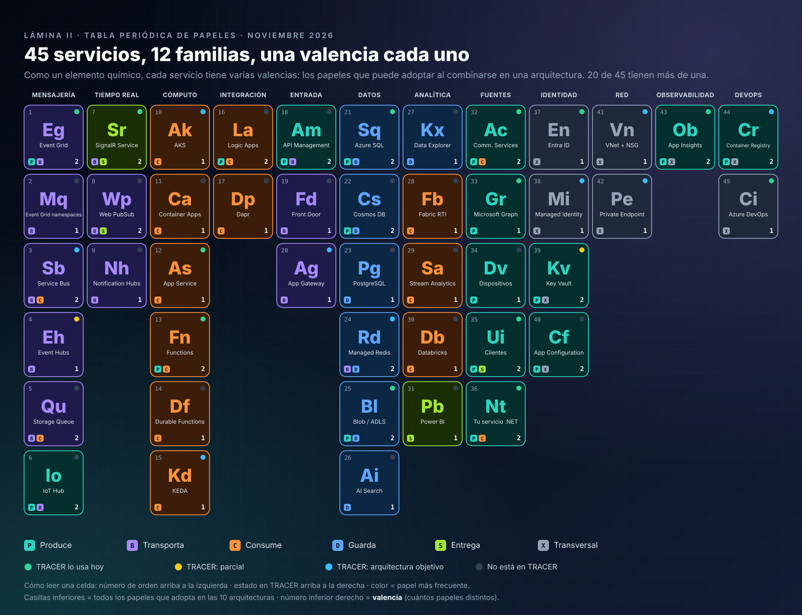
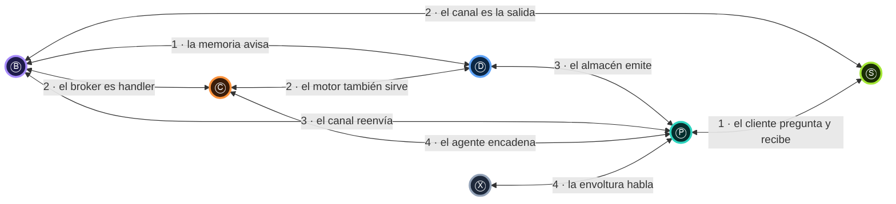
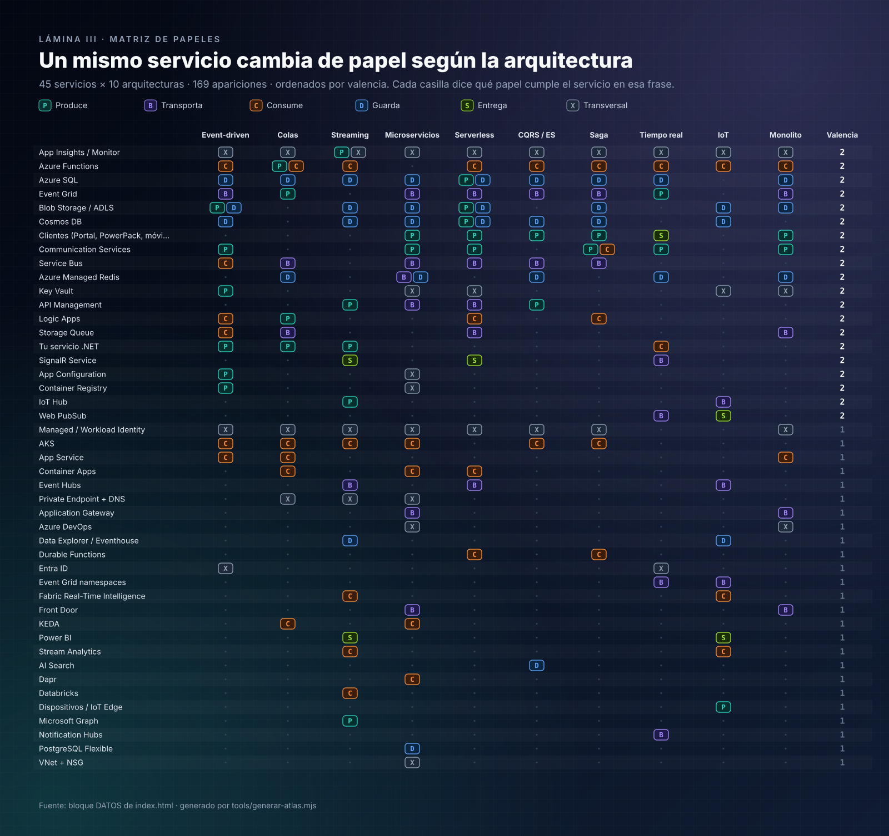

# 10 · Un servicio, muchos papeles

> *"Un mismo servicio cambia de papel según la arquitectura."*
>
> **Ley 6 (de la posición):** el papel lo da la **posición en la frase**, no el producto.

En español, *vino* es sustantivo en *"el vino tinto"* y verbo en *"vino ayer"*. Nadie pregunta qué categoría gramatical "es" la palabra *vino*: se mira
qué hace **en esa oración**. Con los servicios de Azure pasa lo mismo, y este capítulo lo **demuestra con los datos del atlas**: de los 53 servicios,
**22 adoptan más de un papel** en las 13 arquitecturas.

## Contenido

1. [La demostración: valencia de 53 servicios](#1-la-demostración-valencia-de-53-servicios)
2. [Las nueve conversiones de papel](#2-las-nueve-conversiones-de-papel)
3. [Tablas de conjugación](#3-tablas-de-conjugación)
4. [Los monosémicos: servicios de un solo papel](#4-los-monosémicos-servicios-de-un-solo-papel)
5. [Consecuencias de diseño](#5-consecuencias-de-diseño)
6. [La matriz completa](#6-la-matriz-completa)

---

## 1. La demostración: valencia de 53 servicios

En química, la **valencia** de un elemento indica de cuántas maneras puede combinarse. Aquí, la valencia de un servicio es **cuántos papeles distintos**
adopta en las 13 arquitecturas del atlas. La lámina la muestra como una tabla periódica:

  

| Valencia | Servicios | Proporción |
|:-:|:-:|:-:|
| 2 papeles | **22** | 42 % |
| 1 papel | 31 | 58 % |
| **Total** | **53** | 215 apariciones en 13 arquitecturas |

> [!IMPORTANT]
> La afirmación del enunciado no es retórica: más de **cuatro de cada diez** servicios del atlas cambian de papel. Y los que más lo hacen son justamente
> los más usados: Azure SQL (en 11 arquitecturas), Azure Functions y Blob Storage (en 10), Cosmos DB (en 9) y Event Grid (en 8).

---

## 2. Las nueve conversiones de papel

Los 22 servicios polisémicos no cambian de papel al azar. Hay **nueve conversiones**, y cada una tiene un mecanismo concreto en Azure:

| # | Conversión | Nombre | Mecanismo en Azure | Servicios |
|:-:|:-:|---|---|---|
| 1 | Ⓓ ↔ Ⓟ | **El almacén emite** | *Change feed*, Change Tracking, Outbox, `BlobCreated` | Azure SQL, Cosmos DB, Blob Storage |
| 2 | Ⓑ ↔ Ⓟ | **El canal reenvía** | Un transporte que, en otra frase, es el origen: suscripción con *handler* de cola, ruteo de IoT Hub, `log-to-eventhub` de APIM | Event Grid, IoT Hub, API Management |
| 3 | Ⓑ ↔ Ⓒ | **El broker es handler** | Una cola que **consume** de Event Grid para nivelar carga | Service Bus, Storage Queue |
| 4 | Ⓒ ↔ Ⓟ | **El agente encadena** | *Trigger* + *binding* de salida; acción *Send message*; comando REST de vuelta | Azure Functions, Logic Apps, Communication Services, tu servicio .NET |
| 5 | Ⓑ ↔ Ⓢ | **El canal es la salida** | El servicio *push* es transporte (tiempo real) o la última milla (streaming, IoT) | SignalR Service, Web PubSub |
| 6 | Ⓑ ↔ Ⓓ | **La memoria avisa** | Pub/sub efímero sobre el mismo almacén de cache | Azure Managed Redis |
| 7 | Ⓟ ↔ Ⓢ | **El cliente pregunta y recibe** | La misma pantalla envía comandos y recibe *push* | Clientes (LandingPage, PowerPack, móvil) |
| 8 | Ⓧ ↔ Ⓟ | **La envoltura habla** | Eventos de sistema: `SecretNearExpiry`, `KeyValueModified`, `ImagePushed`; *diagnostic settings* a Event Hubs | Key Vault, App Configuration, Container Registry, Application Insights / Monitor |
| 9 | Ⓒ ↔ Ⓓ | **El motor también sirve** | El mismo servicio procesa y después guarda el resultado que otros leen: *data warehouse*, registro de modelos | Synapse Analytics, Azure Machine Learning |

> [!TIP]
> La conversión **4** es la más importante en el día a día: es la [ley del encadenamiento](01-la-frase.md#6-las-siete-leyes-de-la-frase). La conversión **1**
> es la que resuelve el doble *commit*. La **8** es la que más sorprende: la envoltura, que "no es una caja", también puede iniciar frases. La **9** aparece
> con las arquitecturas de datos e IA: los motores analíticos y de *machine learning* consumen y, a la vez, son el almacén del que otros leen.

---

## 3. Tablas de conjugación

Como un verbo se conjuga en personas y tiempos, un servicio se "conjuga" en papeles. Estas tablas usan la descripción exacta que cada arquitectura da
del servicio (los datos de la vista interactiva).

### Event Grid · Ⓟ Ⓑ

| Papel | Arquitectura | Qué hace allí |
|:-:|---|---|
| Ⓑ | Event-driven reactivo | Enrutador: suscripciones por tipo y *subject* |
| Ⓑ | Microservicios · Serverless · CQRS · Monolito | Bus de hechos de integración y de eventos de recursos |
| Ⓑ | Saga | Coreografía por eventos |
| Ⓟ | Mensajería y colas | **Emisor**: una suscripción cuyo *handler* es una cola de Service Bus |
| Ⓟ | Tiempo real | **Origen del cambio**: un hecho de integración que el *backend* traduce a aviso |

### Service Bus · Ⓑ Ⓒ

| Papel | Arquitectura | Qué hace allí |
|:-:|---|---|
| Ⓑ | Mensajería y colas | Cola con **sesiones** por `CallConnectionId` |
| Ⓑ | Microservicios · Saga | Comandos entre servicios; mensajes programados como *timeouts* |
| Ⓑ | Serverless · CQRS | Trabajo confiable; comandos a otros contextos |
| Ⓒ | Event-driven reactivo | **Handler** de Event Grid: *buffer* durable y ordenado |

### Azure Functions · Ⓟ Ⓒ

| Papel | Arquitectura | Qué hace allí |
|:-:|---|---|
| Ⓒ | 10 de 13 arquitecturas | `EventGridTrigger`, `ServiceBusTrigger`, `EventHubTrigger` por lotes, `CosmosDBTrigger`, reglas de IoT, actividades de saga |
| Ⓟ | Mensajería y colas | **Emisor** por *binding* de salida |

### Blob Storage / ADLS · Ⓟ Ⓓ

| Papel | Arquitectura | Qué hace allí |
|:-:|---|---|
| Ⓓ | Streaming · Microservicios · Saga · IoT · Monolito · Big Data · IA · Híbrida | Capture y *checkpoints*, audios, historial de Durable, *cold path*, archivos, lago medallion, documentos para RAG, respaldo |
| Ⓓ | Event-driven reactivo | *Dead-letter* de Event Grid |
| Ⓟ | Event-driven reactivo · Serverless | **Fuente**: `BlobCreated` cuando se sube un archivo |

> En la arquitectura *event-driven*, Blob Storage es **Ⓟ y Ⓓ a la vez**: emite `BlobCreated` al principio de la frase y recibe el *dead-letter* de
> Event Grid al final. La misma palabra abre y cierra la oración.

### Azure SQL · Ⓟ Ⓓ

| Papel | Arquitectura | Qué hace allí |
|:-:|---|---|
| Ⓓ | 10 de 13 arquitecturas | Máquina de estados, Inbox + Outbox + saga, agregados, `WorkflowContext`, estado actual, réplica `ReadOnly` |
| Ⓟ | Serverless · Big Data | **Disparador**: Change Tracking alimenta un `SqlTrigger`; CDC hacia el lago |

### SignalR Service · Ⓑ Ⓢ

| Papel | Arquitectura | Qué hace allí |
|:-:|---|---|
| Ⓑ | Tiempo real | **Canal push** con grupos por *tenant* |
| Ⓢ | Streaming · Serverless | **Salida**: presencia en el LandingPage; *binding* de salida |

### Communication Services · Ⓟ Ⓒ

| Papel | Arquitectura | Qué hace allí |
|:-:|---|---|
| Ⓟ | Event-driven · Microservicios · Serverless · Tiempo real · Monolito · Saga | Emite los eventos de cada llamada (`IncomingCall`…) |
| Ⓒ | Saga | **Participante**: ejecuta la acción externa (*transfer*, *play*) que ordena el orquestador |

### Synapse Analytics · Ⓒ Ⓓ

| Papel | Arquitectura | Qué hace allí |
|:-:|---|---|
| Ⓒ | Big Data | **Procesa**: Spark y SQL pools transforman el lago |
| Ⓓ | Big Data | **Sirve**: el *data warehouse* que lee Power BI |

> Un solo servicio ocupa dos carriles de la **misma** frase: es la conversión *"el motor también sirve"*. Azure Machine Learning hace lo mismo en IA:
> infiere desde sus *endpoints* (Ⓒ) y guarda el registro de modelos (Ⓓ).

### Azure Managed Redis · Ⓑ Ⓓ

| Papel | Arquitectura | Qué hace allí |
|:-:|---|---|
| Ⓓ | Colas · Microservicios · CQRS · Tiempo real · Monolito | *Locks* y cache compartido, lecturas calientes, presencia |
| Ⓑ | Microservicios | **Bus interno** de avisos efímeros (invalidar cache en todas las réplicas) |

---

## 4. Los monosémicos: servicios de un solo papel

31 servicios mantienen un único papel en todo el atlas. No es casualidad: su **contrato es estrecho**.

| Servicio | Papel único | En cuántas arquitecturas | Por qué no cambia |
|---|:-:|:-:|---|
| AKS | Ⓒ | 7 | Es cómputo puro: lo que *produce* lo produce tu código, que se dibuja aparte |
| Event Hubs | Ⓑ | 4 | Es un log y nada más: ni decide ni se muestra |
| Managed / Workload Identity | Ⓧ | 10 | No emite eventos propios: solo autentica |
| Container Apps, App Service | Ⓒ | 4 cada uno | Cómputo que aloja a "alguien" |
| Durable Functions | Ⓒ | 2 | El orquestador: consume resultados y decide |
| Power BI | Ⓢ | 3 | Solo pantalla |
| Data Explorer | Ⓓ | 3 | Solo almacén analítico |

> [!NOTE]
> Monosémico **en este atlas** no significa monosémico siempre. AKS aloja productores; Event Hubs puede ser *handler* de Event Grid
> ([12 · Brokers](12-brokers-quien-escribe-quien-lee.md)). La valencia mide lo que el atlas dibuja, no un límite del producto.

---

## 5. Consecuencias de diseño

**1. No memorices "qué es" un servicio; pregunta "qué hace aquí".** En una entrevista, *"¿qué es Service Bus?"* tiene una respuesta de catálogo. *"¿Qué
hace Service Bus en este diagrama?"* tiene la respuesta que importa: puede ser el transporte de las órdenes o el consumidor que absorbe un pico de Event Grid.

**2. Los roles RBAC están nombrados por papel.** No es coincidencia: *Data **Sender*** es Ⓟ, *Data **Receiver*** es Ⓒ. Cuando un servicio cambia de
papel, **cambia el rol que necesita**. Event Grid, como Ⓟ hacia Service Bus, necesita *Azure Service Bus Data Sender* para su identidad administrada
([07 § 4](07-identidad.md#4-un-rol-de-datos-por-papel)).

**3. Las garantías dependen del papel.** Service Bus como Ⓑ ofrece FIFO por sesión y DLQ. Service Bus como Ⓒ de Event Grid **recibe** lo que Event Grid
garantiza: *at-least-once* y sin orden. La sesión solo ordena lo que entra en orden.

**4. La observabilidad se nombra por papel.** Un tramo `publish` es Ⓟ; un tramo `process` es Ⓒ. Un tablero agrupado por papel enseña dónde se rompe la
frase aunque el mismo servicio aparezca en dos sitios ([09](09-observabilidad.md#4-instrumentar-en-net-con-opentelemetry)).

**5. El papel decide la red.** Un servicio que es Ⓒ por *push* necesita entrada; el mismo servicio como Ⓒ por *pull*, solo salida ([08 § 2](08-red.md#2-la-red-premia-el-pull)).

---

## 6. La matriz completa

  

La misma matriz, en texto. Cada celda es el papel (o papeles) del servicio en esa arquitectura; `·` significa que no participa.

<!-- matriz:inicio -->
<!-- Archivo generado por tools/generar-atlas.mjs a partir de index.html. No lo edites a mano: edita index.html y ejecuta `npm run atlas`. -->

| Servicio | Event-driven | Colas | Streaming | Microservicios | Serverless | CQRS / ES | Saga | Tiempo real | IoT | Monolito | Big Data | IA / MLOps | Híbrida | Valencia |
|---|:-:|:-:|:-:|:-:|:-:|:-:|:-:|:-:|:-:|:-:|:-:|:-:|:-:|:-:|
| [App Insights / Monitor](15-catalogo-a-z.md#app-insights--monitor) | Ⓧ | Ⓧ | ⓅⓍ | Ⓧ | Ⓧ | Ⓧ | Ⓧ | Ⓧ | Ⓧ | Ⓧ | Ⓧ | Ⓧ | Ⓧ | **2** |
| [Azure SQL](15-catalogo-a-z.md#azure-sql) | Ⓓ | Ⓓ | Ⓓ | Ⓓ | ⓅⒹ | Ⓓ | Ⓓ | Ⓓ | · | Ⓓ | Ⓟ | · | Ⓓ | **2** |
| [Azure Functions](15-catalogo-a-z.md#azure-functions) | Ⓒ | ⓅⒸ | Ⓒ | · | Ⓒ | Ⓒ | Ⓒ | Ⓒ | Ⓒ | Ⓒ | · | · | Ⓒ | **2** |
| [Blob Storage / ADLS](15-catalogo-a-z.md#blob-storage--adls) | ⓅⒹ | · | Ⓓ | Ⓓ | ⓅⒹ | · | Ⓓ | · | Ⓓ | Ⓓ | Ⓓ | Ⓓ | Ⓓ | **2** |
| [Cosmos DB](15-catalogo-a-z.md#cosmos-db) | Ⓓ | · | Ⓓ | Ⓓ | ⓅⒹ | Ⓓ | Ⓓ | · | Ⓓ | · | Ⓟ | Ⓓ | · | **2** |
| [Event Grid](15-catalogo-a-z.md#event-grid) | Ⓑ | Ⓟ | · | Ⓑ | Ⓑ | Ⓑ | Ⓑ | Ⓟ | · | Ⓑ | · | · | · | **2** |
| [Clientes (LandingPage, PowerPack, móvil)](15-catalogo-a-z.md#clientes-landingpage-powerpack-móvil) | · | · | · | Ⓟ | Ⓟ | Ⓟ | Ⓟ | Ⓢ | · | Ⓟ | · | ⓅⓈ | · | **2** |
| [Key Vault](15-catalogo-a-z.md#key-vault) | Ⓟ | · | · | Ⓧ | Ⓧ | · | · | · | Ⓧ | Ⓧ | · | Ⓧ | Ⓧ | **2** |
| [Communication Services](15-catalogo-a-z.md#communication-services) | Ⓟ | · | · | Ⓟ | Ⓟ | · | ⓅⒸ | Ⓟ | · | Ⓟ | · | · | · | **2** |
| [Service Bus](15-catalogo-a-z.md#service-bus) | Ⓒ | Ⓑ | · | Ⓑ | Ⓑ | Ⓑ | Ⓑ | · | · | · | · | · | · | **2** |
| [API Management](15-catalogo-a-z.md#api-management) | · | · | Ⓟ | Ⓑ | Ⓑ | Ⓟ | · | · | · | · | · | Ⓑ | · | **2** |
| [Azure Managed Redis](15-catalogo-a-z.md#azure-managed-redis) | · | Ⓓ | · | ⒷⒹ | · | Ⓓ | · | Ⓓ | · | Ⓓ | · | · | · | **2** |
| [Tu servicio .NET](15-catalogo-a-z.md#tu-servicio-net) | Ⓟ | Ⓟ | Ⓟ | · | · | · | · | Ⓒ | · | · | · | Ⓟ | · | **2** |
| [Logic Apps](15-catalogo-a-z.md#logic-apps) | Ⓒ | Ⓟ | · | · | Ⓒ | · | Ⓒ | · | · | · | · | · | · | **2** |
| [Storage Queue](15-catalogo-a-z.md#storage-queue) | Ⓒ | Ⓑ | · | · | Ⓑ | · | · | · | · | Ⓑ | · | · | · | **2** |
| [IoT Hub](15-catalogo-a-z.md#iot-hub) | · | · | Ⓟ | · | · | · | · | · | Ⓑ | · | Ⓟ | · | · | **2** |
| [SignalR Service](15-catalogo-a-z.md#signalr-service) | · | · | Ⓢ | · | Ⓢ | · | · | Ⓑ | · | · | · | · | · | **2** |
| [App Configuration](15-catalogo-a-z.md#app-configuration) | Ⓟ | · | · | Ⓧ | · | · | · | · | · | · | · | · | · | **2** |
| [Container Registry](15-catalogo-a-z.md#container-registry) | Ⓟ | · | · | Ⓧ | · | · | · | · | · | · | · | · | · | **2** |
| [Web PubSub](15-catalogo-a-z.md#web-pubsub) | · | · | · | · | · | · | · | Ⓑ | Ⓢ | · | · | · | · | **2** |
| [Azure Machine Learning](15-catalogo-a-z.md#azure-machine-learning) | · | · | · | · | · | · | · | · | · | · | · | ⒸⒹ | · | **2** |
| [Synapse Analytics](15-catalogo-a-z.md#synapse-analytics) | · | · | · | · | · | · | · | · | · | · | ⒸⒹ | · | · | **2** |
| [Managed / Workload Identity](15-catalogo-a-z.md#managed--workload-identity) | Ⓧ | Ⓧ | Ⓧ | Ⓧ | Ⓧ | Ⓧ | Ⓧ | · | · | Ⓧ | Ⓧ | Ⓧ | · | **1** |
| [AKS](15-catalogo-a-z.md#aks) | Ⓒ | Ⓒ | Ⓒ | Ⓒ | · | Ⓒ | Ⓒ | · | · | · | · | · | Ⓒ | **1** |
| [Entra ID](15-catalogo-a-z.md#entra-id) | Ⓧ | · | · | · | · | · | · | Ⓧ | · | · | Ⓧ | Ⓧ | Ⓧ | **1** |
| [Private Endpoint + DNS](15-catalogo-a-z.md#private-endpoint--dns) | · | Ⓧ | Ⓧ | Ⓧ | · | · | · | · | · | · | Ⓧ | Ⓧ | · | **1** |
| [App Service](15-catalogo-a-z.md#app-service) | Ⓒ | Ⓒ | · | · | · | · | · | · | · | Ⓒ | · | · | Ⓒ | **1** |
| [Container Apps](15-catalogo-a-z.md#container-apps) | · | Ⓒ | · | Ⓒ | Ⓒ | · | · | · | · | · | · | Ⓒ | · | **1** |
| [Event Hubs](15-catalogo-a-z.md#event-hubs) | · | · | Ⓑ | · | Ⓑ | · | · | · | Ⓑ | · | Ⓑ | · | · | **1** |
| [Data Explorer / Eventhouse](15-catalogo-a-z.md#data-explorer--eventhouse) | · | · | Ⓓ | · | · | · | · | · | Ⓓ | · | Ⓓ | · | · | **1** |
| [Fabric Real-Time Intelligence](15-catalogo-a-z.md#fabric-real-time-intelligence) | · | · | Ⓒ | · | · | · | · | · | Ⓒ | · | Ⓒ | · | · | **1** |
| [Power BI](15-catalogo-a-z.md#power-bi) | · | · | Ⓢ | · | · | · | · | · | Ⓢ | · | Ⓢ | · | · | **1** |
| [AI Search](15-catalogo-a-z.md#ai-search) | · | · | · | · | · | Ⓓ | · | · | · | · | · | Ⓓ | · | **1** |
| [Application Gateway](15-catalogo-a-z.md#application-gateway) | · | · | · | Ⓑ | · | · | · | · | · | Ⓑ | · | · | · | **1** |
| [Azure DevOps](15-catalogo-a-z.md#azure-devops) | · | · | · | Ⓧ | · | · | · | · | · | Ⓧ | · | · | · | **1** |
| [Centro de datos local / otra nube](15-catalogo-a-z.md#centro-de-datos-local--otra-nube) | · | · | · | · | · | · | · | · | · | · | Ⓟ | · | Ⓟ | **1** |
| [Databricks](15-catalogo-a-z.md#databricks) | · | · | Ⓒ | · | · | · | · | · | · | · | Ⓒ | · | · | **1** |
| [Durable Functions](15-catalogo-a-z.md#durable-functions) | · | · | · | · | Ⓒ | · | Ⓒ | · | · | · | · | · | · | **1** |
| [Event Grid namespaces](15-catalogo-a-z.md#event-grid-namespaces) | · | · | · | · | · | · | · | Ⓑ | Ⓑ | · | · | · | · | **1** |
| [Front Door](15-catalogo-a-z.md#front-door) | · | · | · | Ⓑ | · | · | · | · | · | Ⓑ | · | · | · | **1** |
| [KEDA](15-catalogo-a-z.md#keda) | · | Ⓒ | · | Ⓒ | · | · | · | · | · | · | · | · | · | **1** |
| [Stream Analytics](15-catalogo-a-z.md#stream-analytics) | · | · | Ⓒ | · | · | · | · | · | Ⓒ | · | · | · | · | **1** |
| [VNet + NSG](15-catalogo-a-z.md#vnet--nsg) | · | · | · | Ⓧ | · | · | · | · | · | · | · | · | Ⓧ | **1** |
| [Azure Arc](15-catalogo-a-z.md#azure-arc) | · | · | · | · | · | · | · | · | · | · | · | · | Ⓧ | **1** |
| [Azure Local](15-catalogo-a-z.md#azure-local) | · | · | · | · | · | · | · | · | · | · | · | · | Ⓟ | **1** |
| [Azure OpenAI (Microsoft Foundry)](15-catalogo-a-z.md#azure-openai-microsoft-foundry) | · | · | · | · | · | · | · | · | · | · | · | Ⓒ | · | **1** |
| [Dapr](15-catalogo-a-z.md#dapr) | · | · | · | Ⓒ | · | · | · | · | · | · | · | · | · | **1** |
| [Data Factory](15-catalogo-a-z.md#data-factory) | · | · | · | · | · | · | · | · | · | · | Ⓑ | · | · | **1** |
| [Dispositivos / IoT Edge](15-catalogo-a-z.md#dispositivos--iot-edge) | · | · | · | · | · | · | · | · | Ⓟ | · | · | · | · | **1** |
| [ExpressRoute / VPN Gateway](15-catalogo-a-z.md#expressroute--vpn-gateway) | · | · | · | · | · | · | · | · | · | · | · | · | Ⓑ | **1** |
| [Microsoft Graph](15-catalogo-a-z.md#microsoft-graph) | · | · | Ⓟ | · | · | · | · | · | · | · | · | · | · | **1** |
| [Notification Hubs](15-catalogo-a-z.md#notification-hubs) | · | · | · | · | · | · | · | Ⓑ | · | · | · | · | · | **1** |
| [PostgreSQL Flexible](15-catalogo-a-z.md#postgresql-flexible) | · | · | · | Ⓓ | · | · | · | · | · | · | · | · | · | **1** |

<!-- matriz:fin -->

---

[← 09 · Observabilidad](09-observabilidad.md) · [Índice](../README.md) · [11 · Trece arquitecturas →](11-trece-arquitecturas-como-frases.md)
