<!-- Archivo generado por tools/generar-atlas.mjs a partir de index.html. No lo edites a mano: edita index.html y ejecuta `npm run atlas`. -->

# 11 · Trece arquitecturas leídas como frases

> Cada arquitectura de este capítulo se escribe con la misma gramática: **Ⓟ produce → Ⓑ transporta → Ⓒ consume → Ⓓ guarda → Ⓢ entrega**, envuelta por Ⓧ identidad, red y observabilidad. Lo que cambia de una a otra no es la gramática: son las palabras, y el papel que cada palabra cumple.

Este capítulo se genera desde los datos de [`index.html`](../index.html), la misma fuente que la vista interactiva **Arquitecturas** (`npm start`).

## Contenido

| # | Arquitectura | Cuándo | TRACER |
|---|---|---|:-:|
| 1 | [Event-driven reactivo](#1-event-driven-reactivo) | Algo pasó y varios interesados reaccionan, sin que el productor sepa quiénes son. | 🟢 |
| 2 | [Mensajería y colas](#2-mensajería-y-colas) | Hay una orden concreta ("haz esto") que no se puede perder y que un consumidor procesa a su ritmo. | 🔷 |
| 3 | [Event streaming y telemetría](#3-event-streaming-y-telemetría) | Llegan miles o millones de eventos por segundo y varios lectores los procesan en paralelo, con la opción de releer. | 🟡 |
| 4 | [Microservicios cloud-native en AKS](#4-microservicios-cloud-native-en-aks) | Varios equipos y dominios que despliegan y escalan por separado, cada uno dueño de sus datos. | 🔷 |
| 5 | [Serverless](#5-serverless) | Cargas irregulares o por evento donde pagar por ejecución y escalar a cero importa más que el control fino. | 🟡 |
| 6 | [CQRS + Event Sourcing](#6-cqrs--event-sourcing) | Lectura y escritura tienen formas y cargas distintas, o necesitas auditar cada cambio como un hecho. | 🟡 |
| 7 | [Saga y workflows distribuidos](#7-saga-y-workflows-distribuidos) | Una operación de negocio cruza varios pasos o servicios y no puede haber una transacción ACID global. | 🟢 |
| 8 | [Tiempo real hacia clientes](#8-tiempo-real-hacia-clientes) | Una persona necesita ver el cambio en segundos sin refrescar: tableros, estados, chats. | 🟢 |
| 9 | [IoT y edge](#9-iot-y-edge) | Hay dispositivos físicos que envían datos y reciben comandos. | · |
| 10 | [Monolito modular en PaaS](#10-monolito-modular-en-paas) | Un equipo, un dominio que todavía se mueve y ganas en simplicidad operativa. | 🟢 |
| 11 | [Big Data y analítica en la nube](#11-big-data-y-analítica-en-la-nube) | Hay que ingerir, transformar y consultar grandes volúmenes de datos de muchas fuentes para analítica e inteligencia de negocio. | · |
| 12 | [Inteligencia artificial y MLOps](#12-inteligencia-artificial-y-mlops) | Hay que entrenar, desplegar y operar modelos de machine learning, o construir aplicaciones de IA generativa sobre modelos fundacionales. | · |
| 13 | [Híbrida y multinube](#13-híbrida-y-multinube) | Parte de las cargas o de los datos debe quedarse en tu centro de datos o en otra nube, por latencia, regulación o inversión existente, y quieres gobernarlo todo como uno. | · |

---

## 1. Event-driven reactivo

**Cuándo:** Algo pasó y varios interesados reaccionan, sin que el productor sepa quiénes son.

<a href="../assets/arquitecturas/01-eda.svg"></a>

> **La frase:** Ⓟ *Communication Services, Blob Storage / ADLS, Key Vault…* **produce** · Ⓑ *Event Grid* **transporta** · Ⓒ *Azure Functions, App Service, AKS…* **consume** · Ⓓ *Azure SQL, Cosmos DB, Blob Storage / ADLS* **guarda**; Ⓧ *Managed / Workload Identity, Entra ID, App Insights / Monitor* **envuelven**.

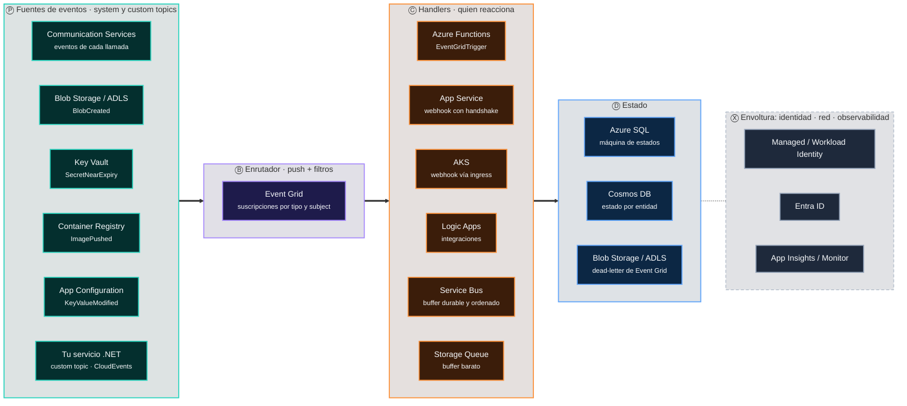

| Papel | Carril | Servicios y cómo participan |
|:-:|---|---|
| Ⓟ | **Fuentes de eventos** system y custom topics | [Communication Services](15-catalogo-a-z.md#communication-services): eventos de cada llamada · [Blob Storage / ADLS](15-catalogo-a-z.md#blob-storage--adls): BlobCreated · [Key Vault](15-catalogo-a-z.md#key-vault): SecretNearExpiry · [Container Registry](15-catalogo-a-z.md#container-registry): ImagePushed · [App Configuration](15-catalogo-a-z.md#app-configuration): KeyValueModified · [Tu servicio .NET](15-catalogo-a-z.md#tu-servicio-net): custom topic · CloudEvents |
| Ⓑ | **Enrutador** push + filtros | [Event Grid](15-catalogo-a-z.md#event-grid): suscripciones por tipo y subject |
| Ⓒ | **Handlers** quien reacciona | [Azure Functions](15-catalogo-a-z.md#azure-functions): EventGridTrigger · [App Service](15-catalogo-a-z.md#app-service): webhook con handshake · [AKS](15-catalogo-a-z.md#aks): webhook vía ingress · [Logic Apps](15-catalogo-a-z.md#logic-apps): integraciones · [Service Bus](15-catalogo-a-z.md#service-bus): buffer durable y ordenado · [Storage Queue](15-catalogo-a-z.md#storage-queue): buffer barato |
| Ⓓ | **Estado** | [Azure SQL](15-catalogo-a-z.md#azure-sql): máquina de estados · [Cosmos DB](15-catalogo-a-z.md#cosmos-db): estado por entidad · [Blob Storage / ADLS](15-catalogo-a-z.md#blob-storage--adls): dead-letter de Event Grid |
| Ⓧ | **Envoltura** | [Managed / Workload Identity](15-catalogo-a-z.md#managed--workload-identity) · [Entra ID](15-catalogo-a-z.md#entra-id) · [App Insights / Monitor](15-catalogo-a-z.md#app-insights--monitor) |

**Garantías que debes conocer**

- At-least-once: el mismo evento puede llegar dos veces
- Sin orden garantizado
- Reintentos con backoff hasta 24 h; luego dead-letter a Blob
- Eventos de hasta 1 MB

**Patrones**

- Idempotent consumer (Inbox): dedupe por event.Id en la misma transacción
- Ordenar por eventTime, no por llegada
- Claim-check: evento delgado y payload en Blob
- Event Grid → Service Bus para nivelar carga

> [!CAUTION]
> **Antipatrones:** Webhook que responde 200 antes de procesar: Event Grid no reintenta · Usar eventos para comandos que exigen orden · Payloads gordos dentro del evento.

> [!NOTE]
> **En TRACER** (🟢 TRACER lo usa hoy): Es la columna vertebral: ACS → Event Grid → EventsController y EventGridAzureFunction. CallGarbageManager publica DisconnectCall al custom topic.

**Dilo en una frase de entrevista:** *"Event Grid garantiza al menos una entrega, no exactamente una, ni orden. Cada handler es idempotente y el orden lo resuelvo con el eventTime."*

---

## 2. Mensajería y colas

**Cuándo:** Hay una orden concreta ("haz esto") que no se puede perder y que un consumidor procesa a su ritmo.

<a href="../assets/arquitecturas/02-msg.svg"></a>

> **La frase:** Ⓟ *Tu servicio .NET, Azure Functions, Event Grid…* **produce** · Ⓑ *Service Bus, Storage Queue* **transporta** · Ⓒ *AKS, KEDA, Container Apps…* **consume** · Ⓓ *Azure SQL, Azure Managed Redis* **guarda**; Ⓧ *Managed / Workload Identity, Private Endpoint + DNS, App Insights / Monitor* **envuelven**.

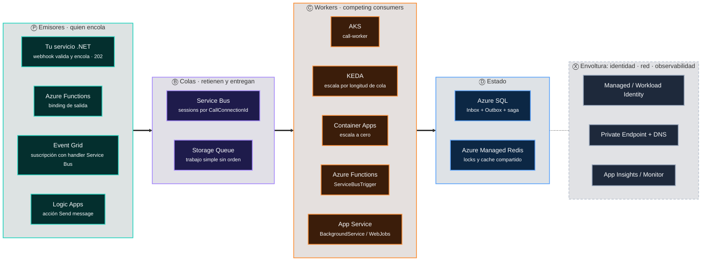

| Papel | Carril | Servicios y cómo participan |
|:-:|---|---|
| Ⓟ | **Emisores** quien encola | [Tu servicio .NET](15-catalogo-a-z.md#tu-servicio-net): webhook valida y encola · 202 · [Azure Functions](15-catalogo-a-z.md#azure-functions): binding de salida · [Event Grid](15-catalogo-a-z.md#event-grid): suscripción con handler Service Bus · [Logic Apps](15-catalogo-a-z.md#logic-apps): acción Send message |
| Ⓑ | **Colas** retienen y entregan | [Service Bus](15-catalogo-a-z.md#service-bus): sessions por CallConnectionId · [Storage Queue](15-catalogo-a-z.md#storage-queue): trabajo simple sin orden |
| Ⓒ | **Workers** competing consumers | [AKS](15-catalogo-a-z.md#aks): call-worker · [KEDA](15-catalogo-a-z.md#keda): escala por longitud de cola · [Container Apps](15-catalogo-a-z.md#container-apps): escala a cero · [Azure Functions](15-catalogo-a-z.md#azure-functions): ServiceBusTrigger · [App Service](15-catalogo-a-z.md#app-service): BackgroundService / WebJobs |
| Ⓓ | **Estado** | [Azure SQL](15-catalogo-a-z.md#azure-sql): Inbox + Outbox + saga · [Azure Managed Redis](15-catalogo-a-z.md#azure-managed-redis): locks y cache compartido |
| Ⓧ | **Envoltura** | [Managed / Workload Identity](15-catalogo-a-z.md#managed--workload-identity) · [Private Endpoint + DNS](15-catalogo-a-z.md#private-endpoint--dns) · [App Insights / Monitor](15-catalogo-a-z.md#app-insights--monitor) |

**Garantías que debes conocer**

- Peek-lock: el mensaje se bloquea mientras lo procesas
- FIFO por sesión
- Duplicate detection por MessageId
- DLQ tras MaxDeliveryCount
- Mensajes programados y transacciones

**Patrones**

- Load leveling: la cola absorbe picos
- Competing consumers
- Sesiones = afinidad por entidad sin estado en memoria
- Outbox para publicar + Inbox para consumir
- Scheduled message como timeout de un paso

> [!CAUTION]
> **Antipatrones:** Procesar más allá del lock (lock lost → duplicado) · Reintentar operaciones no idempotentes · Mandar comandos por Event Grid esperando orden.

> [!NOTE]
> **En TRACER** (🔷 TRACER: arquitectura objetivo): No existe hoy. El diseño objetivo pone Service Bus con sesiones entre el webhook /events y un call-worker con KEDA, en lugar del TaskQueuer en memoria.

**Dilo en una frase de entrevista:** *"Un webhook delgado valida, encola y responde. El trabajo pesado va a un consumidor con reintentos y DLQ, y uso sesiones para ordenar por llamada."*

---

## 3. Event streaming y telemetría

**Cuándo:** Llegan miles o millones de eventos por segundo y varios lectores los procesan en paralelo, con la opción de releer.

<a href="../assets/arquitecturas/03-stream.svg"></a>

> **La frase:** Ⓟ *Microsoft Graph, IoT Hub, Tu servicio .NET…* **produce** · Ⓑ *Event Hubs* **transporta** · Ⓒ *AKS, Azure Functions, Stream Analytics…* **consume** · Ⓓ *Blob Storage / ADLS, Data Explorer / Eventhouse, Cosmos DB…* **guarda** · Ⓢ *Power BI, SignalR Service* **entrega**; Ⓧ *Managed / Workload Identity, Private Endpoint + DNS, App Insights / Monitor* **envuelven**.

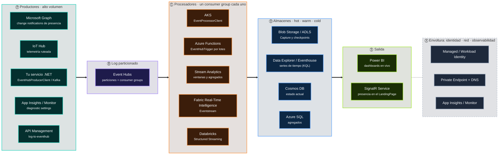

| Papel | Carril | Servicios y cómo participan |
|:-:|---|---|
| Ⓟ | **Productores** alto volumen | [Microsoft Graph](15-catalogo-a-z.md#microsoft-graph): change notifications de presencia · [IoT Hub](15-catalogo-a-z.md#iot-hub): telemetría ruteada · [Tu servicio .NET](15-catalogo-a-z.md#tu-servicio-net): EventHubProducerClient / Kafka · [App Insights / Monitor](15-catalogo-a-z.md#app-insights--monitor): diagnostic settings · [API Management](15-catalogo-a-z.md#api-management): log-to-eventhub |
| Ⓑ | **Log particionado** | [Event Hubs](15-catalogo-a-z.md#event-hubs): particiones + consumer groups |
| Ⓒ | **Procesadores** un consumer group cada uno | [AKS](15-catalogo-a-z.md#aks): EventProcessorClient · [Azure Functions](15-catalogo-a-z.md#azure-functions): EventHubTrigger por lotes · [Stream Analytics](15-catalogo-a-z.md#stream-analytics): ventanas y agregados · [Fabric Real-Time Intelligence](15-catalogo-a-z.md#fabric-real-time-intelligence): Eventstream · [Databricks](15-catalogo-a-z.md#databricks): Structured Streaming |
| Ⓓ | **Almacenes** hot · warm · cold | [Blob Storage / ADLS](15-catalogo-a-z.md#blob-storage--adls): Capture y checkpoints · [Data Explorer / Eventhouse](15-catalogo-a-z.md#data-explorer--eventhouse): series de tiempo (KQL) · [Cosmos DB](15-catalogo-a-z.md#cosmos-db): estado actual · [Azure SQL](15-catalogo-a-z.md#azure-sql): agregados |
| Ⓢ | **Salida** | [Power BI](15-catalogo-a-z.md#power-bi): dashboards en vivo · [SignalR Service](15-catalogo-a-z.md#signalr-service): presencia en el LandingPage |
| Ⓧ | **Envoltura** | [Managed / Workload Identity](15-catalogo-a-z.md#managed--workload-identity) · [Private Endpoint + DNS](15-catalogo-a-z.md#private-endpoint--dns) · [App Insights / Monitor](15-catalogo-a-z.md#app-insights--monitor) |

**Garantías que debes conocer**

- Orden solo dentro de una partición
- At-least-once: el checkpoint marca hasta dónde leíste
- Retención 1–7 días (Standard) y hasta 90 (Premium/Dedicated)
- Replay desde cualquier offset

**Patrones**

- Partition key = entidad (userId, deviceId)
- Checkpoint después de procesar, por lote
- Capture a ADLS: arquitectura Kappa
- Un consumer group por lector independiente

> [!CAUTION]
> **Antipatrones:** Usarlo como cola de trabajo: no hay DLQ ni lock por mensaje · Partition key mala que crea particiones calientes · Checkpoint por cada evento.

> [!NOTE]
> **En TRACER** (🟡 TRACER: parcial): Tres hubs configurados (SuperHandlerPresences, Presences, CallsCatcher). Graph envía presencias a Event Hubs y TRACER.Presences las consume.

**Dilo en una frase de entrevista:** *"Event Hubs es un log, no una cola: cada lector lleva su posición. Lo uso para presencias por volumen y replay; para trabajo por mensaje, Service Bus."*

---

## 4. Microservicios cloud-native en AKS

**Cuándo:** Varios equipos y dominios que despliegan y escalan por separado, cada uno dueño de sus datos.

<a href="../assets/arquitecturas/04-micro.svg"></a>

> **La frase:** Ⓟ *Clientes (LandingPage, Sleuther, móvil), Communication Services* **produce** · Ⓑ *Front Door, Application Gateway, API Management…* **transporta** · Ⓒ *AKS, KEDA, Dapr…* **consume** · Ⓓ *Azure SQL, Cosmos DB, PostgreSQL Flexible…* **guarda**; Ⓧ *Managed / Workload Identity, Key Vault, App Configuration, VNet + NSG, Private Endpoint + DNS, App Insights / Monitor, Container Registry, Azure DevOps* **envuelven**.

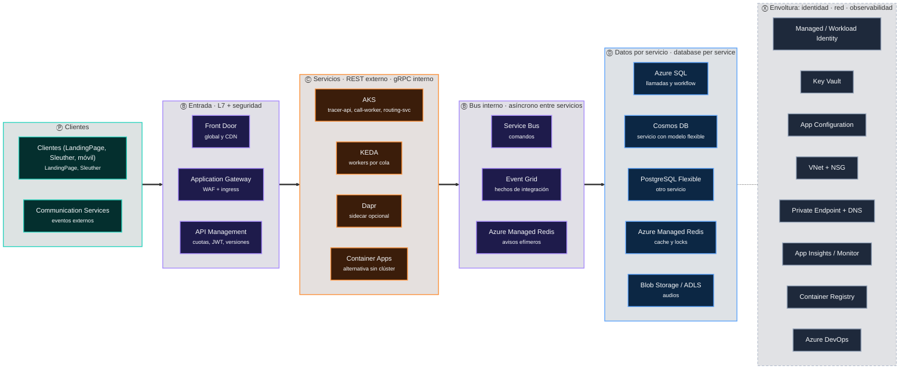

| Papel | Carril | Servicios y cómo participan |
|:-:|---|---|
| Ⓟ | **Clientes** | [Clientes (LandingPage, Sleuther, móvil)](15-catalogo-a-z.md#clientes-landingpage-sleuther-móvil): LandingPage, Sleuther · [Communication Services](15-catalogo-a-z.md#communication-services): eventos externos |
| Ⓑ | **Entrada** L7 + seguridad | [Front Door](15-catalogo-a-z.md#front-door): global y CDN · [Application Gateway](15-catalogo-a-z.md#application-gateway): WAF + ingress · [API Management](15-catalogo-a-z.md#api-management): cuotas, JWT, versiones |
| Ⓒ | **Servicios** REST externo · gRPC interno | [AKS](15-catalogo-a-z.md#aks): tracer-api, call-worker, routing-svc · [KEDA](15-catalogo-a-z.md#keda): workers por cola · [Dapr](15-catalogo-a-z.md#dapr): sidecar opcional · [Container Apps](15-catalogo-a-z.md#container-apps): alternativa sin clúster |
| Ⓑ | **Bus interno** asíncrono entre servicios | [Service Bus](15-catalogo-a-z.md#service-bus): comandos · [Event Grid](15-catalogo-a-z.md#event-grid): hechos de integración · [Azure Managed Redis](15-catalogo-a-z.md#azure-managed-redis): avisos efímeros |
| Ⓓ | **Datos por servicio** database per service | [Azure SQL](15-catalogo-a-z.md#azure-sql): llamadas y workflow · [Cosmos DB](15-catalogo-a-z.md#cosmos-db): servicio con modelo flexible · [PostgreSQL Flexible](15-catalogo-a-z.md#postgresql-flexible): otro servicio · [Azure Managed Redis](15-catalogo-a-z.md#azure-managed-redis): cache y locks · [Blob Storage / ADLS](15-catalogo-a-z.md#blob-storage--adls): audios |
| Ⓧ | **Envoltura** | [Managed / Workload Identity](15-catalogo-a-z.md#managed--workload-identity) · [Key Vault](15-catalogo-a-z.md#key-vault) · [App Configuration](15-catalogo-a-z.md#app-configuration) · [VNet + NSG](15-catalogo-a-z.md#vnet--nsg) · [Private Endpoint + DNS](15-catalogo-a-z.md#private-endpoint--dns) · [App Insights / Monitor](15-catalogo-a-z.md#app-insights--monitor) · [Container Registry](15-catalogo-a-z.md#container-registry) · [Azure DevOps](15-catalogo-a-z.md#azure-devops) |

**Garantías que debes conocer**

- Consistencia eventual entre servicios
- ACID solo dentro de un servicio
- Cada servicio escala y despliega solo

**Patrones**

- Database per service
- API Gateway / BFF
- REST hacia afuera, gRPC entre servicios (balanceo L7)
- Health probes live/ready + PDB + zonas
- Strangler fig para migrar desde el monolito
- Circuit breaker y reintentos con backoff en las llamadas síncronas

> [!CAUTION]
> **Antipatrones:** Base compartida entre servicios: monolito distribuido · Cadenas de llamadas síncronas · Estado en memoria: static SemaphoreSlim, IMemoryCache, BackgroundService duplicado.

> [!NOTE]
> **En TRACER** (🔷 TRACER: arquitectura objetivo): Es la sección 3 del documento: "TRACER en AKS" con App Gateway + WAF, Workload Identity, Private Endpoints, KEDA y routing-svc por gRPC.

**Dilo en una frase de entrevista:** *"Antes de escalar horizontalmente busco todo lo static, Singleton con estado o IMemoryCache, y lo saco a SQL, Redis o sesiones de Service Bus."*

**Equivalentes en otras nubes** (aproximados: los servicios no son idénticos uno a uno)

| Proveedor | Servicios para esta arquitectura | Fortaleza aquí | Enfoque general |
|---|---|---|---|
| **Azure** | AKS, Container Apps | Integración con las herramientas de desarrollo de Microsoft (Visual Studio, GitHub, Azure DevOps) | Adopción corporativa, gobierno de TI, identidad y entornos Microsoft |
| AWS | Amazon EKS, Amazon ECS, AWS Fargate | Contenedores sin gestionar servidores con Fargate | Mayor profundidad de catálogo, madurez en cómputo general y la comunidad más grande |
| Google Cloud | GKE (Google Kubernetes Engine) | El motor de Kubernetes más maduro: Kubernetes nació en Google | Datos masivos, IA, redes globales y contenedores |

---

## 5. Serverless

**Cuándo:** Cargas irregulares o por evento donde pagar por ejecución y escalar a cero importa más que el control fino.

<a href="../assets/arquitecturas/05-serverless.svg"></a>

> **La frase:** Ⓟ *Clientes (LandingPage, Sleuther, móvil), Blob Storage / ADLS, Cosmos DB…* **produce** · Ⓑ *Event Grid, Service Bus, Storage Queue…* **transporta** · Ⓒ *Azure Functions, Durable Functions, Logic Apps…* **consume** · Ⓓ *Cosmos DB, Azure SQL, Blob Storage / ADLS* **guarda** · Ⓢ *SignalR Service* **entrega**; Ⓧ *Managed / Workload Identity, Key Vault, App Insights / Monitor* **envuelven**.

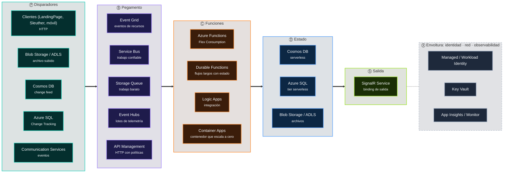

| Papel | Carril | Servicios y cómo participan |
|:-:|---|---|
| Ⓟ | **Disparadores** | [Clientes (LandingPage, Sleuther, móvil)](15-catalogo-a-z.md#clientes-landingpage-sleuther-móvil): HTTP · [Blob Storage / ADLS](15-catalogo-a-z.md#blob-storage--adls): archivo subido · [Cosmos DB](15-catalogo-a-z.md#cosmos-db): change feed · [Azure SQL](15-catalogo-a-z.md#azure-sql): Change Tracking · [Communication Services](15-catalogo-a-z.md#communication-services): eventos |
| Ⓑ | **Pegamento** | [Event Grid](15-catalogo-a-z.md#event-grid): eventos de recursos · [Service Bus](15-catalogo-a-z.md#service-bus): trabajo confiable · [Storage Queue](15-catalogo-a-z.md#storage-queue): trabajo barato · [Event Hubs](15-catalogo-a-z.md#event-hubs): lotes de telemetría · [API Management](15-catalogo-a-z.md#api-management): HTTP con políticas |
| Ⓒ | **Funciones** | [Azure Functions](15-catalogo-a-z.md#azure-functions): Flex Consumption · [Durable Functions](15-catalogo-a-z.md#durable-functions): flujos largos con estado · [Logic Apps](15-catalogo-a-z.md#logic-apps): integración · [Container Apps](15-catalogo-a-z.md#container-apps): contenedor que escala a cero |
| Ⓓ | **Estado** | [Cosmos DB](15-catalogo-a-z.md#cosmos-db): serverless · [Azure SQL](15-catalogo-a-z.md#azure-sql): tier serverless · [Blob Storage / ADLS](15-catalogo-a-z.md#blob-storage--adls): archivos |
| Ⓢ | **Salida** | [SignalR Service](15-catalogo-a-z.md#signalr-service): binding de salida |
| Ⓧ | **Envoltura** | [Managed / Workload Identity](15-catalogo-a-z.md#managed--workload-identity) · [Key Vault](15-catalogo-a-z.md#key-vault) · [App Insights / Monitor](15-catalogo-a-z.md#app-insights--monitor) |

**Garantías que debes conocer**

- Escala por evento y a cero
- Cold start en planes de consumo
- Timeout por ejecución según el plan
- Triggers con reintentos propios (poison queue, DLQ)

**Patrones**

- Trigger → función → binding de salida
- Durable para estado largo, fan-out/fan-in y timers
- Event Grid como pegamento entre recursos

> [!CAUTION]
> **Antipatrones:** Funciones encadenadas por HTTP · Procesos largos sin Durable · Crear HttpClient o clientes de SDK por invocación.

> [!NOTE]
> **En TRACER** (🟡 TRACER: parcial): EventGridAzureFunction (isolated worker) con Clean Architecture: Domain, Application, Infrastructure y el host.

**Dilo en una frase de entrevista:** *"Una Function es productor y consumidor a la vez: el trigger la alimenta y el binding de salida publica."*

**Equivalentes en otras nubes** (aproximados: los servicios no son idénticos uno a uno)

| Proveedor | Servicios para esta arquitectura | Fortaleza aquí | Enfoque general |
|---|---|---|---|
| **Azure** | Azure Functions, Logic Apps | Sinergia con aplicaciones .NET y flujos de trabajo low-code con Logic Apps | Adopción corporativa, gobierno de TI, identidad y entornos Microsoft |
| AWS | AWS Lambda, API Gateway, DynamoDB | Pionero y líder del mercado serverless | Mayor profundidad de catálogo, madurez en cómputo general y la comunidad más grande |
| Google Cloud | Cloud Run functions (antes Cloud Functions), Cloud Run | Contenedores sin servidor con escalado automático instantáneo | Datos masivos, IA, redes globales y contenedores |

---

## 6. CQRS + Event Sourcing

**Cuándo:** Lectura y escritura tienen formas y cargas distintas, o necesitas auditar cada cambio como un hecho.

<a href="../assets/arquitecturas/06-cqrs.svg"></a>

> **La frase:** Ⓟ *Clientes (LandingPage, Sleuther, móvil), API Management* **produce** · Ⓑ *Service Bus, Event Grid* **transporta** · Ⓒ *AKS, Azure Functions* **consume** · Ⓓ *Cosmos DB, Azure SQL, AI Search…* **guarda**; Ⓧ *Managed / Workload Identity, App Insights / Monitor* **envuelven**.

```mermaid
flowchart LR
    subgraph L0["Ⓟ Comandos"]
        direction LR
        L0_0["Clientes (LandingPage, Sleuther, móvil)<br/><small>LandingPage</small>"]:::P
        L0_1["API Management<br/><small>API de comandos</small>"]:::P
    end
    style L0 fill:#042F2E22,stroke:#2DD4BF,stroke-width:2px
    subgraph L1["Ⓒ Escritura · valida y decide"]
        direction LR
        L1_0["AKS<br/><small>command handlers</small>"]:::C
        L1_1["Azure Functions<br/><small>handler ligero</small>"]:::C
    end
    style L1 fill:#3B1D0A22,stroke:#FB923C,stroke-width:2px
    subgraph L2["Ⓓ Event store · append-only"]
        direction LR
        L2_0["Cosmos DB<br/><small>partition key = aggregateId</small>"]:::D
        L2_1["Azure SQL<br/><small>tabla de eventos + Outbox</small>"]:::D
    end
    style L2 fill:#0C274422,stroke:#60A5FA,stroke-width:2px
    subgraph L3["Ⓒ Proyectores · leen el feed"]
        direction LR
        L3_0["Azure Functions<br/><small>CosmosDBTrigger / SQL trigger</small>"]:::C
        L3_1["AKS<br/><small>Change Feed Processor</small>"]:::C
    end
    style L3 fill:#3B1D0A22,stroke:#FB923C,stroke-width:2px
    subgraph L4["Ⓑ Integración · hacia otros contextos"]
        direction LR
        L4_0["Service Bus<br/><small>comandos a otros contextos</small>"]:::B
        L4_1["Event Grid<br/><small>hechos de integración</small>"]:::B
    end
    style L4 fill:#1E1B4B22,stroke:#A78BFA,stroke-width:2px
    subgraph L5["Ⓓ Modelos de lectura · reconstruibles"]
        direction LR
        L5_0["Azure SQL<br/><small>réplica ReadOnly para reportes</small>"]:::D
        L5_1["Cosmos DB<br/><small>vistas desnormalizadas</small>"]:::D
        L5_2["AI Search<br/><small>búsqueda</small>"]:::D
        L5_3["Azure Managed Redis<br/><small>lecturas calientes</small>"]:::D
    end
    style L5 fill:#0C274422,stroke:#60A5FA,stroke-width:2px
    L0 ==> L1
    L1 ==> L2
    L2 ==> L3
    L3 ==> L4
    L4 ==> L5
    subgraph XX["Ⓧ Envoltura: identidad · red · observabilidad"]
        direction LR
        X0["Managed / Workload Identity"]:::X
        X1["App Insights / Monitor"]:::X
    end
    style XX fill:#1E293B22,stroke:#94A3B8,stroke-dasharray:6 4
    L5 -.- XX
    classDef P fill:#042F2E,stroke:#2DD4BF,color:#F8FAFC,stroke-width:2px
    classDef B fill:#1E1B4B,stroke:#A78BFA,color:#F8FAFC,stroke-width:2px
    classDef C fill:#3B1D0A,stroke:#FB923C,color:#F8FAFC,stroke-width:2px
    classDef D fill:#0C2744,stroke:#60A5FA,color:#F8FAFC,stroke-width:2px
    classDef S fill:#1A2E05,stroke:#A3E635,color:#F8FAFC,stroke-width:2px
    classDef X fill:#1E293B,stroke:#94A3B8,color:#F8FAFC,stroke-width:2px
```

| Papel | Carril | Servicios y cómo participan |
|:-:|---|---|
| Ⓟ | **Comandos** | [Clientes (LandingPage, Sleuther, móvil)](15-catalogo-a-z.md#clientes-landingpage-sleuther-móvil): LandingPage · [API Management](15-catalogo-a-z.md#api-management): API de comandos |
| Ⓒ | **Escritura** valida y decide | [AKS](15-catalogo-a-z.md#aks): command handlers · [Azure Functions](15-catalogo-a-z.md#azure-functions): handler ligero |
| Ⓓ | **Event store** append-only | [Cosmos DB](15-catalogo-a-z.md#cosmos-db): partition key = aggregateId · [Azure SQL](15-catalogo-a-z.md#azure-sql): tabla de eventos + Outbox |
| Ⓒ | **Proyectores** leen el feed | [Azure Functions](15-catalogo-a-z.md#azure-functions): CosmosDBTrigger / SQL trigger · [AKS](15-catalogo-a-z.md#aks): Change Feed Processor |
| Ⓑ | **Integración** hacia otros contextos | [Service Bus](15-catalogo-a-z.md#service-bus): comandos a otros contextos · [Event Grid](15-catalogo-a-z.md#event-grid): hechos de integración |
| Ⓓ | **Modelos de lectura** reconstruibles | [Azure SQL](15-catalogo-a-z.md#azure-sql): réplica ReadOnly para reportes · [Cosmos DB](15-catalogo-a-z.md#cosmos-db): vistas desnormalizadas · [AI Search](15-catalogo-a-z.md#ai-search): búsqueda · [Azure Managed Redis](15-catalogo-a-z.md#azure-managed-redis): lecturas calientes |
| Ⓧ | **Envoltura** | [Managed / Workload Identity](15-catalogo-a-z.md#managed--workload-identity) · [App Insights / Monitor](15-catalogo-a-z.md#app-insights--monitor) |

**Garantías que debes conocer**

- La lectura es eventualmente consistente
- Orden por partición lógica (aggregateId)
- Proyecciones reconstruibles con replay

**Patrones**

- Concurrencia optimista: ETag o RowVersion
- Snapshots para agregados largos
- Outbox para publicar a otros contextos
- CQRS no exige event sourcing ni MediatR

> [!CAUTION]
> **Antipatrones:** Event Hubs como event store: la retención es limitada · CQRS en todo el sistema · Validar comandos contra el modelo de lectura.

> [!NOTE]
> **En TRACER** (🟡 TRACER: parcial): Semilla: CallEventsManager (comandos) frente a CallQueriesManager (vacío); reportes con AsNoTracking y AsSplitQuery. Evolución: réplica ReadOnly para reportes.

**Dilo en una frase de entrevista:** *"CQRS es separar modelos de lectura y escritura, no una librería. Event sourcing es guardar el estado como eventos; son independientes."*

---

## 7. Saga y workflows distribuidos

**Cuándo:** Una operación de negocio cruza varios pasos o servicios y no puede haber una transacción ACID global.

<a href="../assets/arquitecturas/07-saga.svg"></a>

> **La frase:** Ⓟ *Communication Services, Clientes (LandingPage, Sleuther, móvil)* **produce** · Ⓑ *Service Bus, Event Grid* **transporta** · Ⓒ *Durable Functions, AKS, Logic Apps…* **consume** · Ⓓ *Azure SQL, Cosmos DB, Blob Storage / ADLS* **guarda**; Ⓧ *Managed / Workload Identity, App Insights / Monitor* **envuelven**.

```mermaid
flowchart LR
    subgraph L0["Ⓟ Disparador"]
        direction LR
        L0_0["Communication Services<br/><small>IncomingCall</small>"]:::P
        L0_1["Clientes (LandingPage, Sleuther, móvil)<br/><small>comando del usuario</small>"]:::P
    end
    style L0 fill:#042F2E22,stroke:#2DD4BF,stroke-width:2px
    subgraph L1["Ⓒ Orquestador · decide el siguiente paso"]
        direction LR
        L1_0["Durable Functions<br/><small>orquestación como código</small>"]:::C
        L1_1["AKS<br/><small>state machine (MassTransit)</small>"]:::C
        L1_2["Logic Apps<br/><small>integración entre sistemas</small>"]:::C
    end
    style L1 fill:#3B1D0A22,stroke:#FB923C,stroke-width:2px
    subgraph L2["Ⓑ Pasos y timeouts"]
        direction LR
        L2_0["Service Bus<br/><small>comandos + mensaje programado</small>"]:::B
        L2_1["Event Grid<br/><small>coreografía por eventos</small>"]:::B
    end
    style L2 fill:#1E1B4B22,stroke:#A78BFA,stroke-width:2px
    subgraph L3["Ⓒ Participantes · transacciones locales"]
        direction LR
        L3_0["Azure Functions<br/><small>actividad</small>"]:::C
        L3_1["AKS<br/><small>servicio</small>"]:::C
        L3_2["Communication Services<br/><small>acción externa (transfer, play)</small>"]:::C
    end
    style L3 fill:#3B1D0A22,stroke:#FB923C,stroke-width:2px
    subgraph L4["Ⓓ Estado de la saga"]
        direction LR
        L4_0["Azure SQL<br/><small>WorkflowContext</small>"]:::D
        L4_1["Cosmos DB<br/><small>estado por instancia</small>"]:::D
        L4_2["Blob Storage / ADLS<br/><small>historial de Durable</small>"]:::D
    end
    style L4 fill:#0C274422,stroke:#60A5FA,stroke-width:2px
    L0 ==> L1
    L1 ==> L2
    L2 ==> L3
    L3 ==> L4
    subgraph XX["Ⓧ Envoltura: identidad · red · observabilidad"]
        direction LR
        X0["Managed / Workload Identity"]:::X
        X1["App Insights / Monitor"]:::X
    end
    style XX fill:#1E293B22,stroke:#94A3B8,stroke-dasharray:6 4
    L4 -.- XX
    classDef P fill:#042F2E,stroke:#2DD4BF,color:#F8FAFC,stroke-width:2px
    classDef B fill:#1E1B4B,stroke:#A78BFA,color:#F8FAFC,stroke-width:2px
    classDef C fill:#3B1D0A,stroke:#FB923C,color:#F8FAFC,stroke-width:2px
    classDef D fill:#0C2744,stroke:#60A5FA,color:#F8FAFC,stroke-width:2px
    classDef S fill:#1A2E05,stroke:#A3E635,color:#F8FAFC,stroke-width:2px
    classDef X fill:#1E293B,stroke:#94A3B8,color:#F8FAFC,stroke-width:2px
```

| Papel | Carril | Servicios y cómo participan |
|:-:|---|---|
| Ⓟ | **Disparador** | [Communication Services](15-catalogo-a-z.md#communication-services): IncomingCall · [Clientes (LandingPage, Sleuther, móvil)](15-catalogo-a-z.md#clientes-landingpage-sleuther-móvil): comando del usuario |
| Ⓒ | **Orquestador** decide el siguiente paso | [Durable Functions](15-catalogo-a-z.md#durable-functions): orquestación como código · [AKS](15-catalogo-a-z.md#aks): state machine (MassTransit) · [Logic Apps](15-catalogo-a-z.md#logic-apps): integración entre sistemas |
| Ⓑ | **Pasos y timeouts** | [Service Bus](15-catalogo-a-z.md#service-bus): comandos + mensaje programado · [Event Grid](15-catalogo-a-z.md#event-grid): coreografía por eventos |
| Ⓒ | **Participantes** transacciones locales | [Azure Functions](15-catalogo-a-z.md#azure-functions): actividad · [AKS](15-catalogo-a-z.md#aks): servicio · [Communication Services](15-catalogo-a-z.md#communication-services): acción externa (transfer, play) |
| Ⓓ | **Estado de la saga** | [Azure SQL](15-catalogo-a-z.md#azure-sql): WorkflowContext · [Cosmos DB](15-catalogo-a-z.md#cosmos-db): estado por instancia · [Blob Storage / ADLS](15-catalogo-a-z.md#blob-storage--adls): historial de Durable |
| Ⓧ | **Envoltura** | [Managed / Workload Identity](15-catalogo-a-z.md#managed--workload-identity) · [App Insights / Monitor](15-catalogo-a-z.md#app-insights--monitor) |

**Garantías que debes conocer**

- Sin 2PC: consistencia eventual con compensaciones
- Cada paso es local e idempotente
- Timeouts explícitos

**Patrones**

- Orquestación (un cerebro) frente a coreografía (cada quien reacciona)
- Compensating transaction
- Semantic lock: reservar antes de confirmar
- Barrendero de sagas atascadas

> [!CAUTION]
> **Antipatrones:** 2PC o DTC en la nube · Compensaciones no idempotentes · Coreografía sin tracing: nadie ve el flujo completo.

> [!NOTE]
> **En TRACER** (🟢 TRACER lo usa hoy): WorkflowManager es el orquestador; WorkflowContext es el estado; OnTransferFailedAction y CancelInvitationAction son compensaciones; CallGarbageManager es el barrendero.

**Dilo en una frase de entrevista:** *"Transferir a un agente es una saga: reservo, invito y espero. Si falla o vence el timer, compenso: libero, cancelo y regreso la llamada a la cola."*

---

## 8. Tiempo real hacia clientes

**Cuándo:** Una persona necesita ver el cambio en segundos sin refrescar: tableros, estados, chats.

<a href="../assets/arquitecturas/08-realtime.svg"></a>

> **La frase:** Ⓟ *Communication Services, Event Grid* **produce** · Ⓑ *SignalR Service, Web PubSub, Notification Hubs…* **transporta** · Ⓒ *Tu servicio .NET, Azure Functions* **consume** · Ⓓ *Azure SQL, Azure Managed Redis* **guarda** · Ⓢ *Clientes (LandingPage, Sleuther, móvil)* **entrega**; Ⓧ *Entra ID, App Insights / Monitor* **envuelven**.

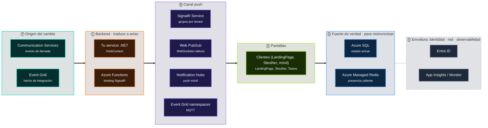

| Papel | Carril | Servicios y cómo participan |
|:-:|---|---|
| Ⓟ | **Origen del cambio** | [Communication Services](15-catalogo-a-z.md#communication-services): evento de llamada · [Event Grid](15-catalogo-a-z.md#event-grid): hecho de integración |
| Ⓒ | **Backend** traduce a aviso | [Tu servicio .NET](15-catalogo-a-z.md#tu-servicio-net): IHubContext · [Azure Functions](15-catalogo-a-z.md#azure-functions): binding SignalR |
| Ⓑ | **Canal push** | [SignalR Service](15-catalogo-a-z.md#signalr-service): grupos por tenant · [Web PubSub](15-catalogo-a-z.md#web-pubsub): WebSockets nativos · [Notification Hubs](15-catalogo-a-z.md#notification-hubs): push móvil · [Event Grid namespaces](15-catalogo-a-z.md#event-grid-namespaces): MQTT |
| Ⓢ | **Pantallas** | [Clientes (LandingPage, Sleuther, móvil)](15-catalogo-a-z.md#clientes-landingpage-sleuther-móvil): LandingPage, Sleuther, Teams |
| Ⓓ | **Fuente de verdad** para resincronizar | [Azure SQL](15-catalogo-a-z.md#azure-sql): estado actual · [Azure Managed Redis](15-catalogo-a-z.md#azure-managed-redis): presencia caliente |
| Ⓧ | **Envoltura** | [Entra ID](15-catalogo-a-z.md#entra-id) · [App Insights / Monitor](15-catalogo-a-z.md#app-insights--monitor) |

**Garantías que debes conocer**

- At-most-once hacia el cliente
- Sin persistencia
- Al reconectar, el cliente relee por API

**Patrones**

- Notificar y releer: aviso ligero + GET
- Grupos por tenant o cola
- Modo serverless con Functions
- El servicio gestionado sustituye al backplane

> [!CAUTION]
> **Antipatrones:** Usar SignalR como fuente de verdad · Grupos amplios con datos sensibles · Polling cada segundo.

> [!NOTE]
> **En TRACER** (🟢 TRACER lo usa hoy): Hub /callshub y avisos como ConfigurationChanged hacia el LandingPage y Sleuther. Es la última milla de ACS → Event Grid → API → SQL → SignalR.

**Dilo en una frase de entrevista:** *"La consistencia eventual se nota aquí: el LandingPage ve "agente conectado" milisegundos después. La UI se diseña para tolerarlo."*

---

## 9. IoT y edge

**Cuándo:** Hay dispositivos físicos que envían datos y reciben comandos.

<a href="../assets/arquitecturas/09-iot.svg"></a>

> **La frase:** Ⓟ *Dispositivos / IoT Edge* **produce** · Ⓑ *IoT Hub, Event Grid namespaces, Event Hubs* **transporta** · Ⓒ *Stream Analytics, Azure Functions, Fabric Real-Time Intelligence* **consume** · Ⓓ *Data Explorer / Eventhouse, Blob Storage / ADLS, Cosmos DB* **guarda** · Ⓢ *Power BI, Web PubSub* **entrega**; Ⓧ *Key Vault, App Insights / Monitor* **envuelven**.

```mermaid
flowchart LR
    subgraph L0["Ⓟ Dispositivos"]
        direction LR
        L0_0["Dispositivos / IoT Edge<br/><small>MQTT / AMQP / HTTPS</small>"]:::P
    end
    style L0 fill:#042F2E22,stroke:#2DD4BF,stroke-width:2px
    subgraph L1["Ⓑ Gateway"]
        direction LR
        L1_0["IoT Hub<br/><small>identidad, twins, ruteo</small>"]:::B
        L1_1["Event Grid namespaces<br/><small>broker MQTT</small>"]:::B
        L1_2["Event Hubs<br/><small>destino del ruteo</small>"]:::B
    end
    style L1 fill:#1E1B4B22,stroke:#A78BFA,stroke-width:2px
    subgraph L2["Ⓒ Procesamiento"]
        direction LR
        L2_0["Stream Analytics<br/><small>hot path con ventanas</small>"]:::C
        L2_1["Azure Functions<br/><small>reglas</small>"]:::C
        L2_2["Fabric Real-Time Intelligence<br/><small>Eventstream + Activator</small>"]:::C
    end
    style L2 fill:#3B1D0A22,stroke:#FB923C,stroke-width:2px
    subgraph L3["Ⓓ Almacenes"]
        direction LR
        L3_0["Data Explorer / Eventhouse<br/><small>warm path</small>"]:::D
        L3_1["Blob Storage / ADLS<br/><small>cold path</small>"]:::D
        L3_2["Cosmos DB<br/><small>último estado</small>"]:::D
    end
    style L3 fill:#0C274422,stroke:#60A5FA,stroke-width:2px
    subgraph L4["Ⓢ Salida"]
        direction LR
        L4_0["Power BI<br/><small>tableros</small>"]:::S
        L4_1["Web PubSub<br/><small>apps en vivo</small>"]:::S
    end
    style L4 fill:#1A2E0522,stroke:#A3E635,stroke-width:2px
    L0 ==> L1
    L1 ==> L2
    L2 ==> L3
    L3 ==> L4
    subgraph XX["Ⓧ Envoltura: identidad · red · observabilidad"]
        direction LR
        X0["Key Vault"]:::X
        X1["App Insights / Monitor"]:::X
    end
    style XX fill:#1E293B22,stroke:#94A3B8,stroke-dasharray:6 4
    L4 -.- XX
    classDef P fill:#042F2E,stroke:#2DD4BF,color:#F8FAFC,stroke-width:2px
    classDef B fill:#1E1B4B,stroke:#A78BFA,color:#F8FAFC,stroke-width:2px
    classDef C fill:#3B1D0A,stroke:#FB923C,color:#F8FAFC,stroke-width:2px
    classDef D fill:#0C2744,stroke:#60A5FA,color:#F8FAFC,stroke-width:2px
    classDef S fill:#1A2E05,stroke:#A3E635,color:#F8FAFC,stroke-width:2px
    classDef X fill:#1E293B,stroke:#94A3B8,color:#F8FAFC,stroke-width:2px
```

| Papel | Carril | Servicios y cómo participan |
|:-:|---|---|
| Ⓟ | **Dispositivos** | [Dispositivos / IoT Edge](15-catalogo-a-z.md#dispositivos--iot-edge): MQTT / AMQP / HTTPS |
| Ⓑ | **Gateway** | [IoT Hub](15-catalogo-a-z.md#iot-hub): identidad, twins, ruteo · [Event Grid namespaces](15-catalogo-a-z.md#event-grid-namespaces): broker MQTT · [Event Hubs](15-catalogo-a-z.md#event-hubs): destino del ruteo |
| Ⓒ | **Procesamiento** | [Stream Analytics](15-catalogo-a-z.md#stream-analytics): hot path con ventanas · [Azure Functions](15-catalogo-a-z.md#azure-functions): reglas · [Fabric Real-Time Intelligence](15-catalogo-a-z.md#fabric-real-time-intelligence): Eventstream + Activator |
| Ⓓ | **Almacenes** | [Data Explorer / Eventhouse](15-catalogo-a-z.md#data-explorer--eventhouse): warm path · [Blob Storage / ADLS](15-catalogo-a-z.md#blob-storage--adls): cold path · [Cosmos DB](15-catalogo-a-z.md#cosmos-db): último estado |
| Ⓢ | **Salida** | [Power BI](15-catalogo-a-z.md#power-bi): tableros · [Web PubSub](15-catalogo-a-z.md#web-pubsub): apps en vivo |
| Ⓧ | **Envoltura** | [Key Vault](15-catalogo-a-z.md#key-vault) · [App Insights / Monitor](15-catalogo-a-z.md#app-insights--monitor) |

**Garantías que debes conocer**

- D2C at-least-once
- MQTT QoS 0 / 1
- Comandos C2D y direct methods

**Patrones**

- Hot / warm / cold path
- Ruteo por propiedades del mensaje
- Identidad X.509 por dispositivo
- Procesar en el borde (IoT Edge)

> [!CAUTION]
> **Antipatrones:** Una SAS compartida para todos los dispositivos · Telemetría masiva por Service Bus.

> [!NOTE]
> **En TRACER** (· No está en TRACER): No aplica. Sirve como contraste: si preguntan por MQTT, la respuesta es IoT Hub o Event Grid namespaces.

**Dilo en una frase de entrevista:** *"IoT Hub es Event Hubs más gestión de dispositivos. Si solo necesito pub/sub MQTT, uso Event Grid namespaces."*

---

## 10. Monolito modular en PaaS

**Cuándo:** Un equipo, un dominio que todavía se mueve y ganas en simplicidad operativa.

<a href="../assets/arquitecturas/10-monolith.svg"></a>

> **La frase:** Ⓟ *Clientes (LandingPage, Sleuther, móvil), Communication Services* **produce** · Ⓑ *Front Door, Application Gateway, Storage Queue…* **transporta** · Ⓒ *App Service, Azure Functions* **consume** · Ⓓ *Azure SQL, Azure Managed Redis, Blob Storage / ADLS* **guarda**; Ⓧ *Key Vault, Managed / Workload Identity, App Insights / Monitor, Azure DevOps* **envuelven**.

```mermaid
flowchart LR
    subgraph L0["Ⓟ Clientes"]
        direction LR
        L0_0["Clientes (LandingPage, Sleuther, móvil)<br/><small>LandingPage, Sleuther</small>"]:::P
        L0_1["Communication Services<br/><small>webhook de eventos</small>"]:::P
    end
    style L0 fill:#042F2E22,stroke:#2DD4BF,stroke-width:2px
    subgraph L1["Ⓑ Entrada"]
        direction LR
        L1_0["Front Door<br/><small>opcional</small>"]:::B
        L1_1["Application Gateway<br/><small>WAF regional</small>"]:::B
    end
    style L1 fill:#1E1B4B22,stroke:#A78BFA,stroke-width:2px
    subgraph L2["Ⓒ Aplicación · módulos por contexto"]
        direction LR
        L2_0["App Service<br/><small>API + BackgroundService</small>"]:::C
        L2_1["Azure Functions<br/><small>tareas sueltas</small>"]:::C
    end
    style L2 fill:#3B1D0A22,stroke:#FB923C,stroke-width:2px
    subgraph L3["Ⓑ Asíncrono"]
        direction LR
        L3_0["Storage Queue<br/><small>trabajo diferido</small>"]:::B
        L3_1["Event Grid<br/><small>eventos de integración</small>"]:::B
    end
    style L3 fill:#1E1B4B22,stroke:#A78BFA,stroke-width:2px
    subgraph L4["Ⓓ Datos"]
        direction LR
        L4_0["Azure SQL<br/><small>una base, esquemas por módulo</small>"]:::D
        L4_1["Azure Managed Redis<br/><small>cache</small>"]:::D
        L4_2["Blob Storage / ADLS<br/><small>archivos</small>"]:::D
    end
    style L4 fill:#0C274422,stroke:#60A5FA,stroke-width:2px
    L0 ==> L1
    L1 ==> L2
    L2 ==> L3
    L3 ==> L4
    subgraph XX["Ⓧ Envoltura: identidad · red · observabilidad"]
        direction LR
        X0["Key Vault"]:::X
        X1["Managed / Workload Identity"]:::X
        X2["App Insights / Monitor"]:::X
        X3["Azure DevOps"]:::X
    end
    style XX fill:#1E293B22,stroke:#94A3B8,stroke-dasharray:6 4
    L4 -.- XX
    classDef P fill:#042F2E,stroke:#2DD4BF,color:#F8FAFC,stroke-width:2px
    classDef B fill:#1E1B4B,stroke:#A78BFA,color:#F8FAFC,stroke-width:2px
    classDef C fill:#3B1D0A,stroke:#FB923C,color:#F8FAFC,stroke-width:2px
    classDef D fill:#0C2744,stroke:#60A5FA,color:#F8FAFC,stroke-width:2px
    classDef S fill:#1A2E05,stroke:#A3E635,color:#F8FAFC,stroke-width:2px
    classDef X fill:#1E293B,stroke:#94A3B8,color:#F8FAFC,stroke-width:2px
```

| Papel | Carril | Servicios y cómo participan |
|:-:|---|---|
| Ⓟ | **Clientes** | [Clientes (LandingPage, Sleuther, móvil)](15-catalogo-a-z.md#clientes-landingpage-sleuther-móvil): LandingPage, Sleuther · [Communication Services](15-catalogo-a-z.md#communication-services): webhook de eventos |
| Ⓑ | **Entrada** | [Front Door](15-catalogo-a-z.md#front-door): opcional · [Application Gateway](15-catalogo-a-z.md#application-gateway): WAF regional |
| Ⓒ | **Aplicación** módulos por contexto | [App Service](15-catalogo-a-z.md#app-service): API + BackgroundService · [Azure Functions](15-catalogo-a-z.md#azure-functions): tareas sueltas |
| Ⓑ | **Asíncrono** | [Storage Queue](15-catalogo-a-z.md#storage-queue): trabajo diferido · [Event Grid](15-catalogo-a-z.md#event-grid): eventos de integración |
| Ⓓ | **Datos** | [Azure SQL](15-catalogo-a-z.md#azure-sql): una base, esquemas por módulo · [Azure Managed Redis](15-catalogo-a-z.md#azure-managed-redis): cache · [Blob Storage / ADLS](15-catalogo-a-z.md#blob-storage--adls): archivos |
| Ⓧ | **Envoltura** | [Key Vault](15-catalogo-a-z.md#key-vault) · [Managed / Workload Identity](15-catalogo-a-z.md#managed--workload-identity) · [App Insights / Monitor](15-catalogo-a-z.md#app-insights--monitor) · [Azure DevOps](15-catalogo-a-z.md#azure-devops) |

**Garantías que debes conocer**

- ACID local dentro del proceso
- Eventos de dominio in-process
- Un despliegue, varios módulos

**Patrones**

- Módulos por bounded context
- Eventos de dominio in-process (MediatR o propio)
- Deployment slots para cero downtime
- Escalar out con el estado fuera del proceso

> [!CAUTION]
> **Antipatrones:** Módulos que comparten tablas · IMemoryCache con varias instancias · BackgroundService duplicado por instancia.

> [!NOTE]
> **En TRACER** (🟢 TRACER lo usa hoy): Así se despliega hoy: App Service (appType webApp), varios servicios y paquetes NuGet compartidos.

**Dilo en una frase de entrevista:** *"TRACER es más un monolito modular que microservicios. Es una decisión válida mientras el estado viva fuera del proceso."*

---

## 11. Big Data y analítica en la nube

**Cuándo:** Hay que ingerir, transformar y consultar grandes volúmenes de datos de muchas fuentes para analítica e inteligencia de negocio.

<a href="../assets/arquitecturas/11-bigdata.svg"></a>

> **La frase:** Ⓟ *Azure SQL, Cosmos DB, Centro de datos local / otra nube…* **produce** · Ⓑ *Data Factory, Event Hubs* **transporta** · Ⓒ *Databricks, Synapse Analytics, Fabric Real-Time Intelligence* **consume** · Ⓓ *Blob Storage / ADLS, Synapse Analytics, Data Explorer / Eventhouse* **guarda** · Ⓢ *Power BI* **entrega**; Ⓧ *Managed / Workload Identity, Entra ID, Private Endpoint + DNS, App Insights / Monitor* **envuelven**.

```mermaid
flowchart LR
    subgraph L0["Ⓟ Fuentes · operacionales y externas"]
        direction LR
        L0_0["Azure SQL<br/><small>CDC o exportación</small>"]:::P
        L0_1["Cosmos DB<br/><small>Fabric mirroring</small>"]:::P
        L0_2["Centro de datos local / otra nube<br/><small>sistemas locales</small>"]:::P
        L0_3["IoT Hub<br/><small>telemetría</small>"]:::P
    end
    style L0 fill:#042F2E22,stroke:#2DD4BF,stroke-width:2px
    subgraph L1["Ⓑ Ingesta · lotes y streaming"]
        direction LR
        L1_0["Data Factory<br/><small>copia y orquestación de lotes</small>"]:::B
        L1_1["Event Hubs<br/><small>streaming con Capture</small>"]:::B
    end
    style L1 fill:#1E1B4B22,stroke:#A78BFA,stroke-width:2px
    subgraph L2["Ⓓ Data lake · bronce · plata · oro"]
        direction LR
        L2_0["Blob Storage / ADLS<br/><small>ADLS Gen2: arquitectura medallion</small>"]:::D
    end
    style L2 fill:#0C274422,stroke:#60A5FA,stroke-width:2px
    subgraph L3["Ⓒ Procesamiento · ETL / ELT"]
        direction LR
        L3_0["Databricks<br/><small>Spark y Delta Lake</small>"]:::C
        L3_1["Synapse Analytics<br/><small>Spark y SQL pools</small>"]:::C
        L3_2["Fabric Real-Time Intelligence<br/><small>alternativa SaaS unificada</small>"]:::C
    end
    style L3 fill:#3B1D0A22,stroke:#FB923C,stroke-width:2px
    subgraph L4["Ⓓ Servir · modelo analítico"]
        direction LR
        L4_0["Synapse Analytics<br/><small>data warehouse</small>"]:::D
        L4_1["Data Explorer / Eventhouse<br/><small>series de tiempo (KQL)</small>"]:::D
    end
    style L4 fill:#0C274422,stroke:#60A5FA,stroke-width:2px
    subgraph L5["Ⓢ Consumo"]
        direction LR
        L5_0["Power BI<br/><small>reportes y modelos semánticos</small>"]:::S
    end
    style L5 fill:#1A2E0522,stroke:#A3E635,stroke-width:2px
    L0 ==> L1
    L1 ==> L2
    L2 ==> L3
    L3 ==> L4
    L4 ==> L5
    subgraph XX["Ⓧ Envoltura: identidad · red · observabilidad"]
        direction LR
        X0["Managed / Workload Identity"]:::X
        X1["Entra ID"]:::X
        X2["Private Endpoint + DNS"]:::X
        X3["App Insights / Monitor"]:::X
    end
    style XX fill:#1E293B22,stroke:#94A3B8,stroke-dasharray:6 4
    L5 -.- XX
    classDef P fill:#042F2E,stroke:#2DD4BF,color:#F8FAFC,stroke-width:2px
    classDef B fill:#1E1B4B,stroke:#A78BFA,color:#F8FAFC,stroke-width:2px
    classDef C fill:#3B1D0A,stroke:#FB923C,color:#F8FAFC,stroke-width:2px
    classDef D fill:#0C2744,stroke:#60A5FA,color:#F8FAFC,stroke-width:2px
    classDef S fill:#1A2E05,stroke:#A3E635,color:#F8FAFC,stroke-width:2px
    classDef X fill:#1E293B,stroke:#94A3B8,color:#F8FAFC,stroke-width:2px
```

| Papel | Carril | Servicios y cómo participan |
|:-:|---|---|
| Ⓟ | **Fuentes** operacionales y externas | [Azure SQL](15-catalogo-a-z.md#azure-sql): CDC o exportación · [Cosmos DB](15-catalogo-a-z.md#cosmos-db): Fabric mirroring · [Centro de datos local / otra nube](15-catalogo-a-z.md#centro-de-datos-local--otra-nube): sistemas locales · [IoT Hub](15-catalogo-a-z.md#iot-hub): telemetría |
| Ⓑ | **Ingesta** lotes y streaming | [Data Factory](15-catalogo-a-z.md#data-factory): copia y orquestación de lotes · [Event Hubs](15-catalogo-a-z.md#event-hubs): streaming con Capture |
| Ⓓ | **Data lake** bronce · plata · oro | [Blob Storage / ADLS](15-catalogo-a-z.md#blob-storage--adls): ADLS Gen2: arquitectura medallion |
| Ⓒ | **Procesamiento** ETL / ELT | [Databricks](15-catalogo-a-z.md#databricks): Spark y Delta Lake · [Synapse Analytics](15-catalogo-a-z.md#synapse-analytics): Spark y SQL pools · [Fabric Real-Time Intelligence](15-catalogo-a-z.md#fabric-real-time-intelligence): alternativa SaaS unificada |
| Ⓓ | **Servir** modelo analítico | [Synapse Analytics](15-catalogo-a-z.md#synapse-analytics): data warehouse · [Data Explorer / Eventhouse](15-catalogo-a-z.md#data-explorer--eventhouse): series de tiempo (KQL) |
| Ⓢ | **Consumo** | [Power BI](15-catalogo-a-z.md#power-bi): reportes y modelos semánticos |
| Ⓧ | **Envoltura** | [Managed / Workload Identity](15-catalogo-a-z.md#managed--workload-identity) · [Entra ID](15-catalogo-a-z.md#entra-id) · [Private Endpoint + DNS](15-catalogo-a-z.md#private-endpoint--dns) · [App Insights / Monitor](15-catalogo-a-z.md#app-insights--monitor) |

**Garantías que debes conocer**

- Consistencia eventual: el lago refleja la fuente con retraso (minutos en streaming, horas en lotes)
- Bronce es inmutable: el dato crudo no se edita, se reprocesa
- Esquema al leer en bronce, esquema al escribir en oro

**Patrones**

- Medallion: bronce (crudo) → plata (limpio) → oro (agregado)
- Formatos abiertos: Delta Lake / Parquet
- Lambda (lotes + stream) frente a Kappa (solo stream con replay)
- Separar cómputo y almacenamiento: el lago es la fuente, los motores son reemplazables

> [!CAUTION]
> **Antipatrones:** Pantano de datos: lago sin catálogo ni linaje · Consultas analíticas pesadas contra la base transaccional · Copiar el mismo dato a cinco almacenes sin dueño.

> [!NOTE]
> **En TRACER** (· No está en TRACER): No aplica hoy. Si TRACER quisiera analítica de llamadas, el camino sería CDC o mirroring de Azure SQL hacia el lago y Power BI encima, sin cargar la base de producción.

**Dilo en una frase de entrevista:** *"El lago guarda, los motores consumen y Power BI entrega. En la medallion el dato crudo nunca se edita: se reprocesa."*

**Equivalentes en otras nubes** (aproximados: los servicios no son idénticos uno a uno)

| Proveedor | Servicios para esta arquitectura | Fortaleza aquí | Enfoque general |
|---|---|---|---|
| **Azure** | Data Lake Storage, Synapse Analytics, Databricks, Power BI (y Microsoft Fabric) | Integración nativa con Power BI y Databricks | Adopción corporativa, gobierno de TI, identidad y entornos Microsoft |
| AWS | Amazon S3, Amazon Redshift, AWS Glue, EMR | S3 como estándar de facto del data lake | Mayor profundidad de catálogo, madurez en cómputo general y la comunidad más grande |
| Google Cloud | BigQuery, Dataflow, Pub/Sub | Su mayor fortaleza: BigQuery analiza petabytes sin gestionar servidores | Datos masivos, IA, redes globales y contenedores |

---

## 12. Inteligencia artificial y MLOps

**Cuándo:** Hay que entrenar, desplegar y operar modelos de machine learning, o construir aplicaciones de IA generativa sobre modelos fundacionales.

<a href="../assets/arquitecturas/12-ia.svg"></a>

> **La frase:** Ⓟ *Clientes (LandingPage, Sleuther, móvil), Tu servicio .NET* **produce** · Ⓑ *API Management* **transporta** · Ⓒ *Azure OpenAI (Microsoft Foundry), Azure Machine Learning, Container Apps* **consume** · Ⓓ *AI Search, Blob Storage / ADLS, Cosmos DB…* **guarda** · Ⓢ *Clientes (LandingPage, Sleuther, móvil)* **entrega**; Ⓧ *Managed / Workload Identity, Entra ID, Key Vault, Private Endpoint + DNS, App Insights / Monitor* **envuelven**.

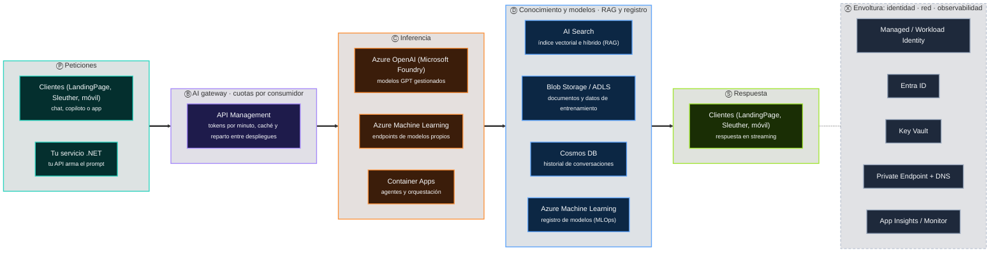

| Papel | Carril | Servicios y cómo participan |
|:-:|---|---|
| Ⓟ | **Peticiones** | [Clientes (LandingPage, Sleuther, móvil)](15-catalogo-a-z.md#clientes-landingpage-sleuther-móvil): chat, copiloto o app · [Tu servicio .NET](15-catalogo-a-z.md#tu-servicio-net): tu API arma el prompt |
| Ⓑ | **AI gateway** cuotas por consumidor | [API Management](15-catalogo-a-z.md#api-management): tokens por minuto, caché y reparto entre despliegues |
| Ⓒ | **Inferencia** | [Azure OpenAI (Microsoft Foundry)](15-catalogo-a-z.md#azure-openai-microsoft-foundry): modelos GPT gestionados · [Azure Machine Learning](15-catalogo-a-z.md#azure-machine-learning): endpoints de modelos propios · [Container Apps](15-catalogo-a-z.md#container-apps): agentes y orquestación |
| Ⓓ | **Conocimiento y modelos** RAG y registro | [AI Search](15-catalogo-a-z.md#ai-search): índice vectorial e híbrido (RAG) · [Blob Storage / ADLS](15-catalogo-a-z.md#blob-storage--adls): documentos y datos de entrenamiento · [Cosmos DB](15-catalogo-a-z.md#cosmos-db): historial de conversaciones · [Azure Machine Learning](15-catalogo-a-z.md#azure-machine-learning): registro de modelos (MLOps) |
| Ⓢ | **Respuesta** | [Clientes (LandingPage, Sleuther, móvil)](15-catalogo-a-z.md#clientes-landingpage-sleuther-móvil): respuesta en streaming |
| Ⓧ | **Envoltura** | [Managed / Workload Identity](15-catalogo-a-z.md#managed--workload-identity) · [Entra ID](15-catalogo-a-z.md#entra-id) · [Key Vault](15-catalogo-a-z.md#key-vault) · [Private Endpoint + DNS](15-catalogo-a-z.md#private-endpoint--dns) · [App Insights / Monitor](15-catalogo-a-z.md#app-insights--monitor) |

**Garantías que debes conocer**

- Salida no determinista: el mismo prompt puede dar respuestas distintas
- Cuotas en tokens por minuto: el 429 es parte del diseño, no una excepción
- Tus prompts y respuestas no se usan para entrenar los modelos base del servicio

**Patrones**

- RAG: recuperar de AI Search y enriquecer el prompt antes que reentrenar
- MLOps: entrenamiento → registro de modelos → despliegue azul/verde con evaluación
- AI gateway en API Management: cuotas, reintentos y reparto entre regiones
- Evaluar antes de desplegar: conjuntos de prueba con métricas de calidad y seguridad

> [!CAUTION]
> **Antipatrones:** API keys del modelo en el cliente o en el código · Meter todo el corpus en el prompt en vez de recuperar lo relevante · Desplegar un modelo sin evaluación ni versión registrada.

> [!NOTE]
> **En TRACER** (· No está en TRACER): No aplica hoy. Un caso natural: resumir y clasificar llamadas con Azure OpenAI a partir de las transcripciones de ACS, como una frase encadenada tras CallEnded.

**Dilo en una frase de entrevista:** *"En RAG el modelo consume, AI Search guarda el conocimiento y API Management transporta con cuotas. Reentrenar es el último recurso, no el primero."*

**Equivalentes en otras nubes** (aproximados: los servicios no son idénticos uno a uno)

| Proveedor | Servicios para esta arquitectura | Fortaleza aquí | Enfoque general |
|---|---|---|---|
| **Azure** | Azure OpenAI (Microsoft Foundry), Azure Machine Learning, AI Search | Alianza estratégica con OpenAI: modelos GPT como servicio gestionado de Azure | Adopción corporativa, gobierno de TI, identidad y entornos Microsoft |
| AWS | Amazon Bedrock (modelos de terceros y propios, como Titan), SageMaker | Muchos modelos de terceros detrás de una sola API | Mayor profundidad de catálogo, madurez en cómputo general y la comunidad más grande |
| Google Cloud | Vertex AI, TPU, modelos Gemini | Chips propios (TPU) y Gemini integrado en todo su stack de datos | Datos masivos, IA, redes globales y contenedores |

---

## 13. Híbrida y multinube

**Cuándo:** Parte de las cargas o de los datos debe quedarse en tu centro de datos o en otra nube, por latencia, regulación o inversión existente, y quieres gobernarlo todo como uno.

<a href="../assets/arquitecturas/13-hybrid.svg"></a>

> **La frase:** Ⓟ *Centro de datos local / otra nube, Azure Local* **produce** · Ⓑ *ExpressRoute / VPN Gateway* **transporta** · Ⓒ *AKS, App Service, Azure Functions* **consume** · Ⓓ *Azure SQL, Blob Storage / ADLS* **guarda**; Ⓧ *Azure Arc, Entra ID, Key Vault, VNet + NSG, App Insights / Monitor* **envuelven**.

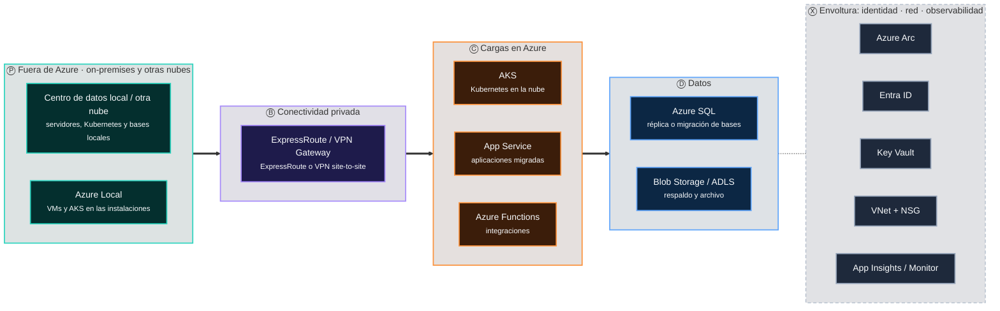

| Papel | Carril | Servicios y cómo participan |
|:-:|---|---|
| Ⓟ | **Fuera de Azure** on-premises y otras nubes | [Centro de datos local / otra nube](15-catalogo-a-z.md#centro-de-datos-local--otra-nube): servidores, Kubernetes y bases locales · [Azure Local](15-catalogo-a-z.md#azure-local): VMs y AKS en las instalaciones |
| Ⓑ | **Conectividad privada** | [ExpressRoute / VPN Gateway](15-catalogo-a-z.md#expressroute--vpn-gateway): ExpressRoute o VPN site-to-site |
| Ⓒ | **Cargas en Azure** | [AKS](15-catalogo-a-z.md#aks): Kubernetes en la nube · [App Service](15-catalogo-a-z.md#app-service): aplicaciones migradas · [Azure Functions](15-catalogo-a-z.md#azure-functions): integraciones |
| Ⓓ | **Datos** | [Azure SQL](15-catalogo-a-z.md#azure-sql): réplica o migración de bases · [Blob Storage / ADLS](15-catalogo-a-z.md#blob-storage--adls): respaldo y archivo |
| Ⓧ | **Envoltura** | [Azure Arc](15-catalogo-a-z.md#azure-arc) · [Entra ID](15-catalogo-a-z.md#entra-id) · [Key Vault](15-catalogo-a-z.md#key-vault) · [VNet + NSG](15-catalogo-a-z.md#vnet--nsg) · [App Insights / Monitor](15-catalogo-a-z.md#app-insights--monitor) |

**Garantías que debes conocer**

- Una sola identidad: Entra ID para usuarios y, con Arc, para servidores
- Un solo plano de control: Azure Resource Manager proyecta recursos externos
- La latencia y el ancho de banda del enlace forman parte del diseño

**Patrones**

- Gobierno unificado con Azure Arc: Policy, RBAC, Defender y Monitor fuera de Azure
- Identidad híbrida: Active Directory sincronizado con Entra ID
- Conectividad redundante: ExpressRoute con VPN de respaldo
- Azure Local para lo que debe quedarse en las instalaciones

> [!CAUTION]
> **Antipatrones:** Dos consolas, dos identidades y dos políticas para la misma empresa · Llamadas síncronas muy conversacionales a través del enlace híbrido · Un único circuito sin respaldo.

> [!NOTE]
> **En TRACER** (· No está en TRACER): No aplica hoy: TRACER es nativo de la nube. Sería relevante si un cliente exigiera que los audios o los datos de llamadas permanezcan en sus instalaciones.

**Dilo en una frase de entrevista:** *"Arc no mueve las cargas: las hace gobernables. El enlace híbrido transporta, Entra ID unifica la identidad y Azure Local mantiene en sitio lo que no puede salir."*

**Equivalentes en otras nubes** (aproximados: los servicios no son idénticos uno a uno)

| Proveedor | Servicios para esta arquitectura | Fortaleza aquí | Enfoque general |
|---|---|---|---|
| **Azure** | Azure Arc, Azure Local (familia Azure Stack), ExpressRoute, Entra ID | Líder en entornos híbridos: Arc y la identidad unificada con Active Directory / Entra ID | Adopción corporativa, gobierno de TI, identidad y entornos Microsoft |
| AWS | AWS Outposts, AWS Direct Connect | Hardware de AWS en tus instalaciones con las mismas API | Mayor profundidad de catálogo, madurez en cómputo general y la comunidad más grande |
| Google Cloud | Anthos (hoy GKE Enterprise) | Kubernetes como capa común para GCP, AWS y servidores locales | Datos masivos, IA, redes globales y contenedores |

---

[← 10 · Un servicio, muchos papeles](10-un-servicio-muchos-papeles.md) · [Índice](../README.md) · [12 · Brokers →](12-brokers-quien-escribe-quien-lee.md)
