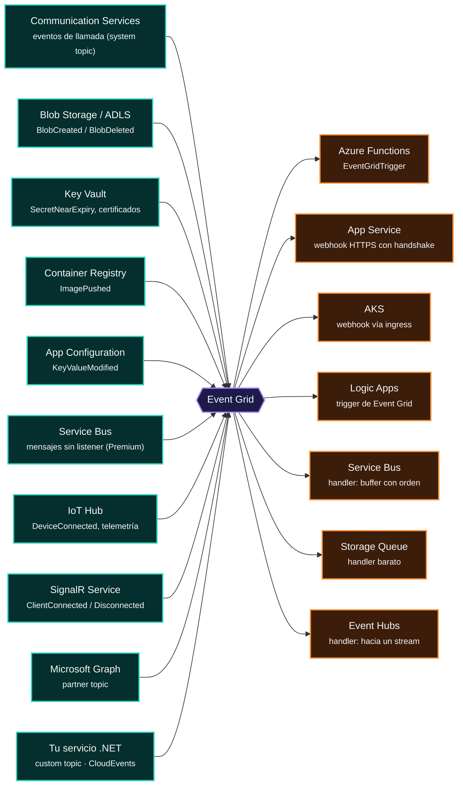
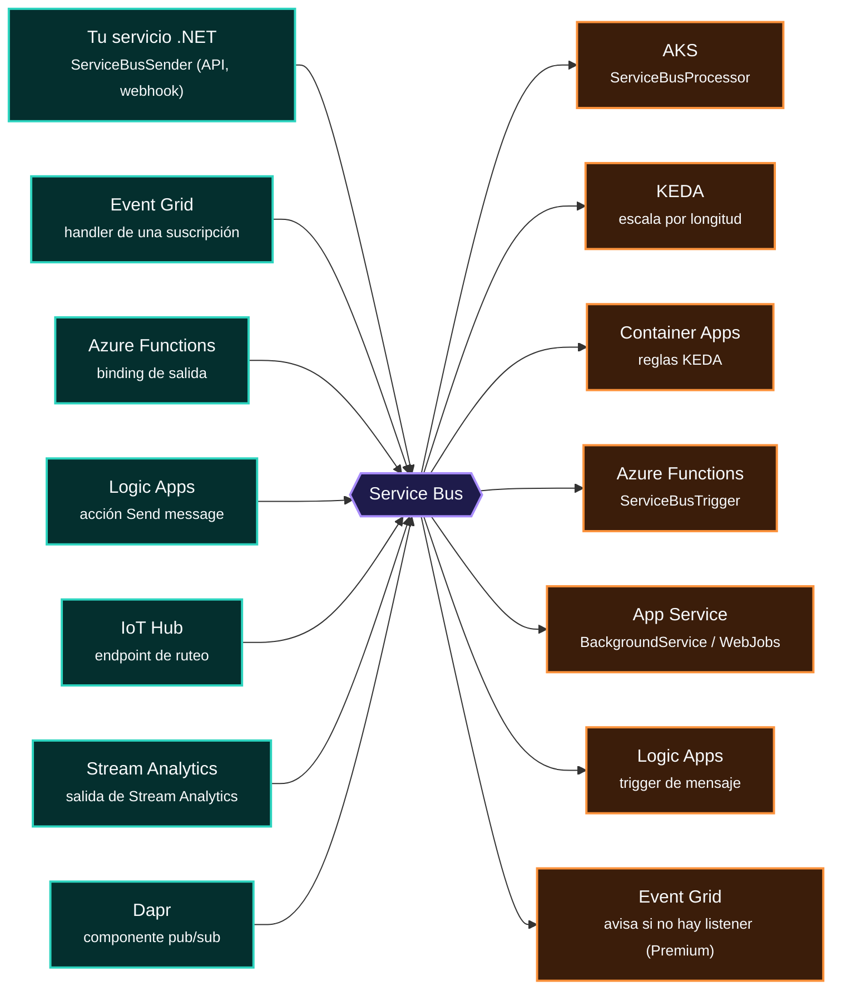
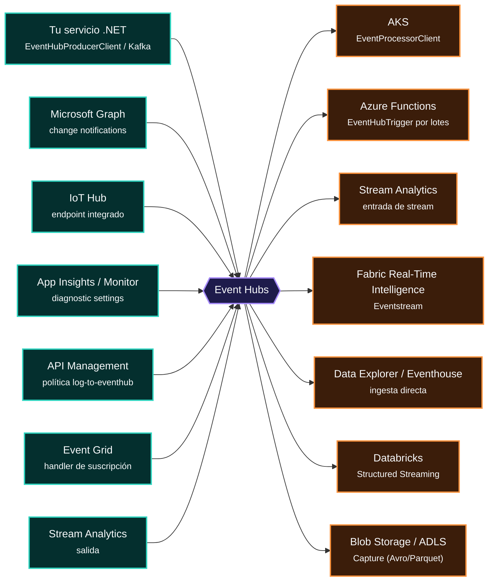
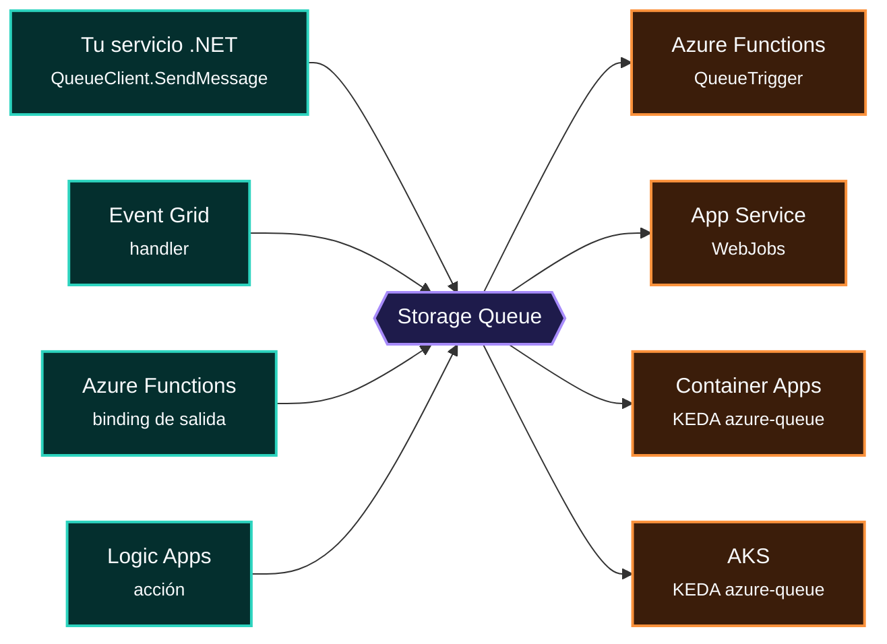
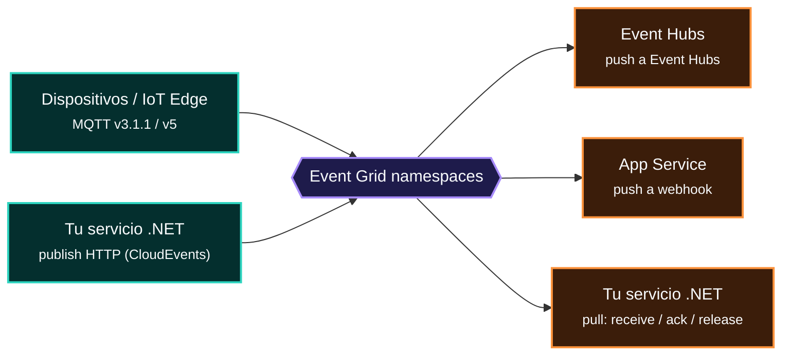
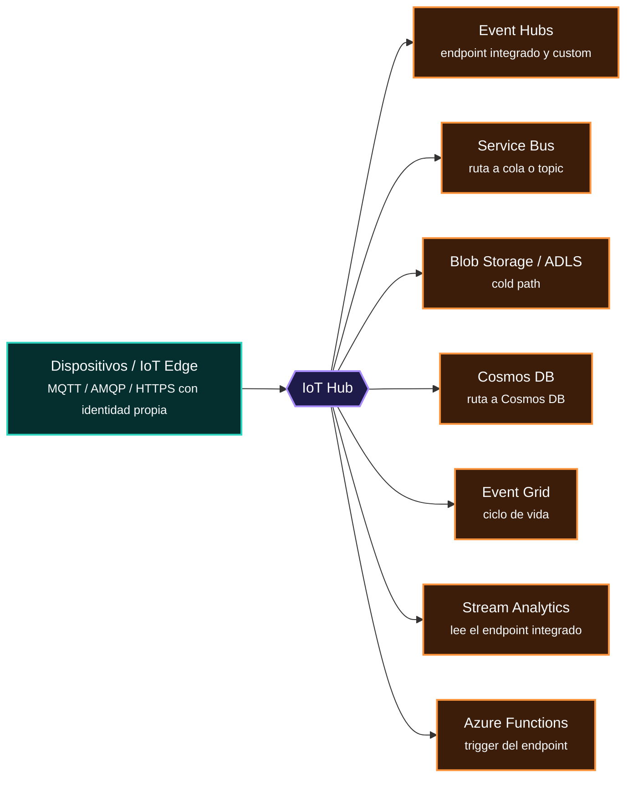
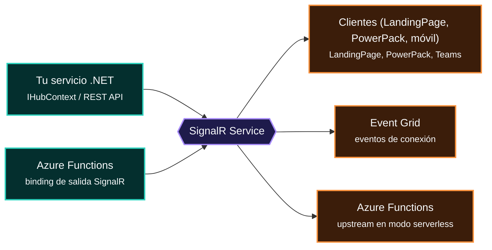
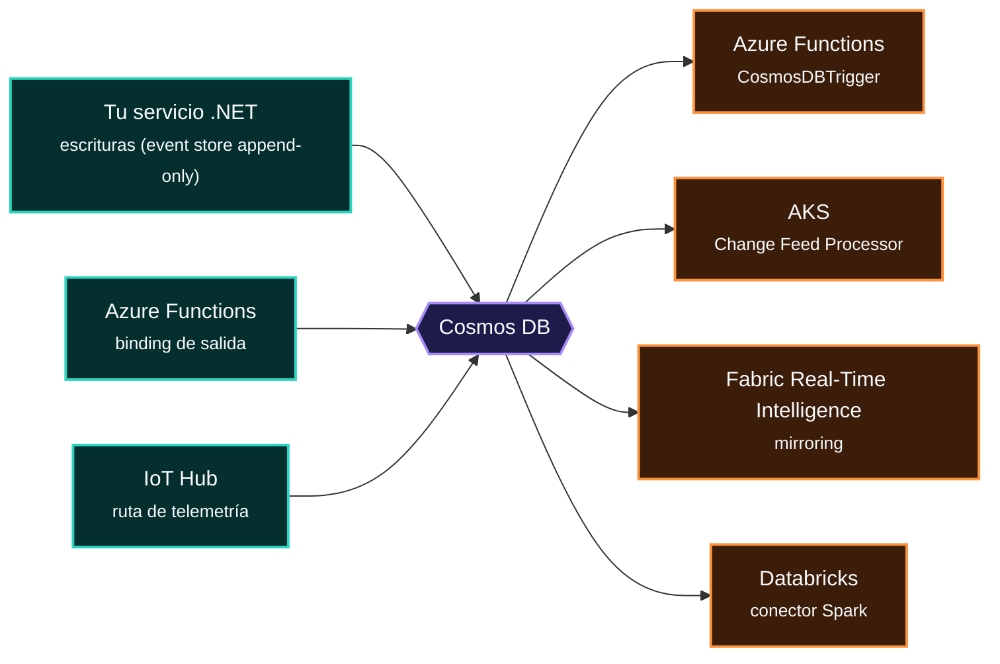
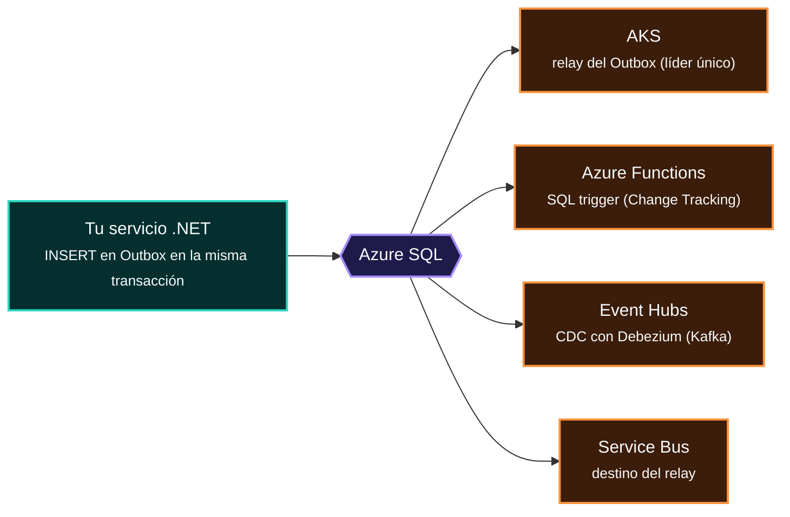
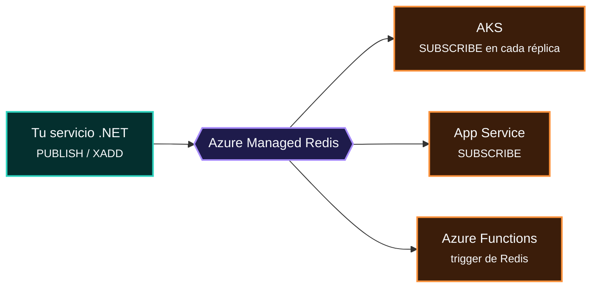

<!-- Archivo generado por tools/generar-atlas.mjs a partir de index.html. No lo edites a mano: edita index.html y ejecuta `npm run atlas`. -->

# 12 · Brokers: quién escribe, quién lee

> Un broker es el **verbo** de la frase: no produce ni consume, pero decide **cómo** viaja el significado (push o pull, orden, retención, reintentos). Este capítulo mira cada broker desde dentro: qué servicios **escriben** en él (Ⓟ en esa relación) y cuáles **leen** de él (Ⓒ en esa relación). Fíjate en cuántos nombres aparecen en ambas columnas de brokers distintos: es la polisemia en acción.

## Comparativa de contratos

| Broker | Para | Modelo | Entrega | Orden | Retención | Tamaño máx. | Dead-letter | Replay |
|---|---|---|---|---|---|---|---|---|
| **Event Grid** | Hechos discretos | Push · pub/sub | At-least-once | No garantizado | Reintentos hasta 24 h | 1 MB | Sí, a Blob | No |
| **Service Bus** | Comandos y trabajo | Pull · peek-lock · colas y topics | At-least-once (o at-most-once) | FIFO con sessions | Hasta que vence el TTL | 256 KB Std · 100 MB Premium | Sí, nativa | No (solo peek) |
| **Event Hubs** | Streams | Pull · log particionado | At-least-once con checkpoints | Por partición | 1–7 días Std · hasta 90 Premium | 1 MB | No | Sí, por offset |
| **Storage Queue** | Trabajo simple | Pull · cola simple | At-least-once | No garantizado | 7 días por defecto, configurable | 64 KB | Poison queue (Functions) | No |
| **Event Grid namespaces** | MQTT y pull | Push o pull · MQTT | At-least-once (pull con ack) | No garantizado | Hasta 7 días | 1 MB | Sí, a Blob | No |
| **IoT Hub** | Dispositivos | Bidireccional dispositivo ↔ nube | At-least-once (D2C) | Por partición | 1–7 días | 256 KB | Ruta de fallback | Sí (endpoint integrado) |
| **SignalR Service** | Push a pantallas | Push WebSocket a clientes | At-most-once | Por conexión | Ninguna | Mensajes pequeños | No | No |
| **Cosmos DB** | Cambios de datos | Pull · change feed | At-least-once con leases | Por partition key | Último estado del documento | 2 MB por ítem | No: la implementas | Sí, desde el inicio |
| **Azure SQL** | Outbox y CDC | Pull · tabla Outbox o CDC | At-least-once | Por secuencia o LSN | La que definas | Una fila | No: la implementas | Sí, mientras exista la fila |
| **Azure Managed Redis** | Avisos efímeros | Push en memoria · pub/sub o Streams | At-most-once (pub/sub) | Por canal | Ninguna (Streams sí) | Pequeño | No | Solo con Streams |

> [!TIP]
> Lee la tabla por columnas, no por filas. **Orden** y **Dead-letter** separan comandos de hechos; **Replay** separa logs de colas; **Entrega** te dice si tu consumidor debe ser idempotente (casi siempre: sí).

## Los que escriben y también leen

7 servicios aparecen como emisores de un broker y como lectores de otro (o del mismo):

| Servicio | Escribe en | Lee de |
|---|---|---|
| [Azure Functions](15-catalogo-a-z.md#azure-functions) | Service Bus, Storage Queue, SignalR Service, Cosmos DB | Event Grid, Service Bus, Event Hubs, Storage Queue, IoT Hub, SignalR Service, Cosmos DB, Azure SQL, Azure Managed Redis |
| [Tu servicio .NET](15-catalogo-a-z.md#tu-servicio-net) | Event Grid, Service Bus, Event Hubs, Storage Queue, Event Grid namespaces, SignalR Service, Cosmos DB, Azure SQL, Azure Managed Redis | Event Grid namespaces |
| [Event Grid](15-catalogo-a-z.md#event-grid) | Service Bus, Event Hubs, Storage Queue | Service Bus, IoT Hub, SignalR Service |
| [Service Bus](15-catalogo-a-z.md#service-bus) | Event Grid | Event Grid, IoT Hub, Azure SQL |
| [Logic Apps](15-catalogo-a-z.md#logic-apps) | Service Bus, Storage Queue | Event Grid, Service Bus |
| [Stream Analytics](15-catalogo-a-z.md#stream-analytics) | Service Bus, Event Hubs | Event Hubs, IoT Hub |
| [Blob Storage / ADLS](15-catalogo-a-z.md#blob-storage--adls) | Event Grid | Event Hubs, IoT Hub |

---

## 1. Event Grid · Hechos discretos

Enrutador push de eventos discretos (pub/sub) con filtros por tipo y subject.

| | |
|---|---|
| **Modelo** | Push · pub/sub |
| **Entrega** | At-least-once |
| **Orden** | No garantizado |
| **Retención** | Reintentos hasta 24 h |
| **Tamaño máx.** | 1 MB |
| **Dead-letter** | Sí, a Blob |
| **Replay** | No |
| **Garantías y límites** | At-least-once · sin orden · reintentos con backoff hasta 24 h · dead-letter a Blob · 1 MB por evento · CloudEvents 1.0. |
| **SDK .NET** | `Azure.Messaging.EventGrid → EventGridPublisherClient` |
| **Rol RBAC de datos** | EventGrid Data Sender |

- ✅ **Úsalo para:** Reaccionar a hechos discretos con fan-out y filtros: eventos de recursos Azure e integraciones serverless.
- ⛔ **Evítalo para:** Comandos que exigen orden, o un consumidor que necesita controlar su ritmo.

> [!TIP]
> Es un router, no una cola: no guarda mensajes para que los pidas. Si el consumidor necesita su propio ritmo u orden, pon Service Bus como handler.

---

## 2. Service Bus · Comandos y trabajo

Broker empresarial: colas (punto a punto) y topics con suscripciones filtradas.

| | |
|---|---|
| **Modelo** | Pull · peek-lock · colas y topics |
| **Entrega** | At-least-once (o at-most-once) |
| **Orden** | FIFO con sessions |
| **Retención** | Hasta que vence el TTL |
| **Tamaño máx.** | 256 KB Std · 100 MB Premium |
| **Dead-letter** | Sí, nativa |
| **Replay** | No (solo peek) |
| **Garantías y límites** | Peek-lock · FIFO con sessions · duplicate detection · DLQ · transacciones · mensajes programados · 256 KB Standard / 100 MB Premium. |
| **SDK .NET** | `Azure.Messaging.ServiceBus → ServiceBusSender / ServiceBusProcessor` |
| **Rol RBAC de datos** | Azure Service Bus Data Sender / Data Receiver |

- ✅ **Úsalo para:** Comandos que no se pueden perder: orden por entidad, transacciones, duplicados y mensajes programados.
- ⛔ **Evítalo para:** Telemetría masiva o lectores que necesitan releer la historia.

> [!TIP]
> SessionId = CallConnectionId: una sola instancia procesa en orden los eventos de esa llamada. Reemplaza al TaskQueuer en memoria.

---

## 3. Event Hubs · Streams

Log distribuido y particionado para ingesta masiva, compatible con Kafka.

| | |
|---|---|
| **Modelo** | Pull · log particionado |
| **Entrega** | At-least-once con checkpoints |
| **Orden** | Por partición |
| **Retención** | 1–7 días Std · hasta 90 Premium |
| **Tamaño máx.** | 1 MB |
| **Dead-letter** | No |
| **Replay** | Sí, por offset |
| **Garantías y límites** | Orden por partición · retención 1–7 días Standard y hasta 90 en Premium/Dedicated · replay por offset · 1 MB por evento. |
| **SDK .NET** | `Azure.Messaging.EventHubs + .Processor` |
| **Rol RBAC de datos** | Azure Event Hubs Data Sender / Data Receiver |

- ✅ **Úsalo para:** Ingesta de alto volumen con varios lectores independientes y replay.
- ⛔ **Evítalo para:** Trabajo por mensaje que necesita reintento individual y DLQ.

> [!TIP]
> El broker no borra al leer: cada lector lleva su posición (checkpoint). Por eso no hay DLQ ni lock por mensaje.

---

## 4. Storage Queue · Trabajo simple

Cola simple y barata dentro de una Storage Account.

| | |
|---|---|
| **Modelo** | Pull · cola simple |
| **Entrega** | At-least-once |
| **Orden** | No garantizado |
| **Retención** | 7 días por defecto, configurable |
| **Tamaño máx.** | 64 KB |
| **Dead-letter** | Poison queue (Functions) |
| **Replay** | No |
| **Garantías y límites** | 64 KB · sin orden · visibility timeout · TTL de 7 días por defecto · poison queue la crea Functions tras 5 intentos. |
| **SDK .NET** | `Azure.Storage.Queues` |
| **Rol RBAC de datos** | Storage Queue Data Message Sender / Processor |

- ✅ **Úsalo para:** Trabajo en segundo plano barato y de alto volumen, sin orden.
- ⛔ **Evítalo para:** Mensajes grandes, orden o duplicados controlados.

> [!TIP]
> Si necesitas DLQ real, orden, duplicados o más de 64 KB, sube a Service Bus.

---

## 5. Event Grid namespaces · MQTT y pull

Broker MQTT gestionado (v3.1.1 y v5) y namespace topics con entrega pull o push.

| | |
|---|---|
| **Modelo** | Push o pull · MQTT |
| **Entrega** | At-least-once (pull con ack) |
| **Orden** | No garantizado |
| **Retención** | Hasta 7 días |
| **Tamaño máx.** | 1 MB |
| **Dead-letter** | Sí, a Blob |
| **Replay** | No |
| **Garantías y límites** | Pull con lock y reintentos, MQTT QoS 0 y 1, topics jerárquicos, autenticación por certificado o Entra ID. |

- ✅ **Úsalo para:** Broker MQTT gestionado, o eventos que el consumidor quiere jalar a su ritmo.
- ⛔ **Evítalo para:** Gestión de dispositivos (twins, firmware): eso es IoT Hub.

> [!TIP]
> La entrega pull le da semántica de cola a Event Grid: el consumidor jala a su ritmo y confirma.

---

## 6. IoT Hub · Dispositivos

Gateway bidireccional para millones de dispositivos, cada uno con identidad propia.

| | |
|---|---|
| **Modelo** | Bidireccional dispositivo ↔ nube |
| **Entrega** | At-least-once (D2C) |
| **Orden** | Por partición |
| **Retención** | 1–7 días |
| **Tamaño máx.** | 256 KB |
| **Dead-letter** | Ruta de fallback |
| **Replay** | Sí (endpoint integrado) |
| **Garantías y límites** | Device twins, direct methods, mensajes cloud-to-device, X.509 por dispositivo, 256 KB por mensaje. |

- ✅ **Úsalo para:** Flotas de dispositivos con identidad, twins y comandos.
- ⛔ **Evítalo para:** Cargas sin dispositivos: usa Event Hubs directamente.

> [!TIP]
> IoT Hub = Event Hubs + gestión de dispositivos. Sin gestión de dispositivos, basta Event Grid MQTT.

---

## 7. SignalR Service · Push a pantallas

Push en tiempo real (WebSockets) a navegadores y apps, gestionado.

| | |
|---|---|
| **Modelo** | Push WebSocket a clientes |
| **Entrega** | At-most-once |
| **Orden** | Por conexión |
| **Retención** | Ninguna |
| **Tamaño máx.** | Mensajes pequeños |
| **Dead-letter** | No |
| **Replay** | No |
| **Garantías y límites** | At-most-once al cliente · sin persistencia · el cliente se resincroniza al reconectar. |
| **SDK .NET** | `Microsoft.Azure.SignalR` |

- ✅ **Úsalo para:** Actualizar pantallas en vivo desde N réplicas sin backplane propio.
- ⛔ **Evítalo para:** Guardar estado: el cliente debe releer al reconectar.

> [!TIP]
> Elimina el backplane: N réplicas de la API comparten las conexiones a través del servicio. En TRACER: hub /callshub.

---

## 8. Cosmos DB · Cambios de datos

Base NoSQL distribuida globalmente.

| | |
|---|---|
| **Modelo** | Pull · change feed |
| **Entrega** | At-least-once con leases |
| **Orden** | Por partition key |
| **Retención** | Último estado del documento |
| **Tamaño máx.** | 2 MB por ítem |
| **Dead-letter** | No: la implementas |
| **Replay** | Sí, desde el inicio |
| **Garantías y límites** | 5 niveles de consistencia · ETag para concurrencia optimista · TTL · serverless · 2 MB por ítem. |

- ✅ **Úsalo para:** Proyecciones y event sourcing: cada escritura se vuelve un evento ordenado por agregado.
- ⛔ **Evítalo para:** Depender de borrados en el modo por defecto: usa borrado lógico con TTL.

> [!TIP]
> El change feed es un Outbox incorporado: cada escritura se vuelve un evento.

---

## 9. Azure SQL · Outbox y CDC

SQL Server como PaaS con HA, réplicas y backups administrados.

| | |
|---|---|
| **Modelo** | Pull · tabla Outbox o CDC |
| **Entrega** | At-least-once |
| **Orden** | Por secuencia o LSN |
| **Retención** | La que definas |
| **Tamaño máx.** | Una fila |
| **Dead-letter** | No: la implementas |
| **Replay** | Sí, mientras exista la fila |
| **Garantías y límites** | ACID local · zone redundancy · failover groups · réplica ApplicationIntent=ReadOnly. |
| **SDK .NET** | `EF Core + "Authentication=Active Directory Default"` |
| **Rol RBAC de datos** | Usuario contenido de Entra ID |

- ✅ **Úsalo para:** Publicar de forma confiable sin dual write: un commit local y un relay.
- ⛔ **Evítalo para:** SaveChanges y luego publicar a mano: si uno falla, quedan inconsistentes.

> [!TIP]
> Lock entre pods sin infraestructura extra: sp_getapplock o UPDATE … WHERE ReservedBy IS NULL y revisar rowsAffected.

---

## 10. Azure Managed Redis · Avisos efímeros

Cache en memoria compartida entre instancias.

| | |
|---|---|
| **Modelo** | Push en memoria · pub/sub o Streams |
| **Entrega** | At-most-once (pub/sub) |
| **Orden** | Por canal |
| **Retención** | Ninguna (Streams sí) |
| **Tamaño máx.** | Pequeño |
| **Dead-letter** | No |
| **Replay** | Solo con Streams |
| **Garantías y límites** | Pub/sub at-most-once · no es un broker durable. |
| **SDK .NET** | `IDistributedCache / HybridCache` |

- ✅ **Úsalo para:** Avisar a todas las réplicas: invalidar cache, refrescar configuración.
- ⛔ **Evítalo para:** Cualquier mensaje que no se pueda perder.

> [!TIP]
> Reemplaza al IMemoryCache por réplica. Microsoft recomienda Azure Managed Redis para despliegues nuevos.

---

[← 11 · Trece arquitecturas](11-trece-arquitecturas-como-frases.md) · [Índice](../README.md) · [13 · Guía de decisión →](13-guia-de-decision.md)
