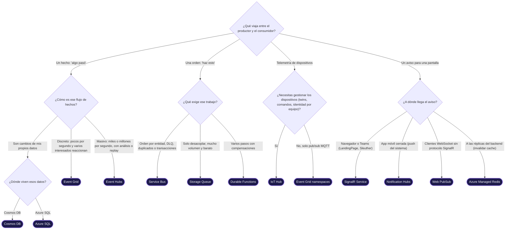

<!-- Archivo generado por tools/generar-atlas.mjs a partir de index.html. No lo edites a mano: edita index.html y ejecuta `npm run atlas`. -->

# 13 · Guía de decisión: ¿qué uso?

> La primera pregunta no es "¿qué servicio?", sino **"¿qué viaja?"**. Un hecho, una orden, una medición y un aviso son cuatro sustantivos distintos y piden cuatro verbos distintos. El árbol es el mismo que el de la pestaña **¿Qué uso?** de la vista interactiva.

## Respuestas razonadas

Cada hoja del árbol trae su porqué, la cadena típica en la que vive y la trampa que debes evitar.

| Resultado | Por qué | Cadena típica | Arquitectura | Trampa |
|---|---|---|---|---|
| **[Event Grid](15-catalogo-a-z.md#event-grid)** | Push con fan-out y filtros: cada suscriptor recibe su copia y nadie hace polling. Pagas por operación. | Ⓟ Communication Services → Ⓑ Event Grid → Ⓒ Azure Functions → Ⓓ Azure SQL | [Event-driven](11-trece-arquitecturas-como-frases.md#1-event-driven-reactivo) | Si el consumidor necesita orden o su propio ritmo, pon Service Bus como handler de la suscripción. |
| **[Event Hubs](15-catalogo-a-z.md#event-hubs)** | Log particionado: cada lector lleva su offset, puedes releer y escalar por particiones. | Ⓟ Microsoft Graph → Ⓑ Event Hubs → Ⓒ AKS → Ⓓ Blob Storage / ADLS | [Streaming](11-trece-arquitecturas-como-frases.md#3-event-streaming-y-telemetría) | No es una cola de trabajo: no hay lock por mensaje ni DLQ. |
| **[Cosmos DB](15-catalogo-a-z.md#cosmos-db)** | El change feed convierte cada escritura en un evento ordenado por partition key. Es un Outbox incorporado. | Ⓟ Tu servicio .NET → Ⓓ Cosmos DB → Ⓒ Azure Functions → Ⓓ AI Search | [CQRS / ES](11-trece-arquitecturas-como-frases.md#6-cqrs--event-sourcing) | En el modo por defecto los borrados no aparecen en el feed: usa borrado lógico con TTL. |
| **[Azure SQL](15-catalogo-a-z.md#azure-sql)** | Outbox: el evento se inserta en la misma transacción que el cambio y un relay lo publica después. Sin dual write. | Ⓟ Tu servicio .NET → Ⓓ Azure SQL → Ⓒ AKS → Ⓑ Service Bus | [Colas](11-trece-arquitecturas-como-frases.md#2-mensajería-y-colas) | Publicar al broker después de SaveChanges: si uno de los dos falla, quedan inconsistentes. |
| **[Service Bus](15-catalogo-a-z.md#service-bus)** | Peek-lock, DLQ, duplicate detection y sesiones FIFO: el contrato de un comando que no se debe perder. | Ⓟ Tu servicio .NET → Ⓑ Service Bus → Ⓒ AKS → Ⓓ Azure SQL | [Colas](11-trece-arquitecturas-como-frases.md#2-mensajería-y-colas) | Sin idempotencia en el consumidor, at-least-once significa "a veces dos veces". |
| **[Storage Queue](15-catalogo-a-z.md#storage-queue)** | Lo más simple y barato para trabajo en segundo plano sin orden. | Ⓟ Tu servicio .NET → Ⓑ Storage Queue → Ⓒ Azure Functions → Ⓓ Blob Storage / ADLS | [Serverless](11-trece-arquitecturas-como-frases.md#5-serverless) | Mensajes de más de 64 KB: usa claim-check con Blob o pasa a Service Bus. |
| **[Durable Functions](15-catalogo-a-z.md#durable-functions)** | Orquestación como código: el framework persiste estado, timers y reintentos; las compensaciones van en el catch. | Ⓟ Clientes (LandingPage, Sleuther, móvil) → Ⓒ Durable Functions → Ⓑ Service Bus → Ⓓ Azure SQL | [Saga](11-trece-arquitecturas-como-frases.md#7-saga-y-workflows-distribuidos) | Código no determinista en el orquestador: DateTime.Now, Guid.NewGuid o I/O directo. |
| **[IoT Hub](15-catalogo-a-z.md#iot-hub)** | Identidad por dispositivo, twins, comandos C2D y ruteo a Event Hubs, Service Bus, Blob o Cosmos DB. | Ⓟ Dispositivos / IoT Edge → Ⓑ IoT Hub → Ⓒ Stream Analytics → Ⓓ Data Explorer / Eventhouse | [IoT](11-trece-arquitecturas-como-frases.md#9-iot-y-edge) | Conectar todos los dispositivos con una sola SAS compartida. |
| **[Event Grid namespaces](15-catalogo-a-z.md#event-grid-namespaces)** | Broker MQTT gestionado con topics jerárquicos y ruteo a Event Hubs o webhooks. | Ⓟ Dispositivos / IoT Edge → Ⓑ Event Grid namespaces → Ⓑ Event Hubs → Ⓒ Fabric Real-Time Intelligence | [IoT](11-trece-arquitecturas-como-frases.md#9-iot-y-edge) | Si además necesitas twins o actualizaciones de firmware, usa IoT Hub. |
| **[SignalR Service](15-catalogo-a-z.md#signalr-service)** | El servicio mantiene las conexiones WebSocket; tus réplicas solo publican. Escala sin backplane. | Ⓟ Communication Services → Ⓑ Event Grid → Ⓒ Tu servicio .NET → Ⓑ SignalR Service → Ⓢ Clientes (LandingPage, Sleuther, móvil) | [Tiempo real](11-trece-arquitecturas-como-frases.md#8-tiempo-real-hacia-clientes) | Tratarlo como fuente de verdad: al reconectar, el cliente relee por API. |
| **[Notification Hubs](15-catalogo-a-z.md#notification-hubs)** | Una llamada llega a APNs, FCM y WNS, con plantillas y tags por usuario. | Ⓟ Tu servicio .NET → Ⓑ Notification Hubs → Ⓢ Clientes (LandingPage, Sleuther, móvil) | [Tiempo real](11-trece-arquitecturas-como-frases.md#8-tiempo-real-hacia-clientes) | El push del sistema no es confiable para datos críticos; úsalo como aviso. |
| **[Web PubSub](15-catalogo-a-z.md#web-pubsub)** | WebSockets nativos y pub/sub sin depender del protocolo SignalR. | Ⓟ Tu servicio .NET → Ⓑ Web PubSub → Ⓢ Clientes (LandingPage, Sleuther, móvil) | [Tiempo real](11-trece-arquitecturas-como-frases.md#8-tiempo-real-hacia-clientes) | Si tus clientes ya son SignalR, SignalR Service es más directo. |
| **[Azure Managed Redis](15-catalogo-a-z.md#azure-managed-redis)** | Pub/sub en memoria para avisar a todas las réplicas a la vez. | Ⓟ Tu servicio .NET → Ⓑ Azure Managed Redis → Ⓒ AKS | [Microservicios](11-trece-arquitecturas-como-frases.md#4-microservicios-cloud-native-en-aks) | El pub/sub de Redis es at-most-once: si nadie escucha, el mensaje se pierde. |

> [!IMPORTANT]
> Observa las cadenas: el mismo servicio aparece con glifos distintos según la respuesta. En la cadena de SignalR, Event Grid es Ⓑ y SignalR también es Ⓑ; en la de Cosmos DB, el propio Cosmos DB es Ⓓ y el change feed lo convierte en fuente. La decisión no elige "un servicio": elige **un papel para cada servicio**.

[← 12 · Brokers](12-brokers-quien-escribe-quien-lee.md) · [Índice](../README.md) · [14 · Caso TRACER →](14-caso-tracer.md)
