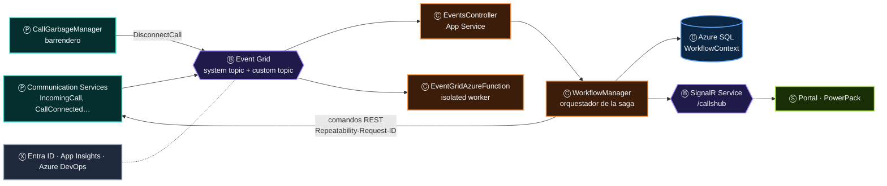
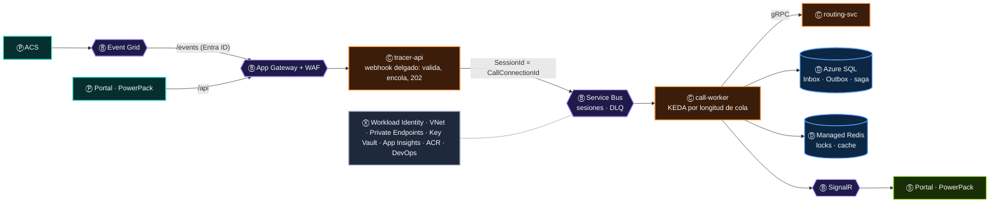

# 14 · Caso práctico: TRACER, leído como frase

> TRACER es el sistema de referencia del atlas: una plataforma de gestión de llamadas sobre Azure Communication Services, con un Portal y PowerPack para
> supervisores y agentes. La vista interactiva lo resalta con el selector **Resaltar TRACER** (*No · Hoy · + Objetivo AKS*). Este capítulo hace lo mismo
> con la gramática: analiza **lo que TRACER dice hoy**, **lo que dirá** en su arquitectura objetivo y **qué frases faltan**.

> [!NOTE]
> La fuente de este capítulo son los datos de la vista interactiva ([`index.html`](../index.html)), que a su vez resumen los documentos de preparación y
> teoría del examen de *backend* .NET + Azure del espacio de trabajo de TRACER. No es una auditoría del código de TRACER: es su lectura gramatical.

## Contenido

1. [El inventario: 24 de 53 servicios](#1-el-inventario-24-de-53-servicios)
2. [Las frases que TRACER dice hoy](#2-las-frases-que-tracer-dice-hoy)
3. [La frase principal: una llamada](#3-la-frase-principal-una-llamada)
4. [Los cinco silencios de TRACER](#4-los-cinco-silencios-de-tracer)
5. [La arquitectura objetivo: TRACER en AKS](#5-la-arquitectura-objetivo-tracer-en-aks)
6. [Hoja de ruta por papel](#6-hoja-de-ruta-por-papel)
7. [Trece frases para la entrevista](#7-trece-frases-para-la-entrevista)

---

## 1. El inventario: 24 de 53 servicios

| Estado | Servicios | # |
|---|---|:-:|
| 🟢 **Lo usa hoy** | Event Grid · SignalR Service · App Service · Azure Functions · Azure SQL · Blob Storage · Communication Services · Microsoft Graph · Clientes (Portal, PowerPack) · servicios .NET propios · Entra ID · Application Insights · Azure DevOps | 13 |
| 🟡 **Parcial** | Event Hubs · Key Vault | 2 |
| 🔷 **Arquitectura objetivo** | Service Bus · AKS · KEDA · Application Gateway · Azure Managed Redis · Managed / Workload Identity · VNet + NSG · Private Endpoint + DNS · Container Registry | 9 |
| · **No está en TRACER** | Los 29 restantes (Cosmos DB, Durable Functions, IoT Hub, Data Explorer, Azure OpenAI, Azure Arc…) | 29 |

Leídos por papel, los 15 servicios en uso (🟢 y 🟡) cuentan una historia clara: **muchos productores y consumidores, pocos transportes y casi ninguna envoltura**.

| Papel | Hoy (🟢 🟡) | Objetivo (🔷) |
|:-:|---|---|
| Ⓟ | ACS, Graph, Clientes, servicios .NET | — |
| Ⓑ | Event Grid, Event Hubs 🟡, SignalR | **Service Bus**, Application Gateway |
| Ⓒ | App Service, Functions | **AKS**, **KEDA** |
| Ⓓ | Azure SQL, Blob Storage | **Azure Managed Redis** |
| Ⓢ | SignalR → Portal y PowerPack | — |
| Ⓧ | Entra ID, App Insights, Azure DevOps, Key Vault 🟡 | **Workload Identity**, **VNet**, **Private Endpoints**, Container Registry |

> [!IMPORTANT]
> Cinco de los nueve servicios objetivo son **envoltura**. El salto de TRACER no es de funcionalidad: es de **identidad, red y operación**. La frase ya
> está escrita; le falta el contexto que la protege.

---

## 2. Las frases que TRACER dice hoy

| Arquitectura | Estado | Lo que TRACER dice |
|---|:-:|---|
| [Event-driven reactivo](11-diez-arquitecturas-como-frases.md#1-event-driven-reactivo) | 🟢 | **Es la columna vertebral:** ACS → Event Grid → `EventsController` y `EventGridAzureFunction`. `CallGarbageManager` publica `DisconnectCall` al *custom topic* |
| [Saga y workflows](11-diez-arquitecturas-como-frases.md#7-saga-y-workflows-distribuidos) | 🟢 | `WorkflowManager` es el orquestador; `WorkflowContext`, el estado; `OnTransferFailedAction` y `CancelInvitationAction`, las compensaciones; `CallGarbageManager`, el barrendero |
| [Tiempo real](11-diez-arquitecturas-como-frases.md#8-tiempo-real-hacia-clientes) | 🟢 | Hub `/callshub` y avisos como `ConfigurationChanged` hacia el Portal y PowerPack |
| [Monolito modular en PaaS](11-diez-arquitecturas-como-frases.md#10-monolito-modular-en-paas) | 🟢 | Así se despliega hoy: App Service, varios servicios y paquetes NuGet compartidos |
| [Streaming](11-diez-arquitecturas-como-frases.md#3-event-streaming-y-telemetría) | 🟡 | Tres *hubs* (`SuperHandlerPresences`, `Presences`, `CallsCatcher`); Graph envía presencias y `TRACER.Presences` las consume |
| [Serverless](11-diez-arquitecturas-como-frases.md#5-serverless) | 🟡 | `EventGridAzureFunction` (*isolated worker*) con Clean Architecture |
| [CQRS](11-diez-arquitecturas-como-frases.md#6-cqrs--event-sourcing) | 🟡 | Semilla: `CallEventsManager` (comandos) frente a `CallQueriesManager` (vacío); reportes con `AsNoTracking` y `AsSplitQuery` |
| [Colas](11-diez-arquitecturas-como-frases.md#2-mensajería-y-colas) | 🔷 | No existe hoy; el diseño objetivo pone Service Bus con sesiones en lugar del `TaskQueuer` en memoria |
| [Microservicios en AKS](11-diez-arquitecturas-como-frases.md#4-microservicios-cloud-native-en-aks) | 🔷 | "TRACER en AKS": App Gateway + WAF, Workload Identity, Private Endpoints, KEDA y `routing-svc` por gRPC |
| [IoT](11-diez-arquitecturas-como-frases.md#9-iot-y-edge) | · | No aplica: sirve de contraste |
| [Big Data](11-diez-arquitecturas-como-frases.md#11-big-data-y-analítica-en-la-nube) | · | No aplica hoy; para analítica de llamadas: CDC o *mirroring* de Azure SQL al lago y Power BI encima, sin cargar producción |
| [IA y MLOps](11-diez-arquitecturas-como-frases.md#12-inteligencia-artificial-y-mlops) | · | No aplica hoy; caso natural: resumir y clasificar llamadas con Azure OpenAI a partir de las transcripciones de ACS, tras `CallEnded` |
| [Híbrida](11-diez-arquitecturas-como-frases.md#13-híbrida-y-multinube) | · | No aplica: TRACER es nativo de la nube; solo si un cliente exige que audios o datos queden en sus instalaciones |

---

## 3. La frase principal: una llamada

Dos detalles gramaticales que este diagrama revela:

- **Communication Services aparece dos veces, con dos papeles.** Al principio es Ⓟ (emite `IncomingCall`); dentro de la saga es Ⓒ (recibe la orden de
  transferir o reproducir). Es la conversión *"el agente encadena"* del [capítulo 10](10-un-servicio-muchos-papeles.md#2-las-nueve-conversiones-de-papel).
- **`CallGarbageManager` es un productor interno.** El barrendero de sagas atascadas no consume nada de fuera: mira el estado y **publica** `DisconnectCall`.
  Una frase que nace de Ⓓ a través de un Ⓟ propio.

---

## 4. Los cinco silencios de TRACER

Las frases que TRACER **no** dice todavía, cada una con la ley que la exige:

| # | Silencio | Lo que hay hoy | Ley que lo exige | Lo que hay que decir |
|:-:|---|---|---|---|
| 1 | **Un verbo para las órdenes** | `TaskQueuer` en memoria | [Ley del verbo](01-la-frase.md#6-las-siete-leyes-de-la-frase): las órdenes necesitan retención y DLQ | Service Bus con `SessionId = CallConnectionId` |
| 2 | **Memoria fuera del proceso** | `static SemaphoreSlim`, `IMemoryCache` | Ley de la memoria: con N réplicas, el estado vive en Ⓓ | Sesiones de Service Bus, `sp_getapplock`, Managed Redis |
| 3 | **Identidad sin secretos** | AccessKey y *connection strings*: **0 usos** de `DefaultAzureCredential` | Ley de la envoltura | Managed / Workload Identity + roles de datos ([07 § 8](07-identidad.md#8-tracer-de-accesskey-a-workload-identity)) |
| 4 | **Red privada** | Servicios PaaS con acceso público | Ley de la envoltura | VNet, *Private Endpoints* + DNS ([08](08-red.md)) |
| 5 | **Una sola traza** | Telemetría por servicio | Ley del encadenamiento | `traceparent` dentro del evento: Garbage → Event Grid → API → SQL ([09](09-observabilidad.md)) |

---

## 5. La arquitectura objetivo: TRACER en AKS

| Cambio | Papel | Qué resuelve |
|---|:-:|---|
| *Webhook* delgado que responde `202` | Ⓒ → Ⓟ | Event Grid nunca espera trabajo pesado; el trabajo no se pierde |
| Service Bus con sesiones | Ⓑ | Orden por llamada, DLQ, duplicados, reintentos |
| `call-worker` con KEDA | Ⓒ | Escala por trabajo pendiente; a cero fuera de horario si se desea |
| Inbox y Outbox en Azure SQL | Ⓓ + Ⓟ | Consumo idempotente y publicación sin doble *commit* |
| Managed Redis | Ⓓ | *Locks* y cache compartidos entre *pods* |
| Workload Identity + *Private Endpoints* | Ⓧ | Sin secretos, sin exposición pública |

---

## 6. Hoja de ruta por papel

El orden importa: cada fase hace segura la siguiente.

| Fase | Papel | Acción | Criterio de salida |
|:-:|:-:|---|---|
| 1 | Ⓧ 🔭 | `traceparent` en cada evento y OpenTelemetry en todos los servicios | Una consulta KQL reconstruye una llamada completa |
| 2 | Ⓧ 🔑 | Identidades administradas y roles de datos; adiós a las *connection strings* | 0 secretos en configuración; `disableLocalAuth` activado |
| 3 | Ⓑ | Service Bus con sesiones en lugar del `TaskQueuer` | El *webhook* responde en < 200 ms; DLQ con alerta |
| 4 | Ⓓ | Estado fuera del proceso: sesiones, `sp_getapplock`, Redis | Dos réplicas en paralelo sin decisiones contradictorias |
| 5 | Ⓧ 🌐 | VNet, *Private Endpoints*, DNS | `publicNetworkAccess: Disabled` en todos los PaaS |
| 6 | Ⓒ | AKS + KEDA + `routing-svc` (patrón *strangler fig* desde App Service) | Tráfico 100 % en AKS con *rollback* probado |

> [!TIP]
> La fase 1 va primero a propósito: sin una traza de extremo a extremo, no hay forma de demostrar que las fases siguientes no rompieron nada.

---

## 7. Trece frases para la entrevista

Cada arquitectura del atlas trae su frase en primera persona. Estas son las trece, listas para decir en voz alta:

| Arquitectura | Frase |
|---|---|
| Event-driven | *"Event Grid garantiza al menos una entrega, no exactamente una, ni orden. Cada handler es idempotente y el orden lo resuelvo con el eventTime."* |
| Colas | *"Un webhook delgado valida, encola y responde. El trabajo pesado va a un consumidor con reintentos y DLQ, y uso sesiones para ordenar por llamada."* |
| Streaming | *"Event Hubs es un log, no una cola: cada lector lleva su posición. Lo uso para presencias por volumen y replay; para trabajo por mensaje, Service Bus."* |
| Microservicios | *"Antes de escalar horizontalmente busco todo lo static, Singleton con estado o IMemoryCache, y lo saco a SQL, Redis o sesiones de Service Bus."* |
| Serverless | *"Una Function es productor y consumidor a la vez: el trigger la alimenta y el binding de salida publica."* |
| CQRS | *"CQRS es separar modelos de lectura y escritura, no una librería. Event sourcing es guardar el estado como eventos; son independientes."* |
| Saga | *"Transferir a un agente es una saga: reservo, invito y espero. Si falla o vence el timer, compenso: libero, cancelo y regreso la llamada a la cola."* |
| Tiempo real | *"La consistencia eventual se nota aquí: el Portal ve 'agente conectado' milisegundos después. La UI se diseña para tolerarlo."* |
| IoT | *"IoT Hub es Event Hubs más gestión de dispositivos. Si solo necesito pub/sub MQTT, uso Event Grid namespaces."* |
| Monolito | *"TRACER es más un monolito modular que microservicios. Es una decisión válida mientras el estado viva fuera del proceso."* |
| Big Data | *"El lago guarda, los motores consumen y Power BI entrega. En la medallion el dato crudo nunca se edita: se reprocesa."* |
| IA y MLOps | *"En RAG el modelo consume, AI Search guarda el conocimiento y API Management transporta con cuotas. Reentrenar es el último recurso, no el primero."* |
| Híbrida | *"Arc no mueve las cargas: las hace gobernables. El enlace híbrido transporta, Entra ID unifica la identidad y Azure Local mantiene en sitio lo que no puede salir."* |

---

[← 13 · Guía de decisión](13-guia-de-decision.md) · [Índice](../README.md) · [15 · Catálogo A–Z →](15-catalogo-a-z.md)
